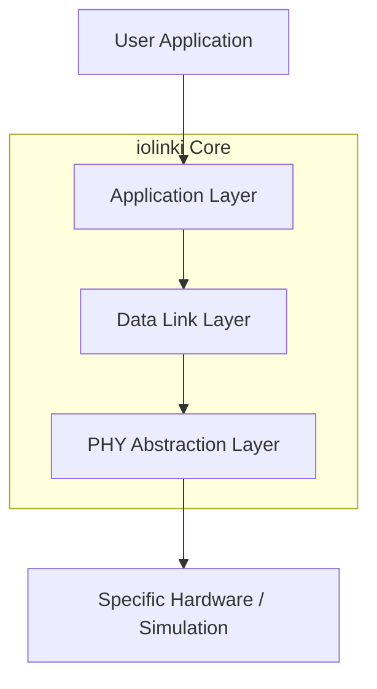

# iolinki Architecture

This document describes the high-level architecture of the `iolinki` IO-Link Device Stack. The primary design goal is **complete hardware independence**, enabling the stack to run on any MCU, RTOS, or even as a host-based simulation.

## 1. Layered Architecture

The stack follows a classic layered approach, strictly enforcing boundaries between hardware-specific operations and protocol logic.

### 1.1 Physical Layer (PHY) Abstraction
The `iolink_phy_api_t` (defined in `phy.h`) is the only point of contact with the hardware. The library has a single transport path — the ISR dispatch pump — and the PHY expresses how it moves data through two compile-time switches (`config.h`):

- **RX BYTE** (`rx_octet`): a byte pipe; the library frames the M-sequence and the PHY reports the frame end (`CHK`, e.g. a byte-gap timer).
- **RX FRAME** (`rx_frame`): the PHY delimits and delivers a whole frame zero-copy (e.g. DMA + UART IDLE).
- **TX BYTE** (`tx_octet` + `tx_done`): the library feeds one reply octet per transceiver request.
- **TX FRAME** (`tx_frame`): the library hands the whole reply frame (e.g. DMA).

`IOLINK_ISR_RX_MODE` / `IOLINK_ISR_TX_MODE` select BYTE (default) or FRAME. Common optional hooks: mode switching (SIO vs SDCI), baudrate, `detect_wakeup`, `set_cq_line`, `get_faults`. Each can be compiled out (see §4).

### 1.2 Data Link Layer (DLL)
The DLL (`dll.c`) implements the IO-Link state machine:
- **STARTUP**: Initial state, power-on synchronization.
- **AWAITING_COMM**: Wake-up detected, waiting for the first valid frame.
- **PREOPERATE**: Parameter exchange and identification (On-request Data / ISDU).
- **ESTAB_COM**: Communication established, transitioning to OPERATE.
- **OPERATE**: Cyclic Process Data (PD) exchange.
- **FALLBACK**: Error recovery toward SIO/STARTUP.

The DLL runs as **two pumps**:
- **main pump** `iolink_device_process()` (called from the main loop): consumes the received request, runs the protocol (ISDU/params/events/vendor), and pre-builds the reply **payload** variants (READ `[OD][PD-in]`, WRITE `[PD-in]`, acyclic READ `[od_resp][PD-in]`) into double buffers.
- **ISR pump** `iolink_device_process_isr()` (called from the PHY data interrupt): frames the incoming M-sequence (`rx_octet`) or takes a whole frame (`rx_frame`), publishes it to a mailbox for the main pump, and — for the cyclic process channel of a pre-cached (`TYPE_2_V`) device — transmits the pre-staged reply (octet by octet, or one `tx_frame`). Before answering it validates the request's A.1.6 checksum and M-sequence type; a corrupt or illegal frame is dropped. Non-cyclic channels (ISDU/page/diagnosis) are answered by the main pump with a per-request OD so the response is fresh.

Non-cyclic OPERATE reads reply with the staged OD response, or `0x01` (Busy) until the main pump has answered; the master re-polls the same FlowCTRL (ISDU convention).

### 1.3 Application Layer (AL)
The AL (`application.h`) provides the interface for the user application to interact with the stack without knowing protocol details.
- **Process Data API**: Acyclic and cyclic data access (`iolink_pd_input_update` / `iolink_pd_output_read`).
- **Lifecycle & PD callbacks**: Optional `iolink_app_register()` hooks (`on_startup`/`on_preoperate`/`on_operate`, PD in/out).
- **ISDU**: Indexed Service Data Unit for parameters, identification, and Data Storage (`isdu.c`, implemented).

## 2. Design Principles & MISRA Compliance

The codebase adheres to a subset of MISRA C:2012 guidelines to ensure safety and reliability in industrial environments.

### 2.1 No Dynamic Memory
All memory is statically allocated at compile time. There are no calls to `malloc`, `free`, or `realloc`. This prevents heap fragmentation and ensures deterministic behavior.

### 2.2 Strict Typing
Only fixed-width integer types from `<stdint.h>` are used (e.g., `uint8_t`, `uint16_t`, `uint32_t`) to ensure portability across different architectures (8-bit to 64-bit).

### 2.3 Modular Mocking (TDD)
The stack is built "test-first". Every layer is verified using CMocka mocks.
- `phy_mock`: Simulates hardware behavior.
- `phy_virtual`: Enables host-based E2E protocol testing.

### 2.4 Error Handling
All API functions return error codes (negative integers). Return values must be checked by the caller.

## 3. Processing Model
The stack uses a non-blocking, periodic processing model. The user application must call `iolink_device_process()` at a regular interval (typically 1ms) to drive the internal state machines and timers. The PHY data interrupt drives `iolink_device_process_isr()` (the ISR pump).

## 4. Compile-time Configuration & Trimming
`config.h` exposes overridable compile-time macros:
- Buffer/timing sizing (`IOLINK_ISDU_BUFFER_SIZE`, `IOLINK_PD_*_MAX_SIZE`, `IOLINK_OD_MAX_SIZE`, `IOLINK_EVENT_QUEUE_SIZE`, …).
- Line-state ownership: `IOLINK_PHY_OWNS_LINE_STATE` (0 keeps the run-time inference from `detect_wakeup == NULL`).
- **Feature trimming** (default: full stack, all `1`): `IOLINK_FEATURE_{DATA_STORAGE,SYSTEM_COMMAND,MASTER_IDENT,EVENTS,LEGACY_PARAMS}` and `IOLINK_PHY_FEATURE_{STREAMING,WAKEUP,SIO_CQ,LEGACY_DIAG}`. When off, the corresponding code and (for PHY features) struct members are removed; `IOLINK_MINIMAL_PROFILE` is a convenience switch that defaults the trimmed set off.

Trimmed code that is actually used fails to compile, which is the intended guard.
