# iolinki 代码流程、分层与通信周期说明

本文按**当前仓库代码**整理 `iolinki` IO-Link Device 协议栈的执行流程，重点说明：

- 代码分层、层间依赖与上下文所有权；
- ISR 双泵传输模型：数据中断 + 主循环；
- 一帧数据从 PHY 到 DLL、再到 ISDU/事件/参数/Data Storage 的分流；
- 各类型 Process Data、On-request Data、诊断数据的处理路径；
- 回调/接口在通信周期中的调用顺序；
- DLL 通信状态机与源码的对应关系；
- 关键缓冲区、并发边界与定时器。

> 本文描述 ISR 双泵路径；这是当前唯一的 transport（RX/TX 粒度仍有编译期开关，见第 13 节）。
> 事实来源：`include/iolinki/*.h`、`src/*.c` 以及 `docs/IOL-Interface-Spec_10002_V1.1.5_Oct2025/`。
> 如果代码与规范冲突，以规范 PDF 为准；本文只描述代码当前实际行为。

## 目录

1. [先看结论](#1-先看结论)
2. [代码分层与文件职责](#2-代码分层与文件职责)
3. [上下文拓扑与所有权](#3-上下文拓扑与所有权)
4. [初始化流程](#4-初始化流程)
5. [ISR 双泵模型与主循环](#5-isr-双泵模型与主循环)
6. [单帧接收、校验与分流](#6-单帧接收校验与分流)
7. [ISDU 数据流](#7-isdu-数据流)
8. [Data Storage、参数与事件](#8-data-storage参数与事件)
9. [回调与接口在通信周期中的调用逻辑](#9-回调与接口在通信周期中的调用逻辑)
10. [通信状态机与代码对应](#10-通信状态机与代码对应)
11. [定时与错误路径](#11-定时与错误路径)
12. [缓冲区、并发与数据流](#12-缓冲区并发与数据流)
13. [编译期分流与集成注意](#13-编译期分流与集成注意)
14. [关键代码索引](#14-关键代码索引)

---

## 1. 先看结论

1. 传输是**双泵**：数据中断里的 `iolink_dll_process_isr()` 只做传输——收帧、校验、暂存 ISDU 写，然后**执行主泵编译好的应答计划**（查计划 → 取源字节 → 追加 CKS → 喂字节）。请求内容语义（哪条通道、回什么、多长）只由主循环的 `iolink_dll_process()` 决定：它运行 DLL 状态机、ISDU 服务、诊断与定时，并在每次调用结束时发布新计划。
2. `iolink_device_process()` 是主循环唯一需要周期调用的入口；PHY 数据中断还要调用 `iolink_device_process_isr()`。主循环负责 DLL 协议处理，并把 ISR 延迟的状态回调、master-lost 边沿、reset 请求、PD 回调分发给应用。
3. 数据按 **MC 通信通道**分流：Process、Page、Diagnosis、ISDU；按 **CKT M-sequence 类型**决定 Type-0 还是 Type-1/2 的帧长与应答布局。已校验帧经 `dll_sm_classify()` 归类，再由 `DLL_SM_ROWS` 展开的 `g_dll_sm[state][event]` 骨架表分发到动作函数。
4. 参数知识只有一份：`src/od.c` 的 const 对象字典描述索引、数据类型、访问权限、写语义、storage 标志与默认值。ISDU 分发、DS 成员判定与内建处理器选择都从这张表派生。
5. ISDU 写请求和读应答是分离的：写段由 ISR 暂存到 `isr_od_ring`，`iolink_isdu_process()` 在后续主循环执行应用服务；读请求从已发布的成帧应答视图读取（单一 `frame` 缓冲 + 租约 + 代数位）。
6. Event 的 “appears” 会立即入队并冻结事件内存、置 CKS bit7；“disappears” 由 `iolink_device_process()` 在 ISDU 传输空闲时自动调用 `iolink_events_process()` 发出（见 `device_service_events_and_ds()`）。DeviceStatus（0x0024）与 DetailedDeviceStatus（0x0025）由 `src/diag.c` 从同一条件集派生。
7. `master_lost` 只是应用提示，**不改变 DLL 状态和波特率**；真正回到 SIO/STARTUP 的是 T_DSIO、T_FBD、DeviceStartup 等路径。

---

## 2. 代码分层与文件职责

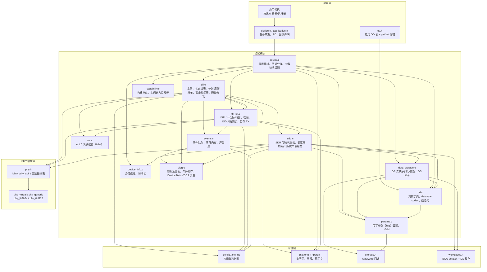

| 文件 | 职责 | 是否在设备运行数据路径 |
| :--- | :--- | :--- |
| `src/device.c` | `iolink_device_init/process`、PD API、应用回调、reset、能力位查询、统一参数访问适配 | 是 |
| `src/dll.c` | 主泵：M-sequence 内容语义、状态机骨架表分发、应答计划编译/发布（seqlock）、截止时间表、PHY 模式/波特率、通道分流 | 是（主上下文） |
| `src/dll_isr.c` | ISR 传输：重入保护、收帧与校验、ISDU 写暂存、计划查表/执行、ISDU 快照读、暂存 TX 的字节喂送 | 是（中断上下文） |
| `src/isdu.c` | ISDU 请求收集、索引解析、OD 表分发、标准对象/系统命令/DS 服务、响应组帧 | 是 |
| `src/od.c` | 对象字典（内建 const 表 + 应用表）、datatype codec、值校验/编解码/读写、DS 集合判定 | 是（每次 ISDU 参数访问） |
| `src/data_storage.c` | DS 参数集流式序列化/恢复、DS 状态与 DS_Command | 是（启用 DS 时） |
| `src/params.c` | 三个可写 Tag 的 RAM/NVM 读写、出厂复位 | 是 |
| `src/device_info.c` | VendorID/DeviceID/字符串身份、Access Locks | 是 |
| `src/events.c` | 事件队列、appears/disappears、Table 58 事件内存 | 是（启用事件时） |
| `src/diag.c` | 诊断源注册表、条件缓存、PULSE 保持窗口、DeviceStatus/DDS 派生 | 是（启用事件时） |
| `src/capability.c` | `iolink_build_caps_t` 单例与 `iolink_caps_resolve()` 唯一判定点 | 初始化期 |
| `src/profile.c` | 构建档位符号，供 `profile.h` 的链接期断言校验 | 否（链接期） |
| `src/crc.c` | A.1.6 XOR + 8→6 bit 压缩校验 | 是 |
| `include/iolinki/dll_ctx.h` | `iolink_dll_ctx_t` = `main` + `isr` 单次分配容器与布局断言 | 否（类型） |
| `include/iolinki/dll_main.h` / `dll_shared.h` / `dll_isr.h` | 主上下文独占 / 双上下文共享 / ISR 独占状态分区 | 否（类型） |
| `include/iolinki/dll_sm.h` | 状态机骨架表 `DLL_SM_ROWS`（7 状态 × 8 事件）唯一事实源 | 否（常量宏） |
| `include/iolinki/ring.h` | ISR↔主上下文的无锁 SPSC 槽环 | 是（内联） |
| `include/iolinki/workspace.h` | ISDU scratch 与 DS 暂存缓冲 | 是 |
| `src/phy_*.c` | PHY 驱动/模拟 | 是（通过 vtable） |

---

## 3. 上下文拓扑与所有权

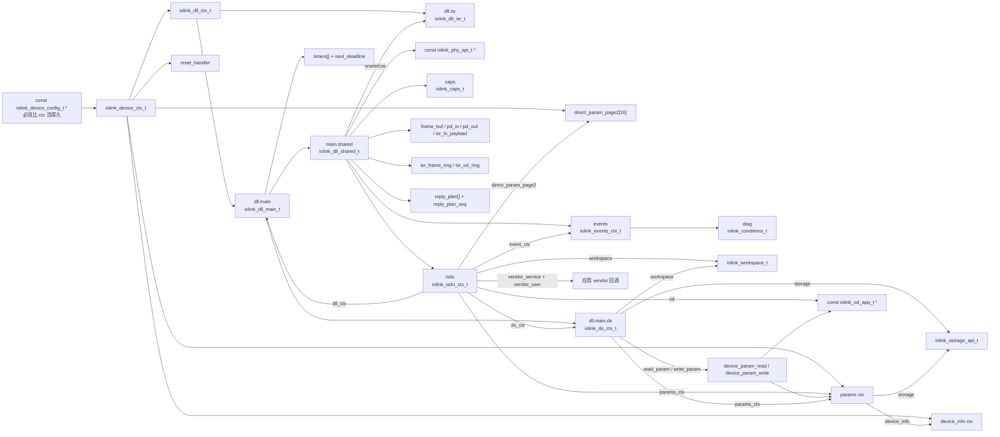

`iolink_dll_ctx_t` 只是 `{ iolink_dll_main_t main; iolink_dll_isr_t isr; }` 的单次分配容器（`include/iolinki/dll_ctx.h`）。两者是**兄弟结构**：`main.shared` 是 `iolink_dll_main_t` 的首成员，`shared.isr` 反向指向 `isr`。因此字段访问路径是 `ctx->dll.main.<field>` 与 `ctx->dll.main.shared.<field>`，`dll.c` 只包含 `dll_main.h`、看不到 ISR 独占字段（`tools/check_ownership.sh` 机械校验）。

绑定分两处：`iolink_dll_init()` 建立 ISDU ↔ DLL/事件的内部反向链接
（`isdu.dll_ctx = &ctx->dll.main`、`isdu.event_ctx = &shared.events`），
`iolink_device_init()`（按 `config.workspace` 绑定工作区）
绑定外部依赖：

- `dll.main.shared.isdu.params_ctx = &ctx->params`、`...isdu.od = config->od`、`...isdu.ds_ctx = &ctx->dll.main.ds`；
- `dll.main.shared.isdu.direct_param_page2 = ctx->direct_param_page2`；
- `dll.main.shared.isdu.vendor_service/vendor_user` 来自 `iolink_device_config_t`；
- `dll.main.shared.caps = iolink_caps_resolve(&config->phy, &config->stack, config->app_callbacks, NULL)`；
- `iolink_isdu_bind_workspace()` / `iolink_ds_bind_workspace()` 把传输 scratch 指向工作区；`iolink_isdu_bind_caps()` 让 ISDU 按实例能力位选路；
- `dll.main.state_cb = device_state_cb`，用于把 DLL 状态变化转成应用回调；
- `params` 与 `ds` 共用同一个 `storage` 后端；`IOLINK_FEATURE_DATA_STORAGE=1`
  时 `storage` 必须非空且具备 `read`/`write`，否则初始化返回
  `IOLINK_DEVICE_INIT_ERR_STORAGE`；
- `ds` 绑定统一访问器 `device_param_read`/`device_param_write`/`device_param_check`：先按 `iolink_od_find()` 定位表项并交给 OD 值层（标准 Tag 经参数管理器，应用参数经应用后端）；表外索引回退 `vendor_service`。`iolink_od_find()` 按索引域决定优先级：规范索引标准表优先，设备专用索引应用表优先、标准表内建项回落。

因此以下对象必须由应用保证生命周期：`iolink_device_config_t`、`device_info`、
`storage`（启用 DS 时）、`iolink_od_app_t`（表与 get/set 后端）、
`iolink_workspace_t`（提供时）、DS 参数描述数组、PHY 上下文。

> `iolink_dll_ctx_t` 只能原地初始化与使用。按值拷贝会让 `main.shared.isr`
> 继续指向原对象；`dll_ctx.h` 用布局断言锁定了这一点。

---

## 4. 初始化流程

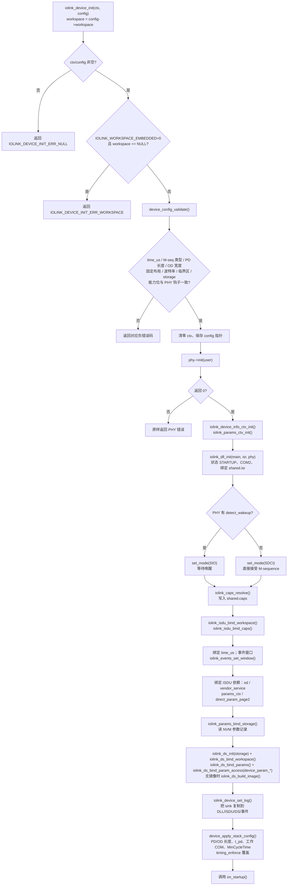

要点：

- 初始化校验在 `device_config_validate()` 完成；本路径还会在 `device_validate_fixed_mseq()` 拒绝 `TYPE_1_1` 和与 Annex A 固定布局不一致的 PD/OD 长度。
- 能力位只在 `iolink_caps_resolve()` 解析，且必须在绑定 PHY 之后、任何 ISR 可能运行之前。校验阶段用同一函数做一致性检查：`IOLINK_CAP_REQUIRE_ISR_TX` 缺 `request_service()`、或 `IOLINK_PHY_FEATURE_TX_BUSY` 开启但 PHY 无 `tx_busy()`，都返回 `IOLINK_DEVICE_INIT_ERR_PHY`。
- `iolink_dll_init()` 默认 COM2；若 `stack.baudrate_set`，`device_apply_stack_config()` 会通过 `iolink_dll_set_operating_baudrate()` 再设置工作 COM。
- `iolink_dll_init()` 结束时已发布 STARTUP 状态的应答计划，因此第一个启动探测可由 ISR 提前应答。
- `on_startup()` 在初始化末尾显式调用一次；`iolink_dll_init()` 内部进入 STARTUP 时因为状态初值已是 0，`dll_set_state()` 不会重复触发。
- PD-in 路径由能力位 `IOLINK_CAP_PD_IN_CALLBACK` 在运行期选择（`on_pd_input` 非 NULL 时置位），不再是编译期二选一；轮询 API 仍被声明，混用时返回错误码。

---

## 5. ISR 双泵模型与主循环

> 本章及全文描述 ISR 双泵路径：数据中断负责收帧、校验、暂存 ISDU 写并执行应答计划；主循环负责 ISDU、事件、诊断、参数和状态机。

### 5.1 ISR 侧流程

ISR 侧只做传输：收帧、校验、暂存 ISDU 写，并执行主泵发布的应答计划；它不解释请求内容，也不执行 ISDU/参数/事件等应用逻辑。

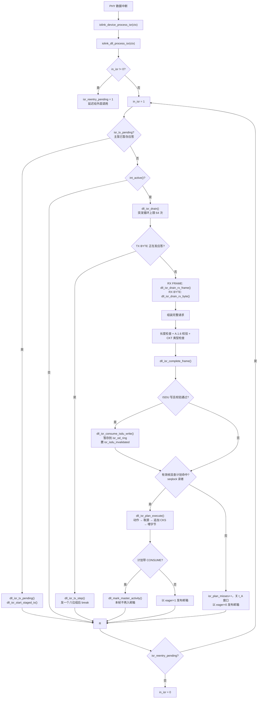

计划命中的应答来源由主泵编译：`IOLINK_REPLY_SRC_TEMPLATE`（静态模板）、`IOLINK_REPLY_SRC_PAGE`（DPP1 字节）、`IOLINK_REPLY_SRC_EVENT_MEM`（Table 58 事件内存）、`IOLINK_REPLY_SRC_ISDU_SEG`（已暂存的 ISDU 段），以及通过 `IOLINK_REPLY_FLAG_PD_TAIL` 表达的 PD-in 尾部。计划动作只有 `IOLINK_REPLY_ACT_*` 五种，状态迁移仍调用 `dll_set_state()`。

### 5.2 主循环侧流程

主循环消费邮箱并执行协议逻辑：

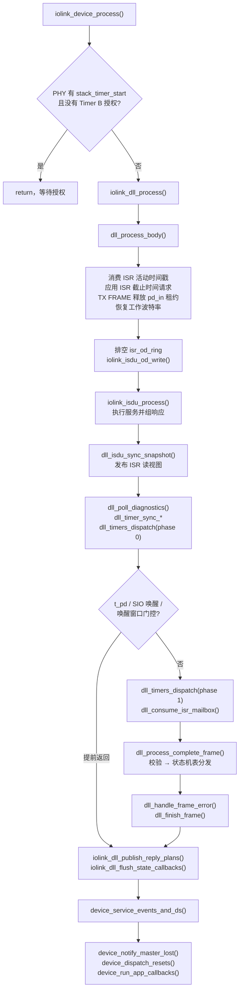

### 5.3 关键约束

- **内容语义只归主泵**：`iolink_dll_publish_reply_plans()` 把当前状态编译成计划表并用 seqlock（`reply_plan_seq` 奇偶）发布；ISR 只做查表与执行。计划内容还依赖运行时能力位（如 `IOLINK_CAP_COMPAT_T0_READ`），而发布键只有 `{状态, M-sequence 类型, OD 宽度, 波特率}`：因此 `iolink_device_set_capabilities()` 调用 `iolink_dll_invalidate_reply_plans()` 把 `reply_plan_seq` 清 0，ISR 立刻按“无计划”回退，下一轮主泵重发布。计划外请求一律不应答、不解释内容，关闭 t_A 窗口并以 `eager=0` 发布邮箱，由主泵按既有分发路径处理，因此计划表只能削弱“ISR 提前应答”，不能改变任何一帧的最终应答内容。
- `ctx->shared.isdu` 由主循环单写；ISR 只读已发布的成帧应答视图（发布字打包 `len | busy | sel | gen`），并拥有 ISDU 读的 FlowCTRL 段索引。Page 通道的 DPP1 读取在 ISR 中只读 ISDU/DLL 状态来构建页面字节。
- ISDU 写由 ISR 暂存到 `isr_od_ring`，主循环排空后调用 `iolink_isdu_od_write()`。暂存成功后 ISR 置 `isr_isdu_invalidated`；在写被应用并产出新应答前，主泵发布 `len=0`（无服务），因此“写后立刻读”不会读到旧值。
- **64 位截止时间只由主上下文写**。ISR 只置一次性标志：`isr_dsio_clear`、`isr_fallback_pending`、`isr_master_activity`；诊断侧只写 `iolink_conditions_t::isr_pulse[]` 单字节 one-shot。这类标志由任一方置 1、只由主泵清 0，重复置位幂等。
- 顺序约束：即时应答在邮箱发布**之前**启动（t_A），记录随后连同 `eager=1` 一起入环；TX BYTE 下每个中断只喂一个八位组后让出，TX FRAME 由 PHY 拥有整帧传输；重入用 `in_isr` + `isr_reentry_pending` 延迟到外层调用，保证泵状态只有一个写入者。
- 邮箱是**两个槽**的 SPSC 环（`include/iolinki/ring.h`）：环满（两帧都未消费）时新帧计入 `isr_mailbox_drops` 并被丢弃。记录携带自身长度与 `eager` 标志，主泵快照到 `frame_replied_by_isr`，因此无需跨帧状态。
- 状态通知是**电平式**的：`ctx->shared.state` 立即更新（单字节写，无临界区），`iolink_dll_flush_state_callbacks()` 只在“当前状态 ≠ 上次已交付状态”时调用一次回调。主上下文迁移在 `dll_set_state()` 内立即投递；ISR 迁移只改状态，由下一次主上下文 flush 投递，多次 ISR 迁移会合并为最终状态（中间态不单独回调）。例外：ISR 进入 STARTUP 会置 `startup_notification_pending`，该复位通知优先投递，不会被后续 PREOPERATE 覆盖。flush 由 `iolink_dll_process()` 末尾执行，设备层不再重复调用。

---

## 6. 单帧接收、校验与分流

### 6.1 请求长度如何确定

ISR 路径在第二个字节（CKT）到达后，用 `iolink_dll_expected_req_len()`（内部 `dll_compute_req_len()`）决定长度：

- Type-0：读 2 字节；Page/Diagnosis/ISDU 写 3 字节（Figure A.5：Type-0 写固定只带一个 OD 字节，与 OPERATE 的 OD 宽度无关）；
- Type-1/2：`2 + pd_out_len_current + (写 ? od_width : 0)`；
- ESTAB_COM 中的 transition command（`MC = 0x0F`）：2 字节。

Type-0 的读/写长度由 MC 通道和读写位决定；Type-1/2 的请求长度由配置的 PD-out 宽度与当前 OD 宽度决定，写请求才携带 OD。RX FRAME 粒度下 `dll_isr_frame_len_ok()` 用同一判据做长度合理性检查，并把不符的帧计入 `framing_errors` 后丢弃。

### 6.2 完整帧处理

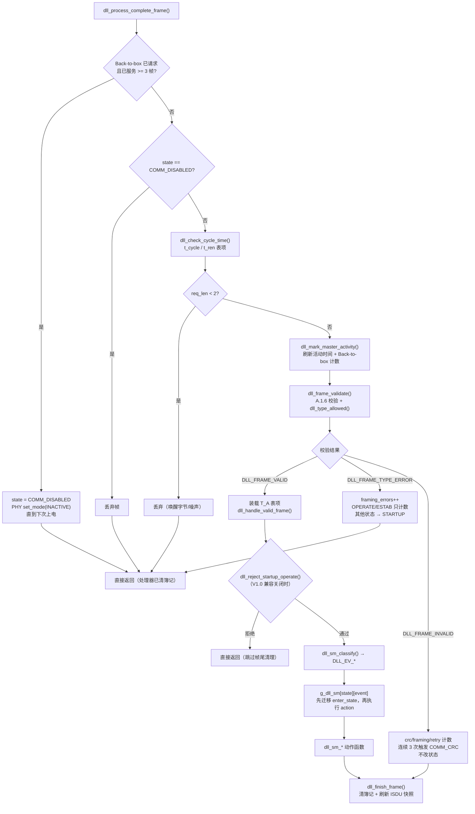

`dll_sm_*` 动作返回 `false` 时（例如 `dll_sm_operate_page_read()` 决定复位到 STARTUP）同样跳过 `dll_finish_frame()`，因为该路径已自行清理簿记。

### 6.3 通道分流

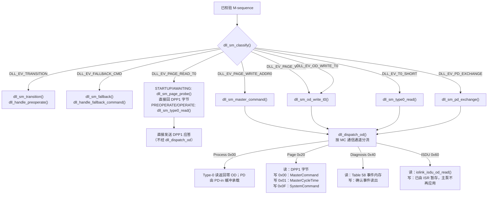

`dll_sm_page_probe()` 是 STARTUP/AWAITING_COMM 的启动探测路径：它用 `dll_handle_page_channel_read()` 直接回应 DPP1 字节，并已由计划表迁移到 PREOPERATE。OPERATE 中的 Type-0 页读由 `dll_sm_operate_page_read()` 处理：非兼容模式（未置 `IOLINK_CAP_COMPAT_T0_READ`）按 Tables 57/67 视为复位请求，不应答并回到 STARTUP；兼容模式才按普通页读应答。

各通道的应答布局（代码路径）：

| 请求 | 应答 | 代码 |
| :--- | :--- | :--- |
| Type-0 READ（任意通道） | `OD + CKS` | `dll_handle_operate_type0()` |
| Type-0 WRITE（任意通道） | `CKS` | 同上 / `dll_handle_type0_od_write()` |
| Type-1/2 READ（Process/Page/Diag/ISDU） | `[OD...][PD-in...]CKS` | `dll_handle_operate_type1_2()` → `dll_send_od_reply()` |
| Type-1/2 WRITE（Process/Page/Diag/ISDU） | `[PD-in...]CKS` | 同上 |
| MasterCommand 页写 | Type-0：`CKS`；Type-1/2：`[PD-in...]CKS` | `dll_handle_master_command()` / `dll_dispatch_od()` |
| FALLBACK MasterCommand | `CKS`，随后 T_FBD 到期回 SIO | `dll_handle_fallback_command()` |
| 命中应答计划的请求 | 按计划 `len` + 可选 PD 尾部 + `CKS` | `dll_isr_plan_execute()` |

CKS 位含义：

- bit7 = Event flag（`iolink_events_flag()`）；
- bit6 = PD invalid（`dll_pd_status_flags()`，无 PD-in 时恒为 0）；
- bit5..0 = A.1.6 6-bit 校验。

### 6.4 Process Data 流向

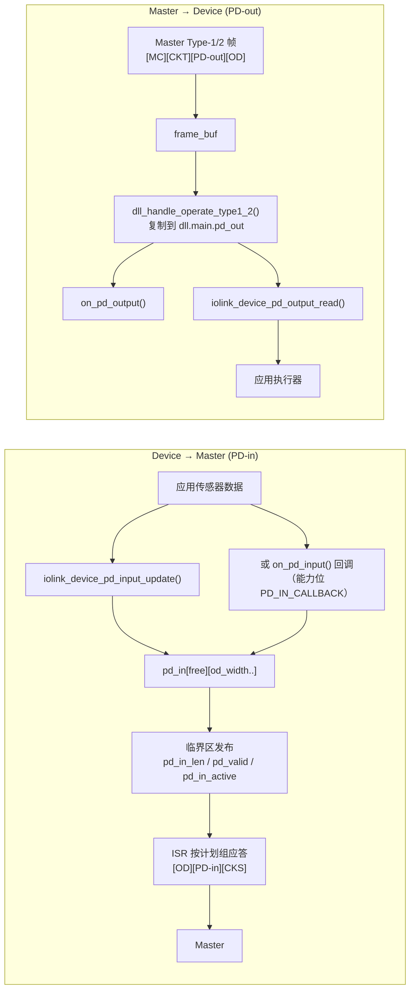

规则：

- `iolink_device_pd_input_update()` 与 `on_pd_input()` 在同一构建内共存，按 `on_pd_input != NULL`（能力位 `IOLINK_CAP_PD_IN_CALLBACK`）在 `device_run_app_callbacks()` 中选路；回调路径已选中时，轮询 API 返回 `IOLINK_DEVICE_INIT_ERR_PD_INPUT`，不会静默覆盖回调输出。`on_pd_input()` 的返回值直接作为 `pd_valid`，返回 `false` 会置 CKS bit6。
- 固定 Annex A 类型的 PD-in 长度不可变；`TYPE_2_V` 可在 `pd_in_len_max` 内变化。
- PD-out 只在 Type-1/2 请求中携带；Type-0 不携带 PD。
- `pd_valid=false` 会置 CKS bit6，Master 可据此判断 PD 无效；没有 PD-in 的设备恒报有效。
- `pd_in` 的缓冲数由 TX 模式决定（`IOLINK_PD_IN_BUFFERS`：TX BYTE=2、TX FRAME=3），主循环填充 ISR 未占用的副本，避免撕裂；没有空闲缓冲时保留当前 PD-in、下个周期重试并计入 `pd_in_skips`。

### 6.5 ISR 快路径与主路径的分工

| 请求 | ISR 双泵（计划命中时） | 主循环 |
| :--- | :--- | :--- |
| Type-0 启动探测（STARTUP/AWAITING 的 Page READ） | 计划动作 `IOLINK_REPLY_ACT_ENTER_PREOPERATE` + `IOLINK_REPLY_SRC_PAGE`；回 DPP1 字节并置 `isr_dsio_clear` | `CONSUME` 帧不入邮箱；状态由下次 flush 以电平方式通知 |
| Type-0 transition command（PREOPERATE） | 计划动作 `IOLINK_REPLY_ACT_ENTER_ESTAB_COM`，带 `CLOSE_WINDOW \| RESTART_TIMER_B \| CONSUME`：不应答 | 帧不入邮箱 |
| Type-0 Page/Diag/Process READ | `IOLINK_REPLY_SRC_PAGE` / `EVENT_MEM` / `TEMPLATE`，`CONSUME` | 帧不入邮箱 |
| Type-0 ISDU READ（FlowCTRL 为 START/COUNT） | `IOLINK_REPLY_SRC_ISDU_SEG`，ISR 自己推进段索引；`CONSUME` | 帧不入邮箱 |
| Type-0 ISDU READ（IDLE/IDLE2/ABORT） | 计划不匹配 | 主泵 `dll_dispatch_od()` → `iolink_isdu_od_read()` 复位传输层并刷新快照 |
| Type-0 Page WRITE addr 0 | 计划动作 `IOLINK_REPLY_ACT_MASTER_COMMAND`：ISR 应用命令并回 CKS | `CONSUME` 帧不入邮箱 |
| Type-0 Page/Diag WRITE 其他地址 | 计划不匹配 | 主泵执行 DPP 写 / 诊断确认 |
| Type-0 ISDU WRITE | 先暂存到 `isr_od_ring`；带 `STAGED` 的计划仅在暂存成功时回 CKS 并 `CONSUME` | 暂存失败或计划未命中时从邮箱取帧处理 |
| OPERATE 中的 Type-0 页读（未开兼容位） | 计划动作 `IOLINK_REPLY_ACT_RESET_STARTUP` + `CLOSE_WINDOW \| CONSUME`：不应答 | 帧不入邮箱，主泵不再看到该复位请求 |
| Type-1/2 READ（Process/Page/Diag） | `PD_TAIL` 计划：OD 头写入活动 PD-in 槽位，零拷贝发送；来源为 `TEMPLATE` / `PAGE` / `EVENT_MEM` | eager 帧仍入邮箱；主泵更新统计、PD-out 与状态，不重发应答 |
| Type-1/2 READ（ISDU） | `PD_TAIL` + `IOLINK_REPLY_SRC_ISDU_SEG`：ISR 从已发布视图取段 | 同上；主泵不再推进段索引 |
| Type-1/2 WRITE | 暂存 ISDU 写；其余只回 `[PD-in]CKS` | eager 帧仍入邮箱；主泵复制 PD-out、推进状态机 |
| FALLBACK MasterCommand（0x5A，Type-0 页写 addr 0） | 命中 MasterCommand 计划且带唤醒能力时：回 CKS、置 `isr_fallback_pending`、迁移 FALLBACK | 主泵 `dll_apply_isr_deadline_requests()` 安装 T_FBD |

计划表内容随配置不同：Type-1/2 配置下 OPERATE 的 Type-0 页读只在兼容位 `IOLINK_CAP_COMPAT_T0_READ` 置位时才有普通页读计划，否则计划显式表达“消费并回 STARTUP”；Type-1/2 的页写计划固定为 `[PD-in]CKS`，因此只有 Type-0 页写 addr 0 才会被 ISR 当作 MasterCommand 应用。

---

## 7. ISDU 数据流

### 7.1 传输状态机

实际使用的状态只有 `IDLE`、`HEADER_INITIAL`（瞬态）、`SERVICE_EXECUTE`、`RESPONSE_READY`；枚举只保留这四个状态，逐字节解析在 `iolink_isdu_od_write()` 内完成，不逐字节停留。

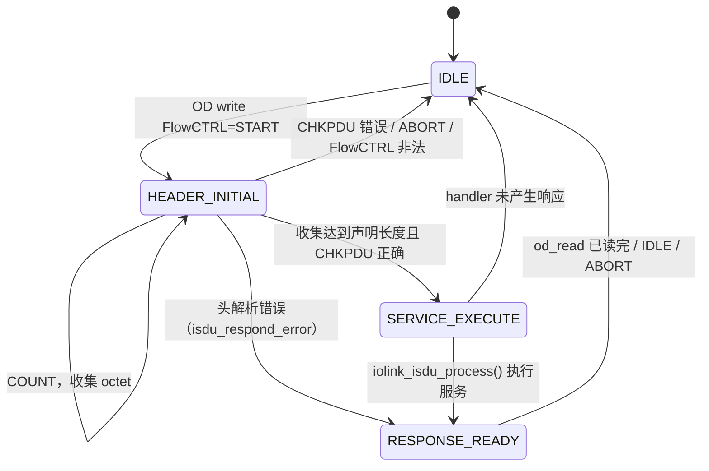

### 7.2 写请求（Master → Device）

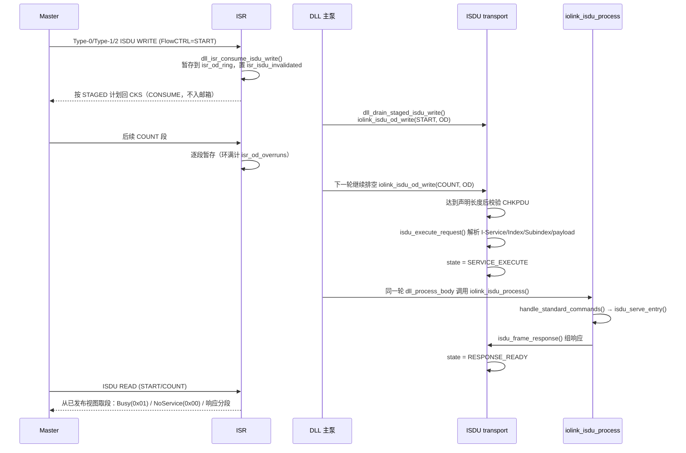

要点：

- ISDU 写请求在 DLL 层的应答**不含 OD**：Type-0 只有 CKS，Type-1/2 为 `[PD-in]CKS`；真正的 ISDU 正/负响应要通过后续 ISDU READ 取回。
- `iolink_isdu_od_write()` 在请求完整时只解析并进入 `SERVICE_EXECUTE`；应用服务由 `iolink_isdu_process()` 在同一轮主泵的后续步骤执行。
- 多段写：FlowCTRL 重复值表示“重发上一段”，其 payload 忽略；不属于 `START` 后的连续 COUNT 会产生 segmentation error 并复位传输层。
- 双泵下 ISR 只按帧结构暂存 OD 段，**不校验 FlowCTRL 顺序、CHKPDU，也不改 ISDU 状态机**；这三件事都由主泵的 `iolink_isdu_od_write()` 完成，因此 `ctx->shared.isdu` 只有一个写入者。

### 7.3 读请求与响应分段

- `START`：
  - `SERVICE_EXECUTE` → 返回 Busy `0x01`；
  - `RESPONSE_READY` → 从头开始读响应；
  - `IDLE` → No Service `0x00`。
- `COUNT`：继续从 `resp_idx` 顺序读取；若剩余不足 `od_len`，补 `0x00`。
- 读完后 `RESPONSE_READY → IDLE`。
- ISR 双泵另有一套快照分段逻辑 `dll_isr_isdu_od()`：它读取主泵 `dll_isdu_sync_snapshot()` 发布的原子字 `isr_isdu_pub`（`len | busy | sel | gen`），并在 START 处整体采纳新字；此后由 ISR 拥有 `isr_isdu_idx` / `isr_isdu_seg_idx` / `isr_isdu_last_flowctrl`，不修改主 ISDU 传输状态。成帧应答只有**一份** `frame` 缓冲，`resp_store[0/1]` 只是两个视图槽；主泵重建缓冲前先发布 `{len=0, busy=1}` 租约，写完再带新代数位发布。ISDU 写暂存后 `isr_isdu_invalidated` 会让主泵发布 `len=0`，杜绝“写后立刻读”读到旧应答。

响应组帧（`isdu_frame_response()`）：

| 情况 | 首字节 | 后续 |
| :--- | :--- | :--- |
| 读负响应 | `0xC4` | `0x80` + AdditionalCode + CHKPDU |
| 写负响应 | `0x44` | `0x80` + AdditionalCode + CHKPDU |
| 写正响应 | `0x52` | CHKPDU |
| 读正响应，总长 ≤ 15 | `0xD0 \| total` | data + CHKPDU |
| 读正响应，总长 > 15 | `0xD1` | ExtLength(total) + data + CHKPDU |

### 7.4 索引分发树

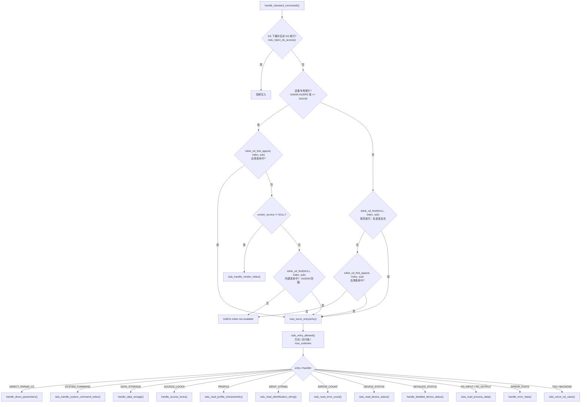

索引到处理器的映射只存在于 `src/od.c` 的内建 const 表：`0x0000/0x0001` Direct Parameter、`0x0002` SystemCommand、`0x0003` DataStorage、`0x000C` DeviceAccessLocks、`0x000D` ProfileCharacteristic、`0x0010-0x0017/0x001B` 标识字符串、`0x0018-0x001A` Tag、`0x0020` ErrorCount、`0x0024` DeviceStatus、`0x0025` DetailedDeviceStatus、`0x0028/0x0029` PD 输入/输出、`0x0040` 厂商错误统计。应用参数通过 `iolink_od_app_t` 自带表项与 `IOLINK_OD_HANDLER_BACKEND`，因此新增参数 = 一行表项 + 一个 get/set 分支。

索引归属按域决定：规范索引（`< 0x0040`）从内建表取，应用表不得遮蔽 `0x0002`/`0x0024` 等对象；设备专用索引先查应用表，再交给 `vendor_service`，最后才回落到内建表。`0x0040` 同时是“设备特定起始索引”和内置 error-stats 索引：**绑定 vendor_service 且应用表未声明时，0x0040 走 vendor 回调**；内置 `handle_error_stats()` 只在两者都不存在时可达。OD 值层另行校验 `max_subindex`（越界 `0x8011`）与 OctetString 的 `block_len`（超长 `0x8033`）。

### 7.5 SystemCommand 映射

`handle_system_command()` 处理（`IOLINK_CAP_SYSTEM_COMMAND` 关闭时全部回 `0x8035`）：

| 命令 | 行为 |
| :--- | :--- |
| `0x80` Device Reset | `iolink_dll_reset_diagnostics()`（诊断置 0）+ `isdu.reset_pending`，由 `iolink_device_process()` 调用 reset handler |
| `0x81` Application Reset | `app_reset_pending = true`，并触发 DS_UPLOAD_REQ |
| `0x82` Restore Factory Settings | `iolink_params_ctx_factory_reset()` + 清 DS_UPLOAD_FLAG + 复位 ErrorCount + `iolink_events_clear_diagnosis()`（Table 101 的 Clear）；不请求上传 |
| `0x83` Back-to-box | 恢复出厂值 + 清 DS_UPLOAD_FLAG + `iolink_dll_request_back_to_box()`，3 个 MasterCycle 后停止通信 + 复位诊断 |
| `0x01/0x02` ParamUploadStart/End | DS 上传 |
| `0x03/0x04` ParamDownloadStart/End | DS 下载；下载期间 DS 参数写入先暂存，End 时先整份校验再逐条应用（非跨参数事务） |
| `0x05` ParamDownloadStore | 完成下载（等价 DownloadEnd）并触发 DS_UPLOAD_REQ |
| `0x06` ParamBreak | 中止 DS；空闲时返回 `0x8036`（Function temporarily unavailable） |
| `0x84-0x9F` | 保留值（Table B.9），返回 `0x8035` |
| 其他 | `0x8035` Function not available |

`0x80/0x81` 不会自动重启设备；reset handler 由应用通过 `iolink_device_set_reset_handler()` 注册并决定动作。

DPP1 地址 `0x0F` 的 SystemCommand 走 `iolink_isdu_execute_system_command()`：命令被执行，随后丢弃已暂存的 ISDU 应答（7.3.5.3 不提供肯定/否定应答）。

---

## 8. Data Storage、参数与事件

### 8.1 参数持久化

参数记录布局（`include/iolinki/storage.h`）：

```text
PARAMS 区域:
  magic(4) | version(2) | reserved(2) |
  application_tag[33] | function_tag[33] | location_tag[33] |
  fletcher32_checksum(4)

DS 区域:
  magic(4) | version(2) | length(2) | fletcher32(4) |
  image[IOLINK_DS_IMAGE_MAX]

FLAG 区域:
  DS_UPLOAD_FLAG(1) + 3 字节对齐保留
```

区域偏移由 `include/iolinki/storage.h` 的区域偏移宏（`IOLINK_STORAGE_PARAMS_BASE`、`IOLINK_STORAGE_DS_BASE`、`IOLINK_STORAGE_FLAG_BASE` 及其 `_SIZE`）在编译期固定，应用在 `read`/`write` 回调里加自己的物理基址。

关键流程：

- `iolink_params_bind_storage()` → `params_ctx_load()`：magic/version/checksum 任一失败则忽略 NVM，保留 RAM 默认值。
- `iolink_params_ctx_write()`：先改候选副本，按 `persist` 写 NVM，成功后才提交 RAM 并同步 AppTag 到 device_info；失败以 `iolink_result_t` 返回（NVM 失败为 `IOLINK_RESULT_IO`），不会留下“已接受”的 RAM 状态。
- `iolink_params_ctx_factory_reset()`：清空三个 Tag，写 NVM，并清 device_info 的 AppTag。

### 8.2 Data Storage 镜像

记录格式（`iolink_ds_serialize()` / `iolink_ds_calc_checksum()`）：

```text
[Index(2, big-endian)][Subindex(1)][Length(1)][Data(Length)] ...
```

- `iolink_ds_serialize(ctx, out, cap)`：按 DS 描述符顺序**流式**序列化当前参数集，同时累加 Fletcher-32。`out` 可以是 ISDU 应答缓冲、调用方缓冲，或 `NULL`（只统计长度/校验和）；此时用 `IOLINK_DS_STREAM_CHUNK` 大小的小栈块读取参数，不建常驻镜像。
- `iolink_ds_build_image()`：只是“写入绑定暂存缓冲”的包装（`workspace.ds_stage` 或内嵌 fallback）；`iolink_ds_refresh()` 只刷新 `image_len` 与 `current_checksum`，不建立快照。
- `iolink_ds_apply_image()`：先完整校验记录结构，再对每个已知参数调用 `check` 回调做无副作用预校验（任一失败返回 `-2`，此时不写任何参数）；全部通过后逐条应用并持久化，未知索引跳过；最后重新序列化，保证镜像与设备真实参数一致。NVM 写入失败仍可能留下已生效的前缀记录（不是跨参数事务）。
- DS 成员判定由 OD 表项的 `storage == IOLINK_OD_STORAGE_DS` 与绑定的描述符集合共同决定；默认集合即 `ApplicationTag/FunctionTag/LocationTag`，应用可用 `iolink_ds_bind_param_access()` / `iolink_ds_set_param_desc()` 扩展。

DS 状态机（`iolink_ds_process()`）：

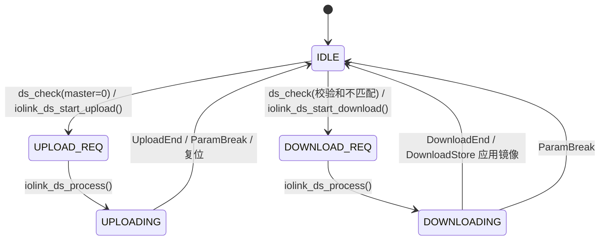

注意：`iolink_ds_process()` 在 ISDU 传输空闲时由 `iolink_device_process()` 自动调用（`device_service_events_and_ds()`，DS 状态非 IDLE 时驱动）。`iolink_ds_check()` 仍由应用驱动：它需要应用提供的 master 校验和（“校验和比较 → 自动上传/下载请求”流程），栈无法自行获取该值。

### 8.3 事件流

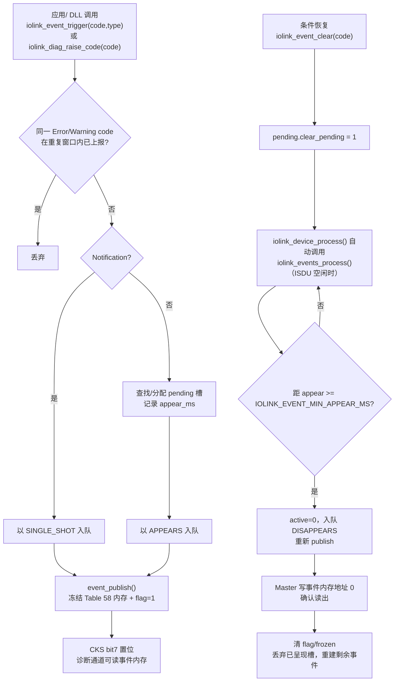

补充：

- 事件队列按严重度排序（Error 优先），队列满时保留更严重的事件。
- 两个 A.6.4 窗口默认取 `IOLINK_EVENT_MIN_APPEAR_MS`（50）与 `IOLINK_EVENT_MIN_REPEAT_MS`（1000），`iolink_device_init()` 用 `iolink_stack_config_t::event_min_appear_ms` / `event_min_repeat_ms` 经 `iolink_events_set_window()` 覆盖（0 = 保留构建默认）。
- `DeviceStatus`（0x0024，Table B.13）与 `DetailedDeviceStatus`（0x0025，Table B.14）都由诊断注册表
  从同一条件集派生（`iolink_diag_device_status()` / `iolink_diag_dds_snapshot()`）：
  Error/Warning 且 `present || reported`，Notification 不提升状态、不进入 DDS。
- `STARTUP` 状态会调用 `iolink_events_reset()` 丢弃事件（A.6.4）。
- 物理诊断轮询 `phy->get_faults()` 位图：`dll_poll_phy_faults()` 把每个位交给
  `iolink_diag_set_level()`，按“当前电平 vs 条件锁存”产生边沿
  （UNDERVOLTAGE→0x5111、OVERVOLTAGE→0x5110、OVERTEMP→0x4000、
  SHORT_CIRCUIT→0x7710）；1→0 只清条件。复位清空条件表后，
  仍存在的故障由下一轮采样重新上报。`get_faults()` 为 NULL 时诊断静默。
- 协议错误（CRC/超时/组帧/时序）是 PULSE 源（0x1801/0x1802/0x1803/0x1804）：
  ISR 只写 `isr_pulse[]` one-shot，主泵 `iolink_diag_service()`（由
  `dll_poll_diagnostics()` 调用）消费并刷新 `IOLINK_DIAG_PULSE_HOLD_MS`
  保持窗口，窗口结束才发 disappears。同一根因连续发生只刷新窗口，不重复 appears（10.10.2）。
- 诊断元数据表 `iolink_diag_desc_t` 是 EventCode → 规范 EventType / Table D.1
  首选 DeviceStatus / 来源 / PULSE 与 LEVEL 标志的唯一出处；`0x1800-0x18FF`
  是厂商特定设备事件区（`IOLINK_EVENT_COMM_*` 使用其中四个值）。
- 计数器语义：`get_faults()` 路径按故障片段计数（每个 0→1 边沿一次）；
  协议错误源按脉冲计数（`iolink_diag_edge_count()`）。

---

## 9. 回调与接口在通信周期中的调用逻辑

### 9.1 初始化阶段

| 顺序 | 调用 | 来源 |
| :--- | :--- | :--- |
| 1 | `phy->init()` | `iolink_device_init()` |
| 2 | `phy->set_baudrate(COM2)` | `iolink_dll_init()` |
| 3 | `phy->set_mode(SIO/SDCI)` | `iolink_dll_init()` 依据 `IOLINK_CAP_WAKEUP` |
| 4 | `storage->read()` | `params_ctx_load()`、`iolink_ds_init()` |
| 5 | `od.read`（经 `device_param_read`） | 无持久镜像时的 `iolink_ds_build_image()` |
| 6 | `phy->set_baudrate(工作 COM)` | `device_apply_stack_config()` 可选 |
| 7 | `on_startup()` | `iolink_device_init()` 末尾 |

### 9.2 一个主循环内的顺序

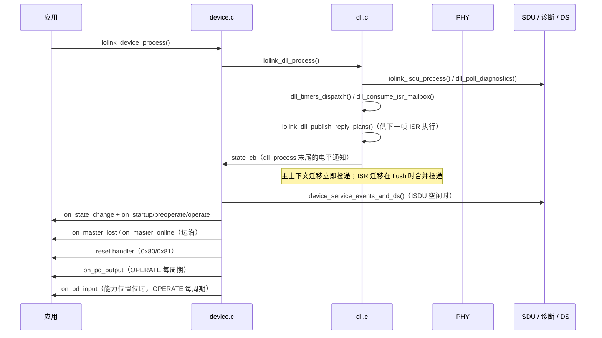

具体顺序（`iolink_device_process()`）：

1. Timer B 授权检查（`device_service_window_ready()`）；没有授权直接返回。
2. `iolink_dll_process()` → `dll_process_body()`：
   - 消费 ISR 活动时间戳、应用 ISR 截止时间请求、TX FRAME 下释放 PD-in 租约、恢复工作波特率；
   - 排空 `isr_od_ring`（`iolink_isdu_od_write()`），执行 `iolink_isdu_process()`，随后 `dll_isdu_sync_snapshot()` 刷新 ISR 读视图；
   - `dll_poll_diagnostics()`：先 `iolink_diag_service()` 消费 ISR 脉冲，再采样 `get_faults()` 电平源；
   - 再次采样 ISR 活动，然后 `dll_timer_sync_master_lost()` / `dll_timer_sync_idle()` / `dll_timer_sync_t_byte()`，执行 `dll_timers_dispatch(phase 0)`；
   - 门控：`dll_check_t_pd()`、`dll_handle_sio_wakeup()`、`dll_timers_dispatch(phase 1)`、`dll_wakeup_window_active()`，任一命中即提前返回（这是唯一跳过邮箱的路径）；
   - `dll_consume_isr_mailbox()` → `dll_process_complete_frame()` → `dll_handle_frame_error()` / `dll_finish_frame()`；
   - 再次恢复工作波特率。
   返回后发布应答计划，再 `iolink_dll_flush_state_callbacks()` 电平式交付当前状态（ISR 期间的多次迁移合并为最终状态；ISR 进入 STARTUP 的复位通知优先单独投递）。
3. `device_service_events_and_ds()`：ISDU 传输空闲时驱动 `iolink_ds_process()` / `iolink_events_process()`，并在 DS 响应读完后把 `upload_event_pending` 转成 `iolink_diag_raise_code()` 的 DS_UPLOAD_REQ 事件。
4. master-lost/online 边沿回调：只在 `state == OPERATE` 时比较 `master_lost` 与 `master_lost_last`；离开 OPERATE 时清空旧状态。
5. reset handler：`isdu.reset_pending` / `isdu.app_reset_pending`。
6. OPERATE 下（`device_run_app_callbacks()`）：
   - `on_pd_output(config.user, ctx->dll.main.pd_out, pd_out_len_current)`；
   - 若 `IOLINK_CAP_PD_IN_CALLBACK`：用 `device_pd_in_free_index()` 取一个 ISR 未在发送的 PD-in 缓冲区，填完后在临界区发布 `pd_in_len` / `pd_valid` / `pd_in_active`；无空闲缓冲时计 `pd_in_skips` 并在下个周期重试。

### 9.3 回调清单与实际调用点

| 接口/回调 | 调用点 | 上下文/说明 |
| :--- | :--- | :--- |
| `phy.init` | `iolink_device_init` | 初始化硬件 |
| `phy.set_baudrate` | `iolink_dll_init`、`iolink_dll_set_baudrate`、`dll_restore_operating_baudrate` | 恢复 COM 时避免在应答中途切换 |
| `phy.set_mode` | `iolink_dll_init`、`iolink_dll_set_sio_mode`、`iolink_dll_set_sdci_mode`、`dll_frame_drop_if_stopped` | SIO/SDCI/INACTIVE |
| `phy.rx_octet` / `rx_frame` | ISR | 逐字节或整帧 |
| `phy.tx_octet` / `tx_done` / `tx_frame` | ISR（直发回退时由主上下文调用 `dll_isr_start_staged_tx()`） | 发送应答 |
| `phy.tx_busy` | `dll_process_body()`（TX FRAME） | 传输结束可观测时提前释放 PD-in 租约 |
| `phy.request_service` | `dll_send()` 暂存后 | 请求 PHY 触发数据中断 |
| `phy.int_active` | ISR 门控 | 判断收发器是否请求服务 |
| `phy.response_timer_start/stop` | ISR RX/TX | t_A 看门狗 |
| `phy.stack_timer_start` | ISR 收到有效帧后 / 计划的 `RESTART_TIMER_B` | 请求 Timer B 授权主循环服务窗口 |
| `phy.detect_wakeup` | `dll_handle_sio_wakeup()` | SIO 唤醒检测 |
| `iolink_critical_enter/exit` | 事件引擎、诊断条件表、PD 索引/长度等标量；直发回退时驱动 PHY（经 `IOLINK_CRITICAL_ENTER/EXIT()`） | 平台临界区；`IOLINK_CONCURRENCY >= ISR` 时必须真实可用（初始化会拒绝 weak 默认），`SINGLE` 档不引用 |
| `on_state_change` | `device_state_cb()` | 当前状态（电平式；主上下文迁移立即投递，ISR 迁移合并） |
| `on_startup` | 初始化末尾 + 进入 STARTUP | 初始化时显式调用一次 |
| `on_preoperate` / `on_operate` | `device_state_cb()` | 进入对应状态时 |
| `on_master_lost` / `on_master_online` | `iolink_device_process()` | OPERATE 下 `master_lost` 边沿 |
| `on_pd_output` | `device_run_app_callbacks()` | OPERATE 每周期，报告最新 PD-out |
| `on_pd_input` | `device_run_app_callbacks()` | `IOLINK_CAP_PD_IN_CALLBACK` 置位时，OPERATE 每周期 |
| `reset_handler` | `device_dispatch_resets()` | 0x80/0x81 请求后 |
| `od.read` / `od.write` | `iolink_od_read_value()` / `iolink_od_write_value()` | 应用参数值后端；标准 Tag 走参数管理器 |
| `vendor_service` | 应用 OD 表未命中的 device-specific 索引；DS 表外参数读写 | 参数 `input/output/output_length` 契约见 `isdu.h` |
| `storage->read/write` | params 加载/保存、DS 加载/保存 | 持久化只使用 read/write |
| `iolink_device_time_us_fn time_us` | DLL、ISR 双泵、事件引擎、诊断窗口 | 必需；初始化时绑定，NULL 返回 `IOLINK_DEVICE_INIT_ERR_TIME`；必须单调/非阻塞/ISR 安全 |
| `phy.get_faults` | `dll_poll_diagnostics()` | 电平源，触发/清除 Table D.1 事件；NULL 时诊断静默 |
| `phy.set_cq_line` | 无 | SIO 线状态由 PHY/应用自行管理 |

### 9.4 库提供给 PHY/平台的钩子

| 钩子 | 调用方 | 作用 |
| :--- | :--- | :--- |
| `iolink_dll_on_rx_timeout(ctx)` | PHY 的 Timer A 中断 | 置 `isr_master_activity`、计 `timeout_errors`、发 COMM_TIMEOUT 诊断脉冲、清 ISR RX 组装状态、停响应定时器 |
| `iolink_dll_on_stack_tick(ctx)` | PHY 的 Timer B 中断 | 授权一次主循环服务窗口；`iolink_device_process()` 在 `stack_timer_start != NULL` 时会等待该授权 |
| `iolink_dll_take_service_window(ctx)` | `iolink_device_process()` | 消费/查询 Timer B 授权 |
| `iolink_dll_process_isr(ctx)` | PHY 数据中断 | ISR 双泵入口 |
| `iolink_dll_publish_reply_plans(ctx)` | `iolink_dll_init()` / `iolink_dll_process()` | 主泵发布应答计划（seqlock 单写者） |
| `iolink_dll_flush_state_callbacks(ctx)` | `iolink_dll_process()` 末尾 | 电平式交付当前状态（无变化则不调用） |

### 9.5 事件与 DS 的应用侧调用

- `iolink_events_process()`（有待处理事件时）与 `iolink_ds_process()`（DS 状态非 IDLE 时）由 `iolink_device_process()` 在 ISDU 传输空闲时自动调用，见 `device_service_events_and_ds()`。
- `iolink_ds_check()` 需应用自行调用：它需要应用提供的 master 校验和，栈无法自行获取。
- `iolink_device_process_isr()` 设计为在 PHY 数据中断中调用；host 模拟可用主循环驱动，但真实设备不要在 `ctx` 已并发进入主循环时从另一上下文调用。

---

## 10. 通信状态机与代码对应

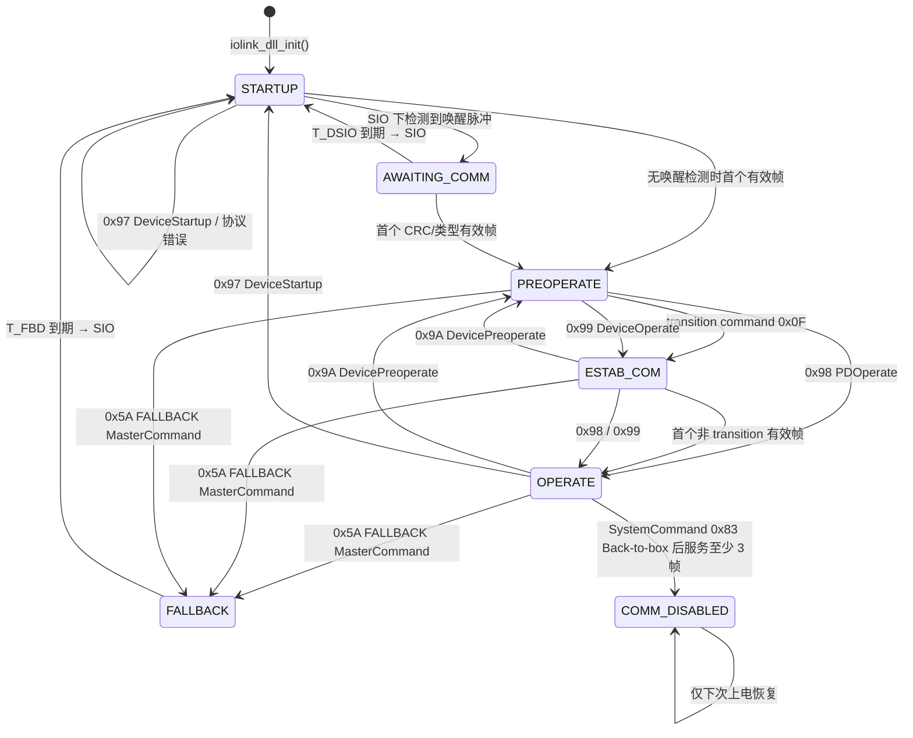

| 迁移 | 触发 | 代码 |
| :--- | :--- | :--- |
| 初始化 → STARTUP | `iolink_dll_init()` | `dll_set_state(STARTUP)` |
| STARTUP → AWAITING_COMM | SIO + `detect_wakeup()>0` | `dll_handle_sio_wakeup()` |
| STARTUP/AWAITING → PREOPERATE | 首个有效帧 | `g_dll_sm` → `dll_sm_*`（表项的 `enter_state`） |
| PREOPERATE → ESTAB_COM | MC=0x0F transition command | `dll_sm_transition()` → `dll_handle_preoperate()` |
| PREOPERATE → ESTAB_COM | 0x99 DeviceOperate | `dll_sm_master_command()` → `dll_apply_master_command()` |
| PREOPERATE → OPERATE | 0x98 PDOperate | `dll_apply_master_command()` |
| ESTAB_COM → OPERATE | 首个周期帧（Type-1/2 或任一 Type-0 周期帧） | `g_dll_sm` 表项的 `enter_state` |
| → PREOPERATE | 0x9A DevicePreoperate | `dll_apply_master_command()` |
| → FALLBACK | 0x5A Fallback（需唤醒能力） | `dll_handle_fallback_command()` / `dll_isr_plan_action()` |
| FALLBACK/OPERATE/ESTAB/PREOP → STARTUP | T_FBD 到期，切 COM1 + SIO | `dll_timer_expire_fbd()` |
| AWAITING/STARTUP → STARTUP | T_DSIO 到期，切 COM1 + SIO | `dll_timer_expire_dsio()` |
| 任意 → STARTUP | 0x97 DeviceStartup 或非 OPERATE/ESTAB 的类型错误 | `dll_protocol_error_to_startup()` / `dll_handle_frame_error()` |
| OPERATE → COMM_DISABLED | SystemCommand 0x83 Back-to-box，服务 ≥3 帧后 | `dll_frame_drop_if_stopped()` |

补充：

- 迁移由 `include/iolinki/dll_sm.h` 的 `DLL_SM_ROWS` 描述：7 个状态 × 8 类事件的每个格子给出“动作函数 + 进入状态”，`src/dll.c` 用指定初始化器展开成 `g_dll_sm[state][event]`。`tools/gen_dll_statemachine.py` 解析同一份宏行生成 mermaid/CSV/覆盖测试，新增迁移只改这一处。
- 首个有效帧把 STARTUP/AWAITING_COMM 迁到 PREOPERATE 后，如果该帧本身就是 transition command（`MC=0x0F`），同一次 `dll_process_complete_frame()` 会继续调用 `dll_handle_preoperate()`，因此可以一帧内连续进入 ESTAB_COM。
- `master_lost` 只在 OPERATE 且 `master_lost_cycles != 0` 时计算，超过阈值只置提示位并触发 `on_master_lost`，**不改变状态和波特率**（`dll_timer_expire_master_lost()`，`iolink_device_master_lost()`）。
- CRC 错误不会单独导致 STARTUP；类型非法在 OPERATE/ESTAB 只计数并丢帧，避免链路抖动。
- `COMM_DISABLED` 会把 PHY 置为 `INACTIVE`，之后主循环不再处理帧，直到重新上电。
- 无 `detect_wakeup` 的 PHY 在初始化时直接进入 SDCI，因此不会出现 AWAITING_COMM/T_DSIO 路径。
- `IOLINK_CAP_COMPAT_V10_OP` 关闭时，启动期间收到的 0x98/0x99 页写会被 `dll_reject_startup_operate()` 按 Table 53（SDCI_TC_0035）拒绝。

---

## 11. 定时与错误路径

所有软件超时收敛为一张静态表 `iolink_dll_main_t::timers[IOLINK_TIMER_COUNT]`（每项只存绝对截止时间，微秒）+ 一个 `next_deadline`。时钟源唯一：`shared.time_us` → `dll_time_us()`；主泵正常路径只做一次“现在是否到达 `next_deadline`”的比较，装载/取消是边沿事件。

timer 的枚举顺序即同刻到期的执行优先级，运行语义与规范条款由 `g_timer_contract[]` 描述并通过 `iolink_dll_timer_contract()` 导出（测试与文档共用同一份事实源）：

| timer | 契约条款 | 行为 | 代码 |
| :--- | :--- | :--- | :--- |
| `IOLINK_TIMER_MASTER_LOST` | 实现相关（ST Timer B 语义） | OPERATE 下按 MasterCycleTime 计数，饱和 0xFF，只置提示位 | `dll_timer_sync_master_lost()` / `dll_timer_expire_master_lost()` |
| `IOLINK_TIMER_IDLE` | 实现诊断（1 s 静默链路，非规范超时） | `idle_timeouts++`，不改状态/波特率 | `dll_timer_sync_idle()` / `dll_timer_expire_idle()` |
| `IOLINK_TIMER_T_DSIO` | Table 47 T10（60..300 ms） | 唤醒后无有效报文 → COM1 + SIO + STARTUP | `dll_timer_expire_dsio()` |
| `IOLINK_TIMER_T_FBD` | Table 47 T8/T9；Table 43 | `3 × MasterCycleTime`（上限 500 ms）→ COM1 + SIO + STARTUP | `dll_handle_fallback_command()` / `dll_apply_isr_deadline_requests()` / `dll_timer_expire_fbd()` |
| `IOLINK_TIMER_T_PD` | A.2 / Table 47（WINDOW） | 上电保护窗口：截止前排空 RX，收到字节计 `t_pd_violations` | `dll_check_t_pd()` |
| `IOLINK_TIMER_T_WU` | Table 47（WINDOW） | 唤醒后首帧窗口（`IOLINK_T_WU_US`），截止前不处理 | `dll_handle_sio_wakeup()` / `dll_wakeup_window_active()` |
| `IOLINK_TIMER_T_BYTE` | A.2 / Table 47（phase 1） | 帧内字节间隙超限 → `t_byte_violations` + `framing_errors`，中止当前帧 | `dll_timer_sync_t_byte()` / `dll_timer_expire_t_byte()` |
| `IOLINK_TIMER_T_REN` | C6 / Table 10（WINDOW） | 应答超出 t_ren 限制 → `t_ren_violations` | `dll_check_cycle_time()` / `dll_send_od_reply()` |
| `IOLINK_TIMER_T_CYCLE` | C5 / Table 47（WINDOW） | 帧间隔 < MinCycleTime → `t_cycle_violations` | `dll_check_cycle_time()` |
| `IOLINK_TIMER_T_A` | Table 47 / A.2（WINDOW） | 应答起始预算（10 个位时间）；PHY 的 Timer A 是权威，软件表项只做镜像/审计 | `dll_process_complete_frame()` / `dll_send()` |

分发规则：

- `IOLINK_TIMER_KIND_DEADLINE` 的表项进入 `next_deadline`，由 `dll_timers_dispatch(ctx, phase)` 在到期时按表序执行；`phase 0` 在 t_pd / SIO 唤醒门控之前，`phase 1` 在两者之后、唤醒窗口门控之前（`t_byte` 只在 phase 1 执行，且只做测量、从不提前返回）。
- `IOLINK_TIMER_KIND_WINDOW` 的表项不进 `next_deadline`，只由各自的边沿检查比较（`dll_t_pd_active()`、`dll_wakeup_window_active()`、`dll_check_cycle_time()` 等）。
- `deadline == 0` 表示未装载；所有比较都走 `dll_time_reached()` / `dll_time_passed()` 的回绕安全减法（选择最早截止时间用同一族的符号差判定）。
- ISR 在 `CONSUME` 计划下应答的帧不经过主泵帧尾：ISR 把帧时间的低 32 位写入 `shared.isr_consumed_us` 并自增 `isr_consumed_seq`，主泵在下一次 process 用该时间戳补做 `dll_check_cycle_time_at()` 并更新 `last_response_us`，因此 T_CYCLE/T_REN 与最坏时序统计不会漏掉这些帧（重建依赖主泵两次运行间隔 < 2^31 us）。
- `device_apply_stack_config()` 在时钟绑定之后直接装载 T_PD 表项（`dll_timer_arm()`），截止时间表是唯一事实源；不存在单独的兼容字段。

错误路径与计数：

| 条件 | 代码行为 | 位置 |
| :--- | :--- | :--- |
| CRC 失败 | `crc_errors` / `framing_errors` / `total_retries` 递增；连续 3 次触发 COMM_CRC 脉冲事件；不改状态 | `dll_handle_frame_error()` |
| 类型非法 | OPERATE/ESTAB 只计 `framing_errors` 并丢帧；其他状态发 COMM_FRAMING 并回 STARTUP | `dll_handle_frame_error()` |
| T_DSIO / T_FBD 到期 | COM1 + SIO + STARTUP | `dll_timer_expire_dsio()` / `dll_timer_expire_fbd()` |
| 字节间超时 | `t_byte_violations` + COMM_TIMING 脉冲，`frame_index = 0` | `dll_timer_expire_t_byte()` |
| ISR RX 超时 | `timeout_errors++`、COMM_TIMEOUT 脉冲、清 RX 组装、停响应定时器 | `iolink_dll_on_rx_timeout()` |
| ISR 帧长/校验拒绝 | `isr_eager_rejects` 或 `framing_errors`，`isr_plan_misses` 记录交给主泵的帧 | `dll_isr_complete_frame()` / `dll_isr_frame_len_ok()` |
| ISR 暂存环满 | `isr_od_overruns++`，写段不暂存 | `dll_isr_consume_isdu_write()` |
| 邮箱环满 | `isr_mailbox_drops++` | `dll_isr_publish_frame()` |

错误计数通过 `iolink_dll_get_stats()` 暴露；部分错误同时触发诊断脉冲，事件 flag 进入 CKS bit7。

---

## 12. 缓冲区、并发与数据流

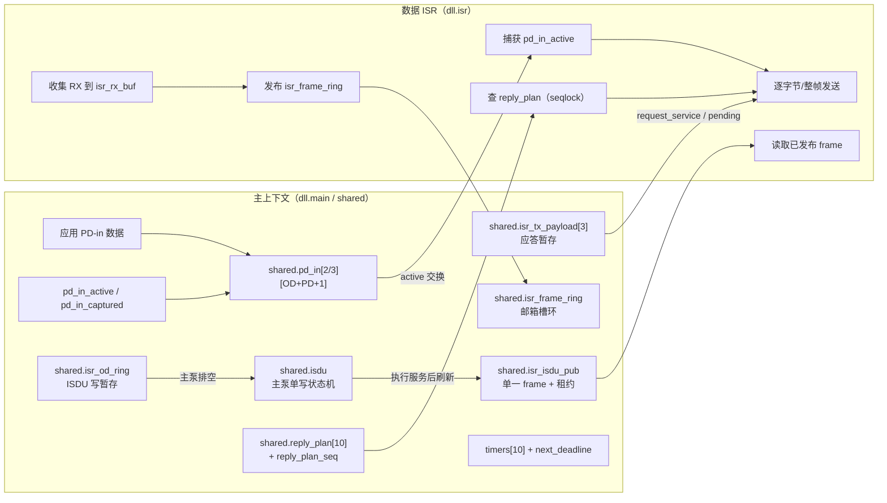

实际的缓冲关系：

- `pd_in[IOLINK_PD_IN_BUFFERS][IOLINK_PD_REPLY_MAX]`：布局为 `[OD...][PD-in...][CKS]`，主循环填一个既不是 `pd_in_active` 也不是 `pd_in_captured` 的缓冲区，再原子发布 `pd_in_active`；ISR 在应答开始时捕获，零拷贝发送。`device_pd_in_free_index()` 负责选空闲缓冲：TX BYTE 下 ISR 在帧末释放租约，2 个缓冲即可；TX FRAME 下 DMA 完成时机对库不可见，租约保持到下次捕获（有 `tx_busy()` 时由主泵提前释放），因此保留 3 个。没有空闲缓冲时主循环保留当前 PD-in，下个周期重试并计入 `pd_in_skips`。
- `pd_out[IOLINK_PD_OUT_MAX_SIZE]`：Type-1/2 帧处理时从 `frame_buf` 复制最新 PD-out；应用通过 `iolink_device_pd_output_read()` 读取。
- `isr_tx_payload[3]`：应答暂存槽。主上下文在槽 0/1 之间交替（单写者，无 RMW）；槽 2（`IOLINK_TX_ISR_SLOT`）专供 ISR 自己的即时应答，两个上下文不共享槽计数。
- `isr_frame_slot[2]` + `isr_frame_ring`：帧邮箱是 SPSC 槽环（`include/iolinki/ring.h`）。ISR 把长度、eager 标志和帧字节一起写入一个槽后发布 `in`；主循环 `peek` → 复制 → `release`。环满时丢帧并计 `isr_mailbox_drops`，但主循环忙时不会连带丢弃下一帧，也不需要临界区。
- `isr_isdu_pub`（发布字）：主泵把 `{len, busy, sel, gen}` 打包成一个原子字发布；ISR 在 START 时整体采纳并自己维护 FlowCTRL 段索引。成帧应答只有**一份** `frame` 缓冲，`resp_store[0/1]` 只是两个视图槽；租约（先发布 `{len=0,busy=1}`）保证 ISR 不会读到半重建的应答，代数位保证长度/槽位相同的新应答仍会打断旧段序列。
- `isr_od_slot[2]` + `isr_od_ring`：ISDU 写段同样走槽环；第三个未排空的段才会被丢弃并计 `isr_od_overruns`。
- `reply_plan[IOLINK_REPLY_PLAN_SLOTS]` + `reply_plan_seq`：主泵按 `{DLL 状态, M-sequence 类型, OD 宽度, 波特率}` 键编译计划，键不变时直接返回；发布是单写者 seqlock（奇数覆盖、偶数稳定），ISR 在拷贝命中项前后各读一次发布字。
- `timers[IOLINK_TIMER_COUNT]` + `next_deadline`：截止时间表，见第 11 节；64 位截止时间只由主上下文写。
- `workspace`（可选）：`iolink_isdu_scratch_t` 的 request / payload / response / frame 四个缓冲 + `ds_stage`。绑定后上下文只保留指针；`IOLINK_WORKSPACE_EMBEDDED=0` 时没有内嵌 fallback，调用方必须提供。
- `iolink_conditions_t`：诊断来源的 RAM 缓存（`isr_pulse[]`、`quiet_since_ms[]`、`edges[]`）；条件本身仍由 `events.pending[]` 的 `present` / `reported` 唯一决定。
- `last_notified_state`：主上下文记录“已交付给应用的状态”，配合 `shared.state` 做电平式通知；`startup_notification_pending` 保留 ISR 触发的 STARTUP 边沿，避免快速进入 PREOPERATE 时丢失复位通知。

并发边界：

- `shared.isdu`、`shared.events`（含 `diag` 条件缓存）、`params`、`ds`、`reply_plan`、`timers` 的主要状态由主循环修改。
- 大块数据（帧邮箱、ISDU 写段、ISDU 响应、应答暂存、PD-in）全部走“单写者 + 发布字/槽环 + 显式租约”，不需要关中断；`IOLINK_CRITICAL_ENTER/EXIT()` 只包住标量与条件表的短操作（事件队列、诊断条件表、PD-in 索引发布、`set_pd_length`、计数器清零、日志 sink），以及仅在直发回退（PHY 无 `request_service()` 且非 `IOLINK_CAP_REQUIRE_ISR_TX`）里驱动 PHY 的那一段；状态迁移不再需要临界区。
- 库不取线程锁：API 只有一个主上下文调用者；共享标量由平台临界区保护，数据交接无锁。
- 平台默认临界区是 weak 空实现（`src/platform.c`）；`iolink_device_init()` 通过
  `iolink_platform_critical_sections_ready()` 探测并返回
  `IOLINK_DEVICE_INIT_ERR_CRITICAL`，因此本路径必须提供真实实现。

### 12.1 主上下文 / ISR 上下文契约

`src/dll_isr.c` 的 ISR 分区只允许调用下表中的 ISR-only 或“双上下文安全”函数：

| 函数 | 上下文 | 说明 |
| :--- | :--- | :--- |
| `iolink_dll_process_isr()` | ISR-only | 数据中断入口 |
| `iolink_dll_on_rx_timeout()` | ISR-only | Timer A 超时入口 |
| `iolink_dll_on_stack_tick()` | ISR-only | Timer B tick 入口 |
| `dll_isr_*()`（`dll_isr_start_staged_tx()` 除外） | ISR-only | 重入状态、RX 组装/校验、`dll_isr_plan_lookup()` / `dll_isr_plan_source()` / `dll_isr_plan_action()` / `dll_isr_plan_execute()`、ISDU 快照读与写暂存、邮箱发布 |
| `dll_isr_start_staged_tx()` | 双上下文 | 主路径由 `dll_send()` 在直发回退时调用；ISR 路径由 `dll_isr_tx_pending()` 调用 |
| `dll_set_state()` | 双上下文 | ISR 内不 flush 回调；迁入 STARTUP 时仍会调用 `iolink_events_reset()`（含临界区与 memset） |
| `dll_mark_master_activity()` | 双上下文 | ISR 在帧结束时刷新活动时间戳并推进 Back-to-box 计数 |
| `dll_pd_status_flags()`、`dll_apply_master_command()`、`dll_type_allowed()` | 双上下文 | 只读 ctx 或状态迁移 |
| `iolink_diag_pulse_isr()` | ISR-only | 写 `isr_pulse[]` 单字节 one-shot |
| `dll_process_complete_frame()`、`dll_consume_isr_mailbox()`、`dll_frame_validate()`、`dll_timers_dispatch()`、`dll_timer_expire_*()`、`dll_check_*()` | 主上下文 | 主泵调度与定时监督 |
| `iolink_diag_service()`、`iolink_diag_set_level()`、`iolink_diag_device_status()`、`iolink_diag_dds_snapshot()` | 主上下文 | 条件表与派生视图只在主上下文读写 |
| `dll_send()` | 主上下文 | 主泵暂存应答，ISR 负责发送 |

ISR 还允许调用以下只读/时序 helper：`iolink_dll_expected_req_len()`、`iolink_checksum6_from_acc()`、`iolink_isdu_direct_param_page1_octet()`、已绑定的时间源（`iolink_device_config_t::time_us` 回调）、`iolink_events_flag()`、`iolink_events_memory_read()`、`iolink_ring_claim/publish`。

禁止在 ISR 分区调用：`iolink_isdu_process()`、事件写路径（`iolink_event_trigger()`、`iolink_events_process()`、`iolink_event_clear()`）、诊断服务/派生（`iolink_diag_service()` 等）、`iolink_dll_flush_state_callbacks()`、应用回调（`state_cb`、`vendor_service`、`od.read/write` 等）。

例外：`dll_set_state(STARTUP)` 会在 ISR 内调用 `iolink_events_reset()`。该函数自带临界区，是当前 ISR 路径唯一的事件写操作；修改事件层时不要移除其重入保护。

### 12.2 异步原语分级与最小依赖

并发原语的契约集中在 `include/iolinki/port.h`，由编译期档位
`IOLINK_CONCURRENCY` 推导出 `IOLINK_NEED_FENCE` / `IOLINK_NEED_CRITICAL`：

| 档位 | 场景 | 需要的能力 |
| :--- | :--- | :--- |
| `SINGLE` | host 仿真、协作式循环 | 无（屏障与临界区塌缩为空） |
| `ISR`（默认） | 数据 ISR 抢占主循环（双泵） | 原子宽度 ≥32 位 + `COMPILER` 屏障 + 临界区 |
| `SMP` | 泵与主循环在不同核 | 原子宽度 + `SMP` 屏障 + 临界区 |

三个档位都假设**一个主上下文调用者**；档位只描述数据 ISR 与它的关系，不描述多任务。

`src/` 只调用三个入口：`IOLINK_FENCE()`、`iolink_atomic_load/store()`、
`IOLINK_CRITICAL_ENTER/EXIT()`。档位不需要临界区时宏展开为空，库因此
**不引用** `iolink_critical_*` 符号（`tools/build_matrix.sh` 用 `nm -u`
对 `SINGLE` 档做机械校验）。

屏障等级 `IOLINK_FENCE_LEVEL` 由 port 声明（它描述硬件事实，不能推导）：
`COMPILER`（单核、无其他总线主设备）/ `DEVICE`（DMA 并发读发布缓冲区，
port 提供 `IOLINK_FENCE_DEVICE_IMPL()`）/ `SMP`（跨核或跨线程，port 提供
`IOLINK_FENCE_SMP_IMPL()`）。错配在编译期 `#error`。

共享对象的**所有权**（审查与后续无锁化改造的基准）：

| 对象 | 写者（可写所有权） | 读者 | 移交机制 | 租约/回收 |
| :--- | :--- | :--- | :--- | :--- |
| `isr_frame_slot[]` + `isr_frame_ring` | ISR | 主上下文 | 槽环 `in`/`out`（各单写者） | 主上下文 `release` 后归还 |
| `isr_tx_payload[0..1]` + `isr_tx_pending` | 主上下文 | ISR | 槽索引 + `request_service()` | ISR 取走后清 pending |
| `isr_tx_payload[2]`（`IOLINK_TX_ISR_SLOT`） | ISR | ISR | 固定槽 | 帧末 `tx_done` |
| `pd_in[]` + `pd_in_active` + `pd_in_captured` | 主上下文 | ISR | 索引发布 | `pd_in_captured`；TX BYTE 帧末释放，TX FRAME 保持到下次捕获或 `tx_busy()` 变空闲 |
| `isdu.resp_frame`（单一 `frame`）+ `isr_isdu_pub` | 主上下文（引擎） | ISR | 原子发布字 `{len,busy,sel,gen}` | 重建前发布 `{len=0,busy=1}` 租约；ISR 在 START 采纳新字 |
| `isr_isdu_invalidated` | ISR 置 1 / 主泵清 0 | 主泵 | 一次性握手 | 主泵在写段排空并发布新视图后清 0 |
| `shared.reply_plan[]` + `reply_plan_seq` | 主上下文 | ISR | seqlock（奇数覆盖、偶数稳定） | ISR 只拷贝命中项，不修改 |
| `timers[]` + `next_deadline` | 主上下文 | 主上下文 | — | ISR 只置一次性请求标志 |
| `isr_od_slot[]` + `isr_od_ring` | ISR | 主上下文 | 槽环 | 主上下文排空并 `release` |
| `shared.state` + `last_notified_state` + `startup_notification_pending` | 主上下文 + ISR（单字节写） | 主上下文 | 电平比较 + STARTUP 边沿标志 | 每次 flush 记录已交付状态；ISR 触发 STARTUP 时优先通知 |
| `iolink_conditions_t` | 主上下文（`isr_pulse[]` 由 ISR 单字节写） | 主上下文 | one-shot 字节 | `iolink_diag_service()` 在临界区消费 |
| 计数器 | 两个上下文 | 读侧 | — | `SHARED` 共享自增（可能丢一次更新）；`SPLIT` 分上下文求和 |

剩余临界区审计（每处都必须能归类，否则应在所有权表里补一行）：

| 位置 | 内容 | 归类 |
| :--- | :--- | :--- |
| `dll_send()`（`dll.c`） | `isr_tx_payload` 暂存（≤`IOLINK_M_SEQ_MAX_LEN`） | 主→ISR 应答移交；暂存本身无锁（主上下文单写者 + 发布字 `isr_tx_pending`），只有直发回退（PHY 无 `request_service()`，非 `IOLINK_CAP_REQUIRE_ISR_TX`）在临界区内驱动 PHY |
| `dll_isdu_sync_snapshot()`（`dll.c`） | 清除 `isr_isdu_invalidated` | 与 ISR 置位握手分离，避免清掉尚未入环的失效请求 |
| `dll_process_body()`（`dll.c`，TX FRAME） | 轮询 `tx_busy` 并释放 `pd_in_captured` | 防止 ISR 在轮询与释放之间捕获新缓冲 |
| `iolink_dll_set_pd_length()`（`dll.c`） | PD-in/PD-out 长度对 | 2 字节 RMW |
| `iolink_dll_reset_error_counters()`（`dll.c`） | 清零两个上下文共享的计数器 | 与 ISR 自增分开 |
| `diag.c`（4 处） | 来源标记、ISR 脉冲消费、DeviceStatus 快照、DDS 快照 | 条件表内部不变式；ISR 只写 `isr_pulse[]` |
| `device.c`（3 处） | `set_log` sink 更新、`on_pd_input` 发布、轮询发布，交换 `pd_in_active`/`pd_in_len`/`pd_valid` | 索引/长度标量（PD 拷贝在锁外；PD-out 读取不取锁） |
| `events.c`（10 处） | 事件队列、pending 表、事件内存 | 事件引擎内部不变式；ISR 侧只读 flag/memory |

`dll_set_state()` 已不在表中：状态是单字节原子写，通知以电平式为主；但
ISR 迁入 STARTUP 时设置 `startup_notification_pending`，由主上下文优先投递
STARTUP。迁入 STARTUP 时的 `iolink_events_reset()` 自带嵌套临界区。`isdu.c`
当前没有任何临界区：它的快照/派生视图已经移交 `diag.c`，且 ISDU 状态只由主泵写。

计数器在 `IOLINK_STATS_MODE=SHARED`（默认）下由两个上下文写同一组字段，
可能丢一次更新（仅影响诊断）；`SPLIT` 为 ISR 增加一组独立计数
（`isr_stat`），`iolink_dll_get_stats()` 求和，因此不再丢更新。两种模式下
计数器都不需要临界区。

状态通知以**电平式**为基础：`dll_set_state()` 只写 `shared.state`，不在 ISR
执行回调；`iolink_dll_flush_state_callbacks()` 比较 `shared.state` 与
`last_notified_state`，有变化才调用一次 `state_cb`。主上下文迁移立即投递。
ISR 迁移通常在下一次 flush 投递并合并为最终状态，但 OPERATE → STARTUP
会设置 `startup_notification_pending`，因此 STARTUP 这一规范要求的复位状态
不会被紧随其后的 PREOPERATE 覆盖。应用回调仍只在主上下文执行。

---

## 13. 编译期分流与集成注意

| 开关 | 影响 |
| :--- | :--- |
| `IOLINK_ISR_RX_MODE` | `RX BYTE`（`phy->rx_octet`，库成帧）或 `RX FRAME`（`phy->rx_frame`，PHY 交付整帧） |
| `IOLINK_ISR_TX_MODE` | `TX BYTE`（`tx_octet` + `tx_done`）或 `TX FRAME`（`tx_frame`）；决定 `IOLINK_PD_IN_BUFFERS`（2/3） |
| `IOLINK_CONCURRENCY` | `SINGLE`/`ISR`/`SMP`；决定 `IOLINK_NEED_*` 与是否需要临界区 |
| `IOLINK_FENCE_LEVEL` | `COMPILER`/`DEVICE`/`SMP`；port 声明的屏障等级，错配编译期报错 |
| `IOLINK_STATS_MODE` | `SHARED`（默认，共享计数）/`SPLIT`（分上下文计数，读取时求和） |
| `IOLINK_WORKSPACE_EMBEDDED` | 1=上下文内嵌 ISDU/DS scratch；0=只留指针，必须提供 `iolink_workspace_t` |
| `IOLINK_PHY_FEATURE_ISR_TX_ONLY` | 只提供 `IOLINK_STACK_FLAG_REQUIRE_ISR_TX` 的构建默认值；运行时判定点是 `IOLINK_CAP_REQUIRE_ISR_TX` |
| `IOLINK_PHY_FEATURE_TX_BUSY` | TX FRAME 下是否要求 `tx_busy()`（否则 PD-in 租约保持到下次捕获） |
| `IOLINK_FEATURE_DATA_STORAGE` | 是否编译 DS 引擎与 ISDU 0x0003 |
| `IOLINK_FEATURE_SYSTEM_COMMAND` | 是否编译 SystemCommand 处理 |
| `IOLINK_FEATURE_EVENTS` | 是否编译事件引擎、诊断注册表、DDS、CKS 事件标志与故障轮询 |
| `IOLINK_PD_IN_MAX_SIZE` / `IOLINK_PD_OUT_MAX_SIZE` / `IOLINK_OD_MAX_SIZE` | PD/OD 缓冲上限（运行时长度不得超过） |
| `IOLINK_ISDU_BUFFER_SIZE` | 单次 ISDU 事务上限，同时决定 `iolink_isdu_scratch_t` 各缓冲容量 |
| `IOLINK_DS_IMAGE_MAX` | DS 镜像上限，同时决定 storage 中 DS 分区与 workspace 的 `ds_stage` |
| `IOLINK_EVENT_QUEUE_SIZE` / `IOLINK_EVENT_PENDING_MAX` | 事件队列深度 / 同时活动的条件数；DDS 快照容量取 `IOLINK_EVENT_PENDING_MAX`（编译期上限 64） |
| `IOLINK_EVENT_MIN_APPEAR_MS` / `IOLINK_EVENT_MIN_REPEAT_MS` | A.6.4 两个窗口的构建默认值（可被 `stack.event_min_*_ms` 覆盖） |
| `IOLINK_DIAG_PULSE_HOLD_MS` | PULSE 诊断源的保持窗口 |
| `IOLINK_TIMING_ENFORCE_DEFAULT` | `iolink_build_caps_t::timing_enforce_default` 的初值 |

运行期能力位（没有对应的编译期开关）：

| 能力位 | 解析来源 |
| :--- | :--- |
| `IOLINK_CAP_WAKEUP` | `detect_wakeup` 是否为 NULL |
| `IOLINK_CAP_SIO_CQ` | `set_cq_line` 是否为 NULL |
| `IOLINK_CAP_PD_IN_CALLBACK` | `on_pd_input` 是否为 NULL（两条 PD-in 路径共存） |
| `IOLINK_CAP_COMPAT_*` | `iolink_stack_config_t::compat_flags` |

最小镜像直接关闭 `IOLINK_FEATURE_DATA_STORAGE` 与 `IOLINK_FEATURE_EVENTS`。

集成注意（按当前代码实际调用点）：

- 1 s idle 监督是截止时间表的 `IOLINK_TIMER_IDLE` 表项（`dll_timer_sync_idle()` / `dll_timer_expire_idle()`），比较阈值固定 1000 ms，不提供编译期开关。
- `iolink_device_config_t::time_us` 是必需项，初始化时绑定到 `shared.time_us` 与事件引擎；NULL 会被 `iolink_device_init()` 拒绝。主循环、ISR、事件与诊断窗口都用它；直接使用 `iolink_dll_*` 时需自行绑定 `ctx->shared.time_us`。
- `phy->set_cq_line` 当前没有栈内调用点（PHY 自己管理 SIO 线状态）。
- `iolink_events_process()`、`iolink_ds_process()` 由 `iolink_device_process()` 在 ISDU 空闲时自动调度；`iolink_ds_check()` 需要应用自行调度（master 校验和来源应用自有）。
- 本路径要求 `iolink_critical_enter/exit` 真实可用（初始化会校验），且 `ctx` 的主循环调用与 ISR 调用遵守文档约束。`IOLINK_CONCURRENCY=SINGLE` 档不需要临界区，初始化跳过校验且库不引用该符号；其余档位仍会校验。
- 当 `phy->stack_timer_start != NULL` 时，PHY 必须在 Timer B 到期时调用 `iolink_dll_on_stack_tick()`，否则 `iolink_device_process()` 会被授权门控挡住；Timer A 超时则应调用 `iolink_dll_on_rx_timeout()`。
- `TYPE_1_1` 在本路径初始化时被拒绝；固定 Annex A 类型必须使用匹配的 PD/OD 布局。
- `IOLINK_PHY_FEATURE_TX_BUSY=1` 的 TX FRAME 构建在初始化时要求 PHY 提供 `tx_busy()`，否则返回 `IOLINK_DEVICE_INIT_ERR_PHY`。
- `dll.c` 只包含 `dll_main.h`，看不到 ISR 独占字段；新增跨上下文访问必须走 `shared` 或既有 API，否则 `tools/check_ownership.sh` 失败。

---

## 14. 关键代码索引

| 主题 | 入口 |
| :--- | :--- |
| 设备初始化/主循环 | `iolink_device_init()`、`iolink_device_process()` |
| 应用状态回调 | `device_state_cb()` |
| PD 更新/读取 | `device_run_app_callbacks()`、`iolink_device_pd_input_update()`、`iolink_device_pd_output_read()` |
| DLL 初始化/主处理 | `iolink_dll_init()`、`iolink_dll_process()` |
| 应答计划 | `iolink_dll_publish_reply_plans()`、`dll_isr_plan_lookup()`、`dll_isr_plan_execute()` |
| 状态迁移 | `dll_set_state()`、`DLL_SM_ROWS`、`iolink_dll_sm_cell()` |
| 完整帧校验/分流 | `dll_process_complete_frame()`、`dll_frame_validate()`、`dll_sm_classify()` |
| 通道分发 | `dll_dispatch_od()` |
| Type-0 / Type-1/2 应答 | `dll_handle_operate_type0()`、`dll_handle_type0_od_write()`、`dll_handle_operate_type1_2()`、`dll_send_od_reply()` |
| MasterCommand/Fallback | `dll_handle_master_command()`、`dll_handle_fallback_command()`、`dll_apply_master_command()` |
| 截止时间表 | `iolink_timer_id_t`、`iolink_dll_timer_contract()`、`dll_timers_dispatch()` |
| ISR 泵 | `iolink_dll_process_isr()`、`dll_isr_drain()` |
| ISR ISDU 快照读 | `dll_isr_isdu_od()` |
| ISR ISDU 写暂存/排空 | `dll_isr_consume_isdu_write()`、`dll_drain_staged_isdu_write()` |
| ISDU 传输写/读 | `iolink_isdu_od_write()`、`iolink_isdu_od_read()` |
| ISDU 执行/组帧 | `iolink_isdu_process()`、`isdu_execute_request()`、`isdu_decode_service()`、`isdu_frame_response()` |
| ISDU 索引分发 | `handle_standard_commands()`、`isdu_serve_entry()` |
| 对象字典 | `iolink_od_find()`、`iolink_od_find_app()`、`iolink_od_read_value()`、`iolink_od_write_value()` |
| SystemCommand | `handle_system_command()`、`iolink_isdu_execute_system_command()` |
| Data Storage 服务 | `handle_data_storage()`、`iolink_ds_serialize()`、`iolink_ds_apply_image()` |
| 参数持久化 | `iolink_params_ctx_write()`、`params_ctx_load()` |
| 事件 | `iolink_event_trigger()`、`iolink_events_process()`、`iolink_events_reset()` |
| 诊断派生视图 | `iolink_diag_set_level()`、`iolink_diag_service()`、`iolink_diag_device_status()`、`iolink_diag_dds_snapshot()` |
| 能力位 | `iolink_caps_resolve()`、`iolink_caps_has()`、`iolink_device_set_capabilities()` |
| 工作区绑定 | `iolink_isdu_bind_workspace()`、`iolink_ds_bind_workspace()` |
| 校验 | `iolink_checksum6()` |
| 存储布局 | `include/iolinki/storage.h` |
| 编译期开关 | `include/iolinki/config.h` |
