# iolinki 代码流程、分层与通信周期说明

本文按**当前仓库代码**整理 `iolinki` IO-Link Device 协议栈的执行流程，重点说明：

- 代码分层、层间依赖与上下文所有权；
- ISR 双泵传输模型：数据中断 + 主循环；
- 一帧数据从 PHY 到 DLL、再到 ISDU/事件/参数/Data Storage 的分流；
- 各类型 Process Data、On-request Data、诊断数据的处理路径；
- 回调/接口在通信周期中的调用顺序；
- DLL 通信状态机与源码的对应关系；
- 关键缓冲区、并发边界与定时器。

> 本文描述 ISR 双泵路径；这是当前唯一的 transport，不再有编译期开关。
> 事实来源：`include/iolinki/*.h`、`src/*.c` 以及 `docs/IOL-Interface-Spec_10002_V1.1.5_Oct2025/`。
> 如果代码与规范冲突，以规范 PDF 为准；本文只描述代码当前实际行为。

## 目录

1. [先看结论](#1-先看结论)
2. [代码分层与文件职责](#2-代码分层与文件职责)
3. [上下文拓扑与所有权](#3-上下文拓扑与所有权)
4. [初始化流程](#4-初始化流程)
5. [ISR 双泵模型与主循环](#5-isr-双泵模型与主循环)
6. [单帧接收、校验与分流](#6-单帧接收校验与分流)
7. [ISDU 数据流](#7-isdu-数据流)
8. [Data Storage、参数与事件](#8-data-storage参数与事件)
9. [回调与接口在通信周期中的调用逻辑](#9-回调与接口在通信周期中的调用逻辑)
10. [通信状态机与代码对应](#10-通信状态机与代码对应)
11. [定时与错误路径](#11-定时与错误路径)
12. [缓冲区、并发与数据流](#12-缓冲区并发与数据流)
13. [编译期分流与集成注意](#13-编译期分流与集成注意)
14. [关键代码索引](#14-关键代码索引)

---

## 1. 先看结论

1. 目标构建使用**双泵传输**：数据中断里的 `iolink_dll_process_isr()` 负责收帧、校验、暂存 ISDU 写、直接由共享状态组帧并发送 cyclic 应答；主循环里的 `iolink_dll_process()` 负责协议逻辑（ISDU 执行、事件、诊断、主状态机）。
2. `iolink_device_process()` 是主循环唯一需要周期调用的入口；PHY 数据中断还要调用 `iolink_device_process_isr()`。主循环负责 DLL 协议处理，并把 ISR 延迟的状态回调、master-lost 边沿、reset 请求、PD 回调分发给应用。
3. 数据按 **MC 通信通道**分流：Process、Page、Diagnosis、ISDU；按 **CKT M-sequence 类型**决定 Type-0 还是 Type-1/2 的帧长与应答布局。
4. ISDU 写请求和读应答是分离的：写请求先进入 ISDU 传输状态机，`iolink_isdu_process()` 在后续主循环执行应用服务，读请求从响应缓冲区或 ISR 快照读取。
5. Event 的 “appears” 会立即入队并冻结事件内存、置 CKS bit7；“disappears” 需要应用周期性调用 `iolink_events_process()` 才会发出。
6. `master_lost` 只是应用提示，**不改变 DLL 状态和波特率**；真正回到 SIO/STARTUP 的是 T_DSIO、T_FBD、DeviceStartup 等路径。

---

## 2. 代码分层与文件职责

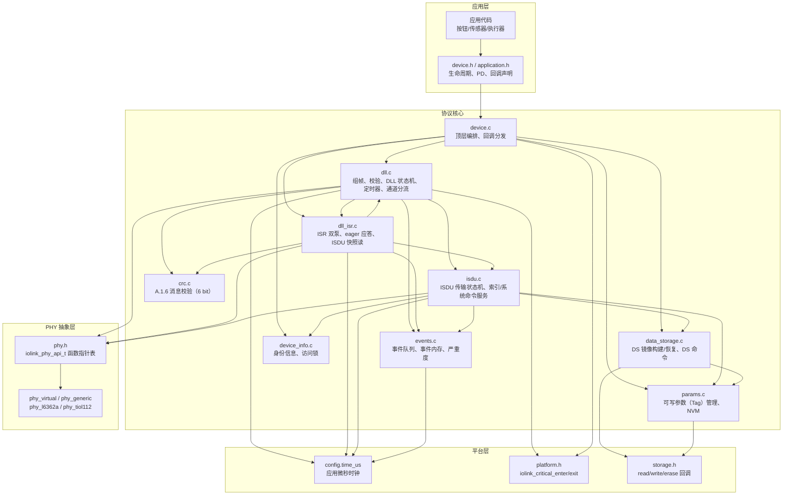

| 文件 | 职责 | 是否在设备运行数据路径 |
| :--- | :--- | :--- |
| `src/device.c` | `iolink_device_init/process`、PD API、应用回调、reset、DS 参数访问适配 | 是 |
| `src/dll.c` | M-sequence 组帧/校验、DLL 状态机、定时器、PHY 模式/波特率、通道分流 | 是 |
| `src/dll_isr.c` | ISR 双泵：收帧、校验、eager 应答、ISDU 快照读、暂存 TX | 是（中断上下文） |
| `src/isdu.c` | ISDU 请求收集、索引解析、标准索引/系统命令/DS 服务、响应组帧 | 是 |
| `src/data_storage.c` | DS 参数集序列化/恢复、DS 状态、DS_Command | 是（启用 DS 时） |
| `src/params.c` | 三个可写 Tag 的 RAM/NVM 读写、出厂复位 | 是 |
| `src/device_info.c` | VendorID/DeviceID/字符串身份、Access Locks | 是 |
| `src/events.c` | 事件队列、appears/disappears、Table 58 事件内存、DeviceStatus | 是（启用事件时） |
| `src/crc.c` | A.1.6 XOR + 8→6 bit 压缩校验 | 是 |
| `src/phy_*.c` | PHY 驱动/模拟 | 是（通过 vtable） |

---

## 3. 上下文拓扑与所有权

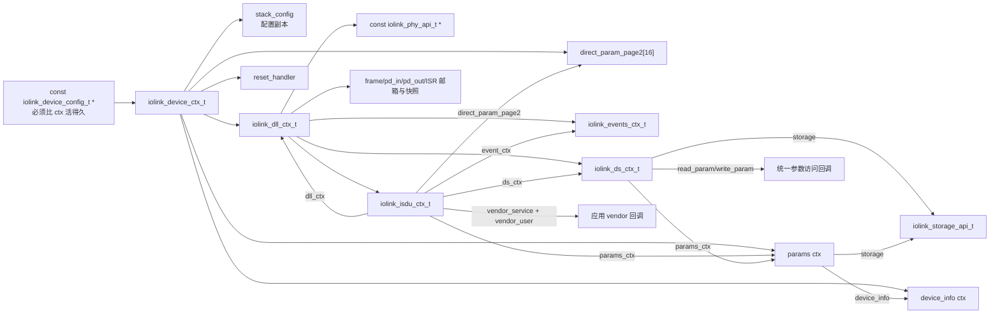

关键绑定发生在 `iolink_device_init()`：

- `dll.isdu.params_ctx = &ctx->params`、`dll.isdu.ds_ctx = &ctx->dll.ds`、`dll.isdu.dll_ctx = &ctx->dll`；
- `dll.isdu.direct_param_page2 = ctx->direct_param_page2`；
- `dll.isdu.vendor_service/vendor_user` 来自 `iolink_device_config_t`；
- `dll.state_cb = device_state_cb`，用于把 DLL 状态变化转成应用回调；
- `params` 与 `ds` 共用同一个 `storage` 后端；`IOLINK_FEATURE_DATA_STORAGE=1`
  时 `storage` 必须非空且具备 `read`/`write`，否则初始化返回
  `IOLINK_DEVICE_INIT_ERR_STORAGE`；
- `ds` 绑定 `device_ds_read/device_ds_write`，实现“标准 Tag 走 params，其余走 vendor_service”。

因此以下对象必须由应用保证生命周期：`iolink_device_config_t`、`device_info`、
`storage`（启用 DS 时）、DS 参数描述数组、PHY 上下文。

---

## 4. 初始化流程

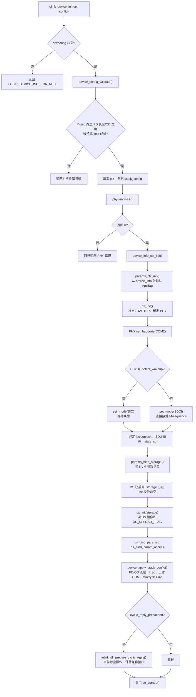

要点：

- 初始化校验在 `device_config_validate()` 完成；本路径还会在 `device_validate_fixed_mseq()` 拒绝 `TYPE_1_1` 和与 Annex A 固定布局不一致的 PD/OD 长度。
- `dll_init()` 默认 COM2；若 `stack.baudrate_set`，`device_apply_stack_config()` 会通过 `iolink_dll_set_operating_baudrate()` 再设置工作 COM。
- `on_startup()` 在 `iolink_device_init()` 末尾显式调用一次；`dll_init()` 内部进入 STARTUP 时因为状态初值已是 0，`dll_set_state()` 不会重复触发。
- `IOLINK_APP_PD_INPUT_CALLBACK=1` 时，PD-in 由 `on_pd_input()` 填充，`iolink_device_pd_input_update()` 返回 `-1`，两者不能混用。

---

## 5. ISR 双泵模型与主循环

> 本章及全文描述 ISR 双泵路径：数据中断负责收帧、校验和确定性应答；主循环负责 ISDU、事件、诊断、参数和状态机。

### 5.1 ISR 侧流程

ISR 侧只做传输和“确定性应答”，不执行 ISDU/参数/事件等应用逻辑。

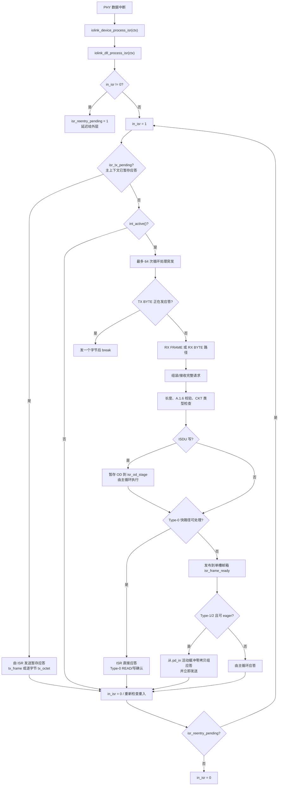

### 5.2 主循环侧流程

主循环消费邮箱并执行协议逻辑：

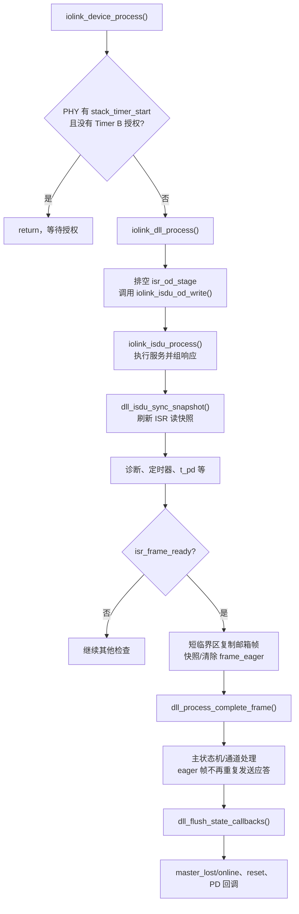

### 5.3 关键约束

- `ctx->isdu` 由主循环单写；ISR 不写 `ctx->isdu`，ISDU 响应只读 `isr_isdu_resp_buf` 快照，并拥有 ISDU 读的 FlowCTRL/segment 索引。Page 通道的 DPP1 读取会在 ISR 中只读 `ctx->isdu`/DLL 状态来构建页面字节。
- ISDU 写由 ISR 暂存到 `isr_od_stage`，主循环排空后调用 `iolink_isdu_od_write()`。
- 邮箱只有**一个槽**：`isr_frame_ready` 未消费时新帧会计入 `isr_mailbox_drops` 并被丢弃。
- `isr_eager_replied` 表示 ISR 已应答该帧；主循环通过 `frame_eager` 避免重复发送，但仍会处理状态/错误/ISDU 读复位等。
- RX FRAME 路径先发布邮箱、再启动 eager 应答，最后复制稳定副本；RX BYTE 路径先启动 eager 应答、再发布邮箱，以减少 t_A 延迟。
- 状态迁移统一进入 `pending_states` 队列；ISR 中的迁移由主循环 `flush` 延迟交付，主循环中的迁移入队后立即 `flush`。深度为 `IOLINK_PENDING_STATES=4`。

---

## 6. 单帧接收、校验与分流

### 6.1 请求长度如何确定

ISR 路径在第二个字节（CKT）到达后，用 `iolink_dll_expected_req_len()` 决定长度：

- Type-0：读 2 字节；Page/Diagnosis/ISDU 写 3 字节；
- Type-1/2：`2 + pd_out_len_current + (写 ? od_width : 0)`；
- transition command：2 字节。

Type-0 的读/写长度由 MC 通道和读写位决定；Type-1/2 的请求长度由配置的 PD-out 宽度与当前 OD 宽度决定，写请求才携带 OD。

### 6.2 完整帧处理

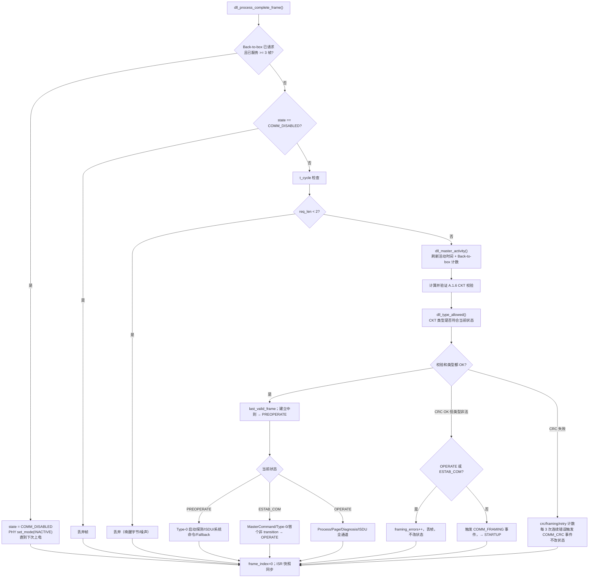

### 6.3 通道分流

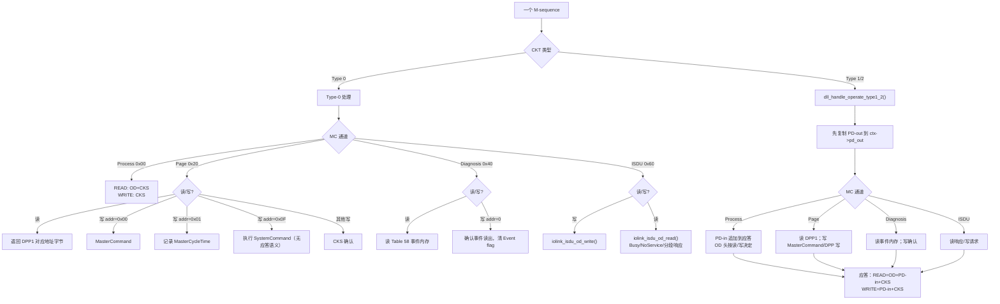

各通道的应答布局（代码路径）：

| 请求 | 应答 | 代码 |
| :--- | :--- | :--- |
| Type-0 READ（任意通道） | `OD + CKS` | `dll_handle_operate_type0()` |
| Type-0 WRITE（任意通道） | `CKS` | 同上 / `dll_handle_type0_od_write()` |
| Type-1/2 READ（Process/Page/Diag/ISDU） | `[OD...][PD-in...]CKS` | `dll_handle_operate_type1_2()` |
| Type-1/2 WRITE（Process/Page/Diag/ISDU） | `[PD-in...]CKS` | 同上 |
| MasterCommand 页写 | `CKS` | `dll_handle_master_command()` |
| FALLBACK MasterCommand | `CKS`，随后 T_FBD 到期回 SIO | `dll_handle_fallback_command()` |

CKS 位含义：

- bit7 = Event flag（`iolink_events_flag()`）；
- bit6 = PD invalid（`!ctx->pd_valid`）；
- bit5..0 = A.1.6 6-bit 校验。

### 6.4 Process Data 流向

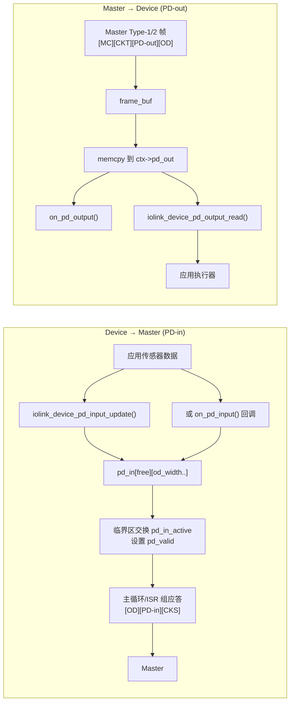

规则：

- `iolink_device_pd_input_update()` 与 `on_pd_input()` 二选一；`IOLINK_APP_PD_INPUT_CALLBACK=1` 时前者直接返回 `-1`。`on_pd_input()` 的返回值直接作为 `pd_valid`，返回 `false` 会置 CKS bit6。
- 固定 Annex A 类型的 PD-in 长度不可变；`TYPE_2_V` 可在 `pd_in_len_max` 内变化。
- PD-out 只在 Type-1/2 请求中携带；Type-0 不携带 PD。
- `pd_valid=false` 会置 CKS bit6，Master 可据此判断 PD 无效。
- 三缓冲 `pd_in[3]` 允许主循环在 ISR 正在发送旧副本时填充新副本，避免撕裂。

### 6.5 ISR 快路径与主路径的分工

| 请求 | ISR 双泵 | 主循环 |
| :--- | :--- | :--- |
| Type-0 启动探测（Page READ） | 迁到 PREOPERATE 并直接返回 DPP1 字节 | 该帧不再入邮箱；状态迁移通过 `pending_states` 回调 |
| Type-0 transition command | PREOPERATE → ESTAB_COM，无应答 | 该帧不再入邮箱 |
| Type-0 Page/Diag/ISDU READ | 直接应答；ISDU READ 从快照取数 | 该帧不再入邮箱；若为 ISDU READ，ISR 已推进读段索引 |
| Type-0 Page WRITE addr0（MasterCommand/Fallback） | 在 ISR 内应用并回 CKS | 该帧不再入邮箱；状态迁移排队 |
| Type-0 Page/Diag WRITE 其他地址 | 不处理，发布邮箱 | 主循环执行 DPP 写/诊断确认；其他 Type-0 写由主循环按当前状态处理 |
| Type-0 ISDU WRITE | 暂存 `isr_od_stage` 并回 CKS | 主循环从 `isr_od_stage` 取写请求，不经过邮箱 |
| Type-1/2 READ | Process/Page/Diag/ISDU 从 `pd_in` 组应答并发送 | eager 帧仍发布到邮箱；主循环不重复发送，但会更新 PD-out、统计和 OD 分发 |
| Type-1/2 WRITE | 暂存 ISDU 写；Process 等直接回复 `[PD-in]CKS` | eager 帧仍发布到邮箱；主循环不重复发送，但会复制 PD-out、执行 ISDU 等 |

---

## 7. ISDU 数据流

### 7.1 传输状态机

实际使用的状态只有 `IDLE`、`HEADER_INITIAL`（瞬态）、`SERVICE_EXECUTE`、`RESPONSE_READY`；头文件里的 `HEADER_*`、`DATA_COLLECT` 等是保留枚举，当前实现不逐字节停在这些状态。

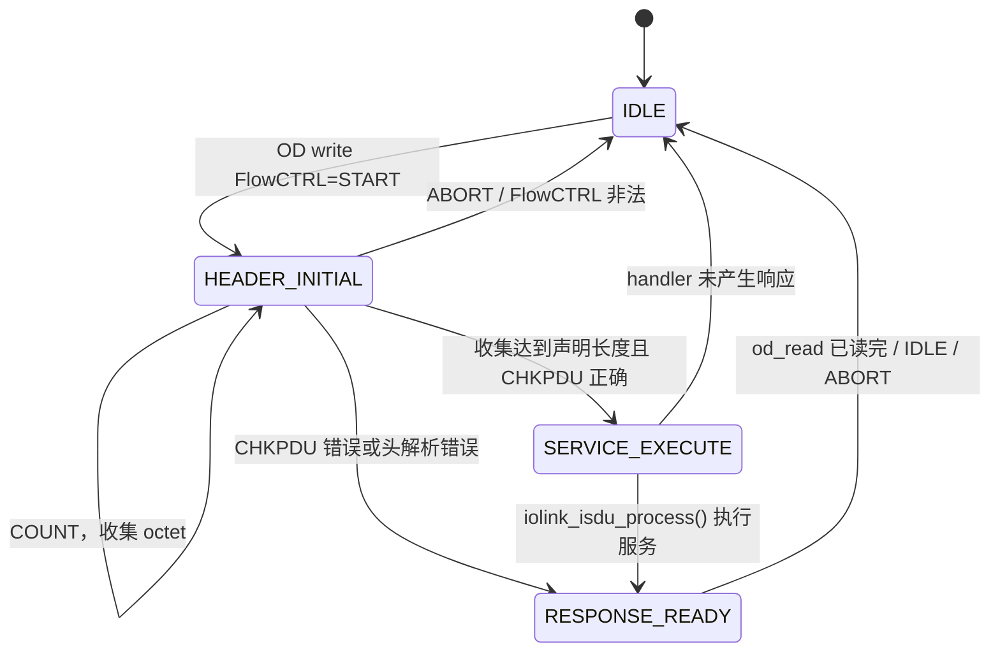

### 7.2 写请求（Master → Device）

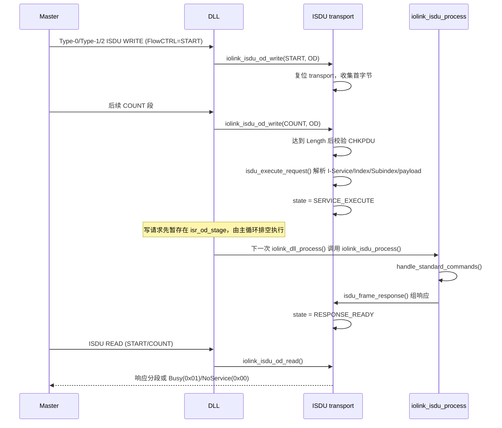

要点：

- ISDU 写请求在 DLL 层的应答**不含 OD**：Type-0 只有 CKS，Type-1/2 为 `[PD-in]CKS`；真正的 ISDU 正/负响应要通过后续 ISDU READ 取回。
- `iolink_isdu_od_write()` 在请求完整时只解析并进入 `SERVICE_EXECUTE`；应用服务由 `iolink_isdu_process()` 在后续主循环执行。
- 多段写：FlowCTRL 重复值表示“重发上一段”，其 payload 忽略；不属于 `START` 后的连续 COUNT 会产生 segmentation error。
- 双泵下 ISR 只做字节收集和 CHKPDU 校验，`ctx->isdu` 的状态机仍由主循环单写。

### 7.3 读请求与响应分段

- `START`：
  - `SERVICE_EXECUTE` → 返回 Busy `0x01`；
  - `RESPONSE_READY` → 从头开始读响应；
  - `IDLE` → No Service `0x00`。
- `COUNT`：继续从 `resp_idx` 顺序读取；若剩余不足 `od_len`，补 `0x00`。
- 读完后 `RESPONSE_READY → IDLE`。
- ISR 双泵另有一套快照分段逻辑 `dll_isr_isdu_od()`，使用 `isr_isdu_resp_buf`、`isr_isdu_idx`、`isr_isdu_seg_idx`、`isr_isdu_last_flowctrl`，不直接修改主 ISDU 传输状态。

响应组帧（`isdu_frame_response()`）：

| 情况 | 首字节 | 后续 |
| :--- | :--- | :--- |
| 读负响应 | `0xC4` | `0x80` + AdditionalCode + CHKPDU |
| 写负响应 | `0x44` | `0x80` + AdditionalCode + CHKPDU |
| 写正响应 | `0x52` | CHKPDU |
| 读正响应，总长 ≤ 15 | `0xD0 \| total` | data + CHKPDU |
| 读正响应，总长 > 15 | `0xD1` | ExtLength(total) + data + CHKPDU |

### 7.4 索引分发树

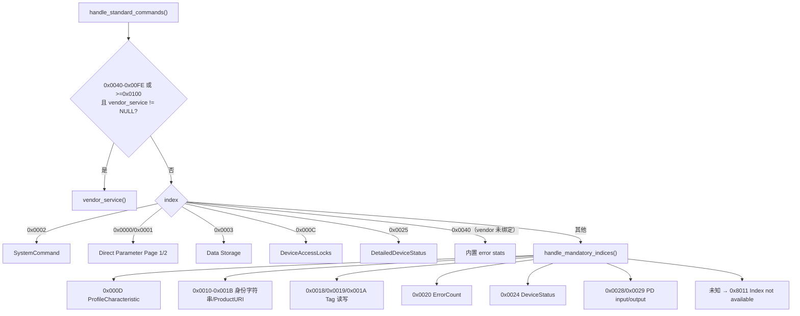

注意：`0x0040` 同时是“设备特定起始索引”和内置 error-stats 索引。代码先判断 `device_specific && vendor_service != NULL`，所以**绑定 vendor_service 时 0x0040 会走 vendor 回调**，内置 `handle_error_stats()` 只在 vendor_service 为 NULL 时可达。

### 7.5 SystemCommand 映射

`handle_system_command()` 处理：

| 命令 | 行为 |
| :--- | :--- |
| `0x80` Device Reset | `isdu.reset_pending = true`，由 `iolink_device_process()` 调用 reset handler |
| `0x81` Application Reset | `app_reset_pending = true`，并触发 DS_UPLOAD_REQ |
| `0x82` Restore Factory Settings | `params_ctx_factory_reset()` + DS_UPLOAD_REQ |
| `0x83` Back-to-box | 恢复出厂值 + `iolink_dll_request_back_to_box()`，3 个 MasterCycle 后停止通信 |
| `0x01/0x02` ParamUploadStart/End | DS 上传 |
| `0x03/0x04` ParamDownloadStart/End | DS 下载；下载期间 Tag 写入先暂存，End 时原子应用 |
| `0x05` ParamDownloadStore | 映射为 DownloadEnd，并触发 DS_UPLOAD_REQ |
| `0x06` ParamBreak | 中止 DS |
| `0x84-0x9F` | 保留值（含旧 `0x95/0x96`），返回 `0x8035` |
| 其他 | `0x8035` Function not available |

`0x80/0x81` 不会自动重启设备；reset handler 由应用通过 `iolink_device_set_reset_handler()` 注册并决定动作。

---

## 8. Data Storage、参数与事件

### 8.1 参数持久化

参数记录布局（`include/iolinki/storage.h`）：

```text
PARAMS 区域:
  magic(4) | version(2) | reserved(2) |
  application_tag[33] | function_tag[33] | location_tag[33] |
  fletcher32_checksum(4)

DS 区域:
  magic(4) | version(2) | length(2) | fletcher32(4) | image[IOLINK_DS_IMAGE_MAX]

FLAG 区域:
  DS_UPLOAD_FLAG(1)
```

关键流程：

- `params_bind_storage()` → `params_ctx_load()`：magic/version/checksum 任一失败则忽略 NVM，保留 RAM 默认值。
- `iolink_params_ctx_set()`：先改候选副本，按 `persist` 写 NVM，成功后才提交 RAM 并同步 AppTag 到 device_info；NVM 失败不会留下“已接受”的 RAM 状态。
- `iolink_params_ctx_factory_reset()`：清空三个 Tag，写 NVM，并清 device_info 的 AppTag。

### 8.2 Data Storage 镜像

记录格式（`iolink_ds_calc_checksum()`）：

```text
[Index(2, big-endian)][Subindex(1)][Length(1)][Data(Length)] ...
```

- `iolink_ds_build_image()`：遍历 DS 参数描述数组，通过统一访问器读取参数，生成镜像并计算 Fletcher-32。
- `iolink_ds_apply_image()`：先完整校验记录结构，再逐条应用；未知索引跳过，已知参数被拒绝则返回 `-2`；最后重新 build 镜像，保证镜像与设备真实参数一致。
- 默认 DS 参数集是 `ApplicationTag/FunctionTag/LocationTag`，应用可用 `iolink_ds_bind_param_access()` / `iolink_ds_set_param_desc()` 扩展。

DS 状态机（`iolink_ds_check()`）：

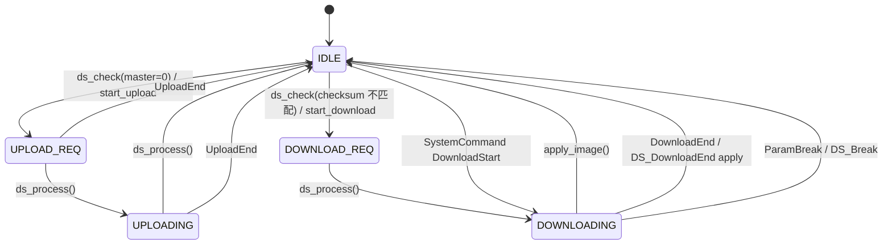

注意：`iolink_ds_process()` / `iolink_ds_check()` **不会**被 `iolink_device_process()` 自动调用。当前核心只在 SystemCommand/DS_Command 路径里直接驱动 DS；如果应用使用 `ds_check()` 的“校验和比较 → 自动上传/下载请求”流程，需要自己在主循环调用 `iolink_ds_process()`。另外 `IOLINK_DS_STATE_LOCKED` 目前没有赋值点，DS 访问锁是在命令处理入口直接返回访问拒绝。

### 8.3 事件流

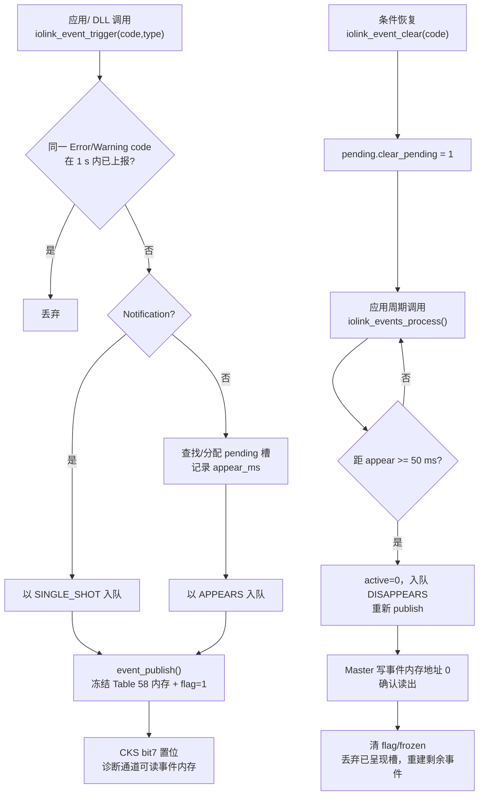

补充：

- 事件队列按严重度排序（Error 优先），队列满时保留更严重的事件。
- `DeviceStatus` 取当前队列最高严重度（`iolink_events_get_highest_severity()`）。
- `DetailedDeviceStatus` 读取的是 `pending[]` 中的 Error/Warning，而不是队列。
- `STARTUP` 状态会调用 `iolink_events_reset()` 丢弃事件（A.6.4）。
- 物理诊断当前只轮询旧接口 `get_voltage_mv()` / `is_short_circuit()`；`phy->get_faults()` 在 `src/` 中没有调用点。

---

## 9. 回调与接口在通信周期中的调用逻辑

### 9.1 初始化阶段

| 顺序 | 调用 | 来源 |
| :--- | :--- | :--- |
| 1 | `phy->init()` | `iolink_device_init()` |
| 2 | `phy->set_baudrate(COM2)` | `iolink_dll_init()` |
| 3 | `phy->set_mode(SIO/SDCI)` | `iolink_dll_init()` 依据 `detect_wakeup` |
| 4 | `storage->read()` | `params_ctx_load()`、`ds_init()` |
| 5 | `phy->set_baudrate(工作 COM)` | `device_apply_stack_config()` 可选 |
| 6 | `on_startup()` | `iolink_device_init()` 末尾 |

### 9.2 一个主循环内的顺序

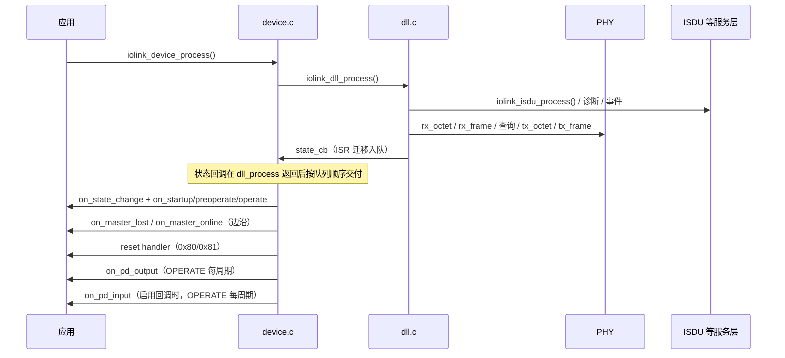

具体顺序（`iolink_device_process()`）：

1. Timer B 授权检查；没有授权直接返回。
2. `iolink_dll_process()`：
   - 处理 ISR 活动时间戳、恢复工作波特率；
   - 排空 `isr_od_stage`，调用 `iolink_isdu_od_write()`；
   - `iolink_isdu_process()`，随后刷新 ISR 快照；
   - `dll_poll_diagnostics()`；
   - master-lost 计算、1 s idle 计数、T_DSIO、T_FBD、t_pd；
   - SIO 唤醒检测；
   - 邮箱处理 → `dll_process_complete_frame()`。
3. `iolink_dll_flush_state_callbacks()`，按队列顺序交付 ISR 期间的状态迁移。
4. master-lost/online 边沿回调：只在 `state == OPERATE` 时比较 `master_lost` 与 `master_lost_last`；离开 OPERATE 时清空旧状态。
5. reset handler：`isdu.reset_pending` / `isdu.app_reset_pending`。
6. OPERATE 下：
   - `on_pd_output(ctx->dll.pd_out, pd_out_len_current)`；
   - 若 `IOLINK_APP_PD_INPUT_CALLBACK`：取一个未被 ISR 捕获的 PD-in 缓冲区，填完后在临界区交换 `pd_in_active`，随后调用 `iolink_dll_prepare_cyclic_reply()`（当前为空操作，ISR 直接读共享状态）。

### 9.3 回调清单与实际调用点

| 接口/回调 | 调用点 | 上下文/说明 |
| :--- | :--- | :--- |
| `phy.init` | `device_init` | 初始化硬件 |
| `phy.set_baudrate` | `dll_init`、`set_baudrate`、`restore_operating_baudrate` | 恢复 COM 时避免在应答中途切换 |
| `phy.set_mode` | `dll_init`、`set_sio_mode`、`set_sdci_mode`、Back-to-box | SIO/SDCI/INACTIVE |
| `phy.rx_octet` / `rx_frame` | ISR | 逐字节或整帧 |
| `phy.tx_octet` / `tx_done` / `tx_frame` | ISR | 发送应答 |
| `phy.request_service` | `dll_send()` 暂存后 | 请求 PHY 触发数据中断 |
| `phy.int_active` | ISR 门控 | 判断收发器是否请求服务 |
| `phy.response_timer_start/stop` | ISR RX/TX | t_A 看门狗 |
| `phy.stack_timer_start` | 帧结束 / Timer B | 授权主循环服务窗口；`stack_timer_stop` 当前无栈内调用点 |
| `phy.detect_wakeup` | `iolink_dll_process()` | SIO 唤醒检测 |
| `phy.get_voltage_mv` / `is_short_circuit` | `dll_poll_diagnostics()` | 旧版诊断，触发电压/短路事件 |
| `config->lock/unlock` | PD 更新/读取、`dll_send()` 暂存 | 与 ISR/其他线程互斥；必须成对 |
| `iolink_critical_enter/exit` | 邮箱、ISDU 快照、状态队列、事件（经 `IOLINK_CRITICAL_ENTER/EXIT()`） | 平台临界区；`IOLINK_CONCURRENCY >= ISR` 时必须真实可用（初始化会拒绝 weak 默认），`SINGLE` 档不引用 |
| `on_state_change` | `device_state_cb()` | 所有实际状态迁移 |
| `on_startup` | 初始化末尾 + 进入 STARTUP | 初始化时显式调用一次 |
| `on_preoperate` / `on_operate` | `device_state_cb()` | 进入对应状态时 |
| `on_master_lost` / `on_master_online` | `iolink_device_process()` | OPERATE 下 `master_lost` 边沿 |
| `on_pd_output` | `iolink_device_process()` | OPERATE 每周期，报告最新 PD-out |
| `on_pd_input` | `iolink_device_process()` | 启用回调时，OPERATE 每周期 |
| `reset_handler` | `iolink_device_process()` | 0x80/0x81 请求后 |
| `vendor_service` | ISDU device-specific 索引；DS 读写回退 | 参数 `input/output/output_length` 契约见 `isdu.h` |
| `storage->read/write` | params 加载/保存、DS 加载/保存 | `erase` 当前无调用点 |
| `iolink_device_time_us_fn time_us` | DLL、ISR 双泵、事件引擎 | 必需；初始化时绑定，NULL 返回 `IOLINK_DEVICE_INIT_ERR_TIME`；必须单调/非阻塞/ISR 安全 |
| `phy.get_faults` | 无 | 当前声明但未被 DLL 调用 |
| `phy.set_cq_line` | 无 | SIO 线状态由 PHY/应用自行管理 |

### 9.4 库提供给 PHY/平台的钩子

| 钩子 | 调用方 | 作用 |
| :--- | :--- | :--- |
| `iolink_dll_on_rx_timeout(ctx)` | PHY 的 Timer A 中断 | 仅双泵路径有效：置 `isr_master_activity`、计 `timeout_errors`、清 ISR RX 组装状态、停响应定时器 |
| `iolink_dll_on_stack_tick(ctx)` | PHY 的 Timer B 中断 | 仅双泵路径有效：授权一次主循环服务窗口；`iolink_device_process()` 在 `stack_timer_start != NULL` 时会等待该授权 |
| `iolink_dll_can_run_user_code(ctx)` | `iolink_device_process()` | 消费/查询 Timer B 授权 |
| `iolink_dll_process_isr(ctx)` | PHY 数据中断 | ISR 双泵入口 |
| `iolink_dll_flush_state_callbacks(ctx)` | `iolink_device_process()` | 交付 ISR 期间排队的状态回调 |

### 9.5 事件与 ISDU 的“应用驱动”部分

- `iolink_events_process()` 必须在主循环周期调用，否则 `on clear` 不会发出 “disappears”。
- `iolink_ds_process()` / `iolink_ds_check()` 也需应用自行调用；核心不自动轮询。
- `iolink_device_process_isr()` 设计为在 PHY 数据中断中调用；host 模拟可用主循环驱动，但真实设备不要在 `ctx` 已并发进入主循环时从另一上下文调用。

---

## 10. 通信状态机与代码对应

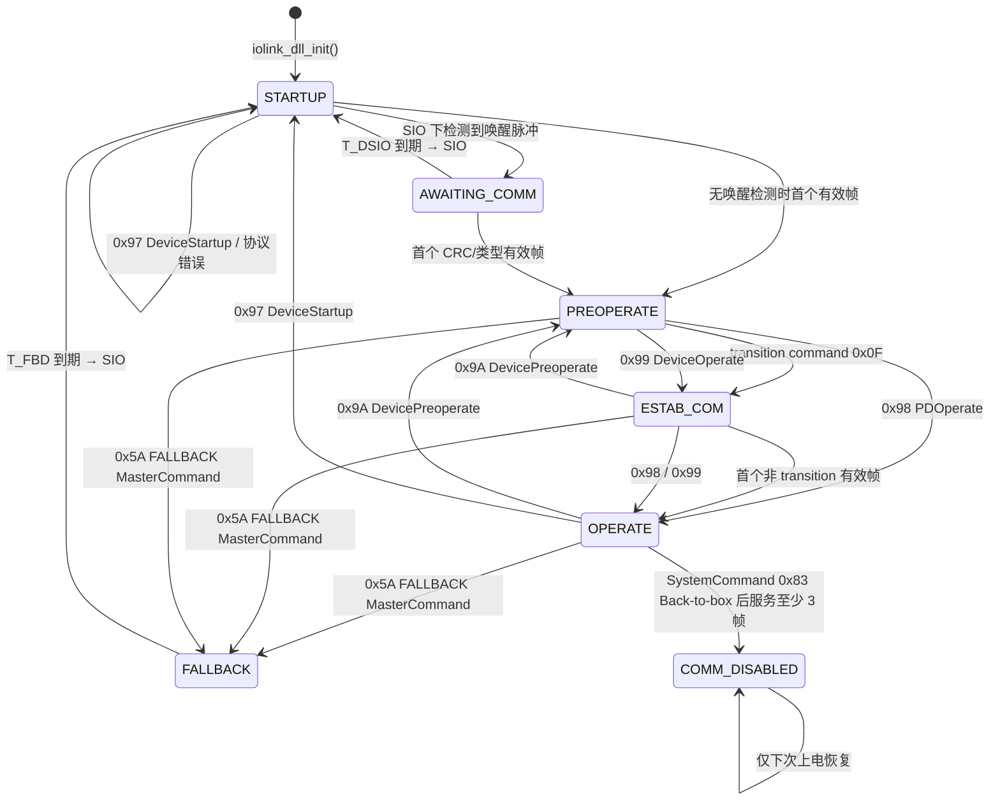

| 迁移 | 触发 | 代码 |
| :--- | :--- | :--- |
| 初始化 → STARTUP | `iolink_dll_init()` | `dll_set_state(STARTUP)` |
| STARTUP → AWAITING_COMM | SIO + `detect_wakeup()>0` | `dll_handle_sio_wakeup()` |
| STARTUP/AWAITING → PREOPERATE | 首个有效帧 | `dll_handle_valid_frame()` |
| PREOPERATE → ESTAB_COM | MC=0x0F transition command | `dll_handle_preoperate()` |
| PREOPERATE → ESTAB_COM | 0x99 DeviceOperate | `dll_apply_master_command()` |
| PREOPERATE → OPERATE | 0x98 PDOperate | `dll_apply_master_command()` |
| ESTAB_COM → OPERATE | 首个非 transition 有效帧 | `dll_dispatch_estab_com()` |
| → PREOPERATE | 0x9A DevicePreoperate | `dll_apply_master_command()` |
| → FALLBACK | 0x5A Fallback | `dll_handle_fallback_command()` |
| FALLBACK/OPERATE/ESTAB/PREOP → STARTUP | T_FBD 到期，切 COM1 + SIO | `dll_check_fallback_deadline()` |
| AWAITING/STARTUP → STARTUP | T_DSIO 到期，切 COM1 + SIO | `dll_check_dsio_deadline()` |
| 任意 → STARTUP | 0x97 DeviceStartup 或非 OPERATE/ESTAB 的类型错误 | `dll_protocol_error_to_startup()` |
| OPERATE → COMM_DISABLED | SystemCommand 0x83 Back-to-box，服务 ≥3 帧后 | `dll_frame_drop_if_stopped()` |

补充：

- 首个有效帧把 STARTUP/AWAITING_COMM 迁到 PREOPERATE 后，如果该帧本身就是 transition command（`MC=0x0F`），同一次 `dll_process_complete_frame()` 会继续调用 `dll_handle_preoperate()`，因此可以一帧内连续进入 ESTAB_COM。
- `master_lost` 只在 OPERATE 且 `master_lost_cycles != 0` 时计算，超过阈值只置提示位并触发 `on_master_lost`，**不改变状态和波特率**（`dll_update_master_lost()`，`iolink_device_master_lost()`）。
- CRC 错误不会单独导致 STARTUP；类型非法在 OPERATE/ESTAB 只计数并丢帧，避免链路抖动。
- `COMM_DISABLED` 会把 PHY 置为 `INACTIVE`，之后主循环不再处理帧，直到重新上电。
- 无 `detect_wakeup` 的 PHY 在初始化时直接进入 SDCI，因此不会出现 AWAITING_COMM/T_DSIO 路径。

---

## 11. 定时与错误路径

| 定时/条件 | 代码行为 | 位置 |
| :--- | :--- | :--- |
| `t_pd` 上电保护窗口 | 截止前排空 RX，收到字节计 `t_pd_violations` 并返回 | `dll_check_t_pd()` |
| `T_WU` 唤醒后等待 | 仅在 timing enforcement 开启时，AWAITING_COMM 在截止前不处理 | `dll_wakeup_window_active()` |
| `T_DSIO` | 唤醒后无有效报文，超时 → COM1 + SIO + STARTUP | `dll_check_dsio_deadline()` |
| `T_FBD` | Fallback 后 `3*MinCycleTime`（上限 500ms；MinCycleTime 为 0 时用 500ms）→ COM1 + SIO + STARTUP | `dll_check_fallback_deadline()` |
| `t_cycle` | 帧间隔 < MinCycleTime → `t_cycle_violations` + COMM_TIMING | `dll_check_cycle_time()` |
| `t_ren` | 应答发送结束 - 周期开始 > 500us → `t_ren_violations` + COMM_TIMING | `dll_send_od_reply()` |
| master lost | OPERATE 下按 MasterCycleTime 计数，饱和 0xFF，仅提示 | `dll_update_master_lost()` |
| 1 s idle | `last_activity_ms` 超过 1 s → `timeout_errors++`，不改状态 | `dll_check_idle_timeout()` |
| CRC 错误 | 计数；连续 3 次触发 COMM_CRC 事件 | `dll_handle_frame_error()` |
| 类型错误 | OPERATE/ESTAB 丢帧计数；其他状态 COMM_FRAMING + STARTUP | `dll_handle_frame_error()` |
| ISR RX 超时 | `iolink_dll_on_rx_timeout()` → `timeout_errors++`、清 RX 状态 | `iolink_dll_on_rx_timeout()` |

错误计数通过 `iolink_dll_get_stats()` 暴露；部分错误同时触发事件，事件 flag 进入 CKS bit7。

---

## 12. 缓冲区、并发与数据流

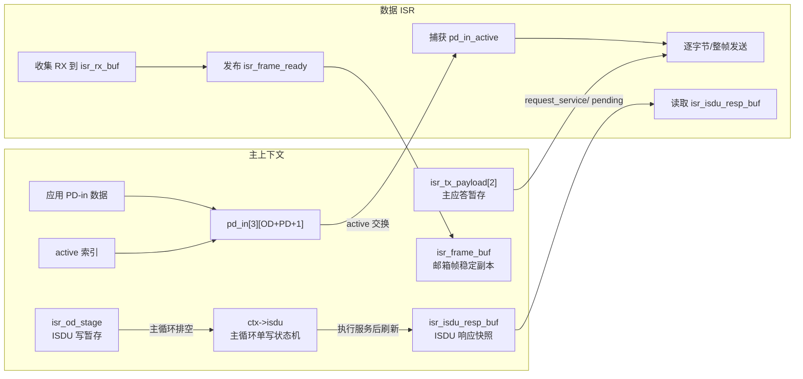

实际的缓冲关系：

- `pd_in[IOLINK_PD_IN_BUFFERS=3][IOLINK_PD_REPLY_MAX]`：布局为 `[OD...][PD-in...][CKS]`，主循环填一个既不是 `active` 也不是 `captured` 的缓冲区，再原子切换 `pd_in_active`；ISR 在应答开始时捕获 `pd_in_active`，零拷贝发送。`device_pd_in_free_index()` 负责选空闲缓冲。
- `pd_out[IOLINK_PD_OUT_MAX_SIZE]`：Type-1/2 帧处理时从 `frame_buf` 复制最新 PD-out；应用通过 `iolink_device_pd_output_read()` 读取。
- `isr_tx_payload[2]`：主上下文暂存的应答；`isr_tx_pending_slot`/`isr_tx_pending` 交给 ISR 发送。
- `isr_frame_buf` + `isr_frame_ready`：单槽邮箱。RX BYTE 先复制到 `isr_rx_buf` 再发布；RX FRAME 先发布 PHY 指针做 eager 应答，再复制到稳定副本。
- `isr_isdu_resp_buf`：主循环在 `dll_isdu_sync_snapshot()` 中复制 `ctx->isdu.resp_buf`；ISR 只读。
- `isr_od_stage`：ISR 暂存一个 ISDU 写段；如果主循环未及时排空，新段覆盖并计 `isr_od_overruns`。
- `pending_states[4]`：ISR 期间的状态迁移队列。

并发边界：

- `ctx->isdu`、`ctx->events`、`ctx->params`、`ctx->ds` 的主要状态由主循环修改。
- `iolink_critical_enter/exit` 保护邮箱发布/消费、ISDU 快照复制、状态队列、事件队列等短操作。
- `config->lock/unlock` 优先用于 `dll_send()` 暂存和 PD-in 发布；如果未配置，则退回平台临界区。
- 平台默认临界区是 weak 空实现（`src/platform.c`）；`iolink_device_init()` 通过
  `iolink_platform_critical_sections_ready()` 探测并返回
  `IOLINK_DEVICE_INIT_ERR_CRITICAL`，因此本路径必须提供真实实现。

### 12.1 主上下文 / ISR 上下文契约

`src/dll_isr.c` 的 ISR 分区只允许调用下表中的 ISR-only 或“双上下文安全”函数：

| 函数 | 上下文 | 说明 |
| :--- | :--- | :--- |
| `iolink_dll_process_isr()` | ISR-only | 数据中断入口 |
| `iolink_dll_on_rx_timeout()` | ISR-only | Timer A 超时入口 |
| `iolink_dll_on_stack_tick()` | ISR-only | Timer B tick 入口 |
| `dll_isr_*()`（`dll_isr_start_staged_tx()` 除外） | ISR-only | 双泵快路径、TYPE-0 应答、ISDU 快照读 |
| `dll_isr_start_staged_tx()` | 双上下文 | 主路径由 `dll_send()` 在直发回退时调用；ISR 路径由 `dll_isr_tx_pending()` 调用 |
| `dll_publish_isr_frame()`、`dll_mc_is_isdu_write()` | ISR-only | 邮箱发布与 ISDU 写判定 |
| `dll_set_state()` | 双上下文 | ISR 内不 flush 回调；迁入 STARTUP 时仍会调用 `iolink_events_reset()`（含临界区与 memset） |
| `dll_master_activity()` | 双上下文 | ISR 在帧结束时刷新活动时间戳 |
| `dll_pd_status_flags()`、`dll_apply_master_command()`、`dll_type_allowed()` | 双上下文 | 只读 ctx 或状态迁移 |
| `dll_process_complete_frame()`、`dll_consume_isr_mailbox()`、`dll_check_*()`、`dll_update_master_lost()` | 主上下文 | 主泵调度与定时监督 |
| `dll_send()` | 主上下文 | 主泵暂存应答，ISR 负责发送 |

ISR 还允许调用以下只读/时序 helper：`iolink_dll_expected_req_len()`、`iolink_checksum6_from_acc()`、`iolink_isdu_direct_param_page1_octet()`、已绑定的时间源（`iolink_device_config_t::time_us` 回调）、`iolink_events_flag()`、`iolink_events_memory_read()`。

禁止在 ISR 分区调用：`iolink_isdu_process()`、事件写路径（`iolink_event_trigger()`、`iolink_events_process()`、`iolink_event_clear()`）、`iolink_dll_flush_state_callbacks()`、应用回调（`state_cb`、`vendor_service` 等）。

例外：`dll_set_state(STARTUP)` 会在 ISR 内调用 `iolink_events_reset()`。该函数自带临界区，是当前 ISR 路径唯一的事件写操作；修改事件层时不要移除其重入保护。

### 12.2 异步原语分级与最小依赖

并发原语的契约集中在 `include/iolinki/port.h`，由编译期档位
`IOLINK_CONCURRENCY` 推导出 `IOLINK_NEED_FENCE` / `IOLINK_NEED_CRITICAL` /
`IOLINK_NEED_THREAD_LOCK`：

| 档位 | 场景 | 需要的能力 |
| :--- | :--- | :--- |
| `SINGLE` | host 仿真、协作式循环 | 无（屏障与临界区塌缩为空） |
| `ISR`（默认） | 数据 ISR 抢占主循环（双泵） | 原子宽度 ≥32 位 + `COMPILER` 屏障 + 临界区 |
| `RTOS` | 主上下文是多任务 | 上一档 + `config.lock/unlock` |
| `SMP` | 泵与主循环在不同核 | 原子宽度 + `SMP` 屏障 + 临界区 |

`src/` 只调用三个入口：`IOLINK_FENCE()`、`iolink_atomic_load/store()`、
`IOLINK_CRITICAL_ENTER/EXIT()`。档位不需要临界区时宏展开为空，库因此
**不引用** `iolink_critical_*` 符号（`tools/build_matrix.sh` 用 `nm -u`
对 `SINGLE` 档做机械校验）。

屏障等级 `IOLINK_FENCE_LEVEL` 由 port 声明（它描述硬件事实，不能推导）：
`COMPILER`（单核、无其他总线主设备）/ `DEVICE`（DMA 并发读发布缓冲区，
port 提供 `IOLINK_FENCE_DEVICE_IMPL()`）/ `SMP`（跨核或跨线程，port 提供
`IOLINK_FENCE_SMP_IMPL()`）。错配在编译期 `#error`。

共享对象的**所有权**（审查与后续无锁化改造的基准）：

| 对象 | 写者（可写所有权） | 读者 | 移交机制 | 租约/回收 |
| :--- | :--- | :--- | :--- | :--- |
| `isr_frame_buf` + `isr_frame_ready` | ISR | 主上下文 | `isr_frame_ready` 标志 | 主上下文拷出后清标志 |
| `isr_tx_payload[]` + `isr_tx_pending` | 主上下文 | ISR | `request_service()` | ISR 取走后清 pending |
| `pd_in[]` + `pd_in_active` | 主上下文 | ISR | 索引交换 | `pd_in_captured` 记录 ISR 占用槽；TX FRAME 下保持到下次捕获 |
| `isr_isdu_resp_buf` + 索引字段 | 主上下文 | ISR | 快照刷新 | 新响应使 `isr_isdu_resp_valid` 失效 |
| `isr_od_stage` | ISR | 主上下文 | `isr_od_staged` | 主上下文排空后清标志 |
| `pending_states[]` | 主上下文 + ISR | 主上下文 | head/tail 环形 | flush 消费后推进 tail |
| 计数器 | 两个上下文 | 读侧 | — | 共享自增，受临界区保护 |

表中"两个上下文都写"的项（计数器、`isr_tx_next` 的槽分配）属于真正的
RMW，M0+ 无独占指令，不能靠原子宽度解决；后续（P2/P3）改为单写者
所有权或分上下文计数。

---

## 13. 编译期分流与集成注意

| 开关 | 影响 |
| :--- | :--- |
| `IOLINK_ISR_RX_MODE` | `RX BYTE` 或 `RX FRAME` |
| `IOLINK_ISR_TX_MODE` | `TX BYTE` 或 `TX FRAME` |
| `IOLINK_CONCURRENCY` | `SINGLE`/`ISR`/`RTOS`/`SMP`；决定 `IOLINK_NEED_*` 与是否需要临界区 |
| `IOLINK_FENCE_LEVEL` | `COMPILER`/`DEVICE`/`SMP`；port 声明的屏障等级，错配编译期报错 |
| `IOLINK_STATS_MODE` | `SHARED`（默认）/`SPLIT`（尚未实现，编译期拒绝） |
| `IOLINK_PHY_FEATURE_ISR_TX_ONLY` | 1=必须有 `request_service()`，否则计 `isr_tx_dropped` |
| `IOLINK_APP_PD_INPUT_CALLBACK` | 1=用 `on_pd_input()`，禁用 `iolink_device_pd_input_update()` |
| `IOLINK_FEATURE_DATA_STORAGE` | 是否编译 DS 引擎与 ISDU 0x0003 |
| `IOLINK_FEATURE_SYSTEM_COMMAND` | 是否编译 SystemCommand |
| `IOLINK_FEATURE_EVENTS` | 是否编译事件队列/事件内存/诊断事件 |
| `IOLINK_FEATURE_LEGACY_PARAMS` | 是否保留全局 legacy params API |
| `IOLINK_PHY_FEATURE_WAKEUP` | 是否编译 `detect_wakeup` 能力 |
| `IOLINK_PHY_FEATURE_LEGACY_DIAG` | 是否轮询 `get_voltage_mv`/`is_short_circuit` |
| `IOLINK_MINIMAL_PROFILE` | 一键关闭 DS/SystemCommand/legacy params/wakeup/SIO_CQ/legacy diag |

集成注意（按当前代码实际调用点）：

- `IOLINK_OPERATE_TIMEOUT_MS`、`IOLINK_PHY_OWNS_LINE_STATE`、`IOLINK_OD_EVENT_MODE` 在 `src/` 中没有引用；不要按注释推断它们已生效。
- `iolink_device_config_t::time_us` 是必需项，初始化时绑定到 DLL/事件上下文；NULL 会被 `iolink_device_init()` 拒绝。主循环、ISR 和事件计时都用它，核心不再调用平台时间函数；直接使用 `iolink_dll_*` 时需自行绑定 `ctx->time_us`。
- `phy->get_faults`、`phy->set_cq_line`、`storage->erase` 当前没有栈内调用点。
- `iolink_events_process()`、`iolink_ds_process()`、`iolink_ds_check()` 需要应用自行调度。
- 本路径要求 `iolink_critical_enter/exit` 真实可用（初始化会校验），且 `ctx` 的主循环调用与 ISR 调用遵守文档约束。`IOLINK_CONCURRENCY=SINGLE` 档不需要临界区，初始化跳过校验且库不引用该符号；其余档位仍会校验。
- 当 `phy->stack_timer_start != NULL` 时，PHY 必须在 Timer B 到期时调用 `iolink_dll_on_stack_tick()`，否则 `iolink_device_process()` 会被授权门控挡住；Timer A 超时则应调用 `iolink_dll_on_rx_timeout()`。
- `TYPE_1_1` 在本路径初始化时被拒绝；固定 Annex A 类型必须使用匹配的 PD/OD 布局。

---

## 14. 关键代码索引

| 主题 | 入口 |
| :--- | :--- |
| 设备初始化/主循环 | `iolink_device_init()`、`iolink_device_process()` |
| 应用状态回调 | `device_state_cb()` |
| PD 更新/读取 | `device_run_app_callbacks()`、`iolink_device_pd_output_read()` |
| DLL 初始化/主处理 | `iolink_dll_init()`、`iolink_dll_process()` |
| 状态迁移 | `dll_set_state()` |
| 完整帧校验/分流 | `dll_process_complete_frame()` |
| 通道分发 | `dll_handle_valid_frame()` |
| Type-0 / Type-1/2 应答 | `dll_handle_operate_type0()`、`dll_handle_operate_type1_2()` |
| MasterCommand/Fallback | `dll_handle_master_command()`、`dll_handle_fallback_command()` |
| ISR 泵 | `iolink_dll_process_isr()`、`dll_isr_drain()` |
| ISR Type-0 快路径 | `dll_isr_handle_type0()` |
| ISR ISDU 快照读 | `dll_isr_isdu_od()` |
| ISR ISDU 写暂存 | `dll_isr_consume_isdu_write()` |
| ISDU 传输写/读 | `iolink_isdu_od_write()`、`iolink_isdu_od_read()` |
| ISDU 执行/组帧 | `isdu_execute_request()`、`isdu_decode_service()`、`isdu_frame_response()` |
| ISDU 索引分发 | `handle_standard_commands()` |
| SystemCommand | `handle_system_command()` |
| Data Storage 服务 | `handle_data_storage()`、`iolink_ds_build_image()`、`iolink_ds_apply_image()` |
| 参数持久化 | `iolink_params_ctx_set()`、`params_ctx_load()` |
| 事件 | `iolink_event_trigger()`、`iolink_events_process()`、`iolink_events_reset()` |
| 校验 | `iolink_checksum6()` |
| 存储布局 | `include/iolinki/storage.h` |
| 编译期开关 | `include/iolinki/config.h` |
