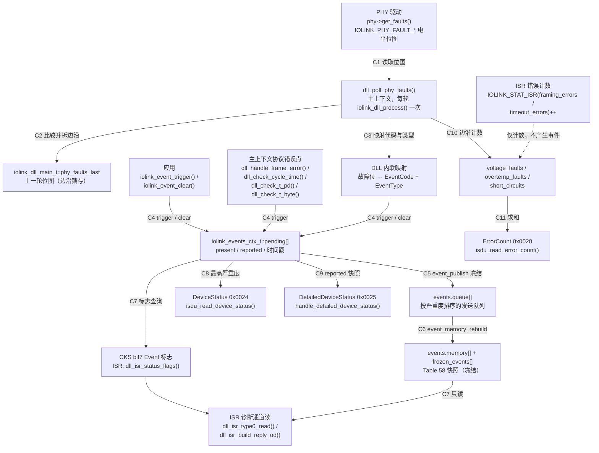

# 诊断统一设计（P10）

本文是 [EVOLUTION_ROADMAP](EVOLUTION_ROADMAP.md) §P10 中“诊断注册表：PHY faults →
events → DeviceStatus → 0x0025 收敛，带锁存/边沿语义”的设计稿。

> **实现状态（P10，2026-11）**：§3 的注册表、条件缓存与派生视图已落地
> （`include/iolinki/diag.h`、`src/diag.c`）；M2–M6、M9 已完成，M1 由
> `tests/test_diag.c`、`tests/test_phy_diagnostics.c`、`tests/test_events.c`、
> `tests/test_isdu.c` 覆盖。与设计稿的差异：
>
> - 条件权威表仍是 `iolink_events_ctx_t::pending[]`（新增 `source` /
>   `quiet_since_ms`），没有第二份条件副本；`iolink_conditions_t` 只缓存来源自身
>   的 ISR one-shot、PULSE 最后发生时间与边沿计数。
> - M7 只完成“复位后由电平重新锁存”：STARTUP 仍在 `dll_set_state()` 内同步
>   `iolink_events_reset()`（现有 ISR 临界区契约不变），尚未改为
>   `reset_pending`；0x82 通过 `clear_diagnosis()` 清 `present` 后由下一轮采样
>   重新触发。
> - 应用自定义 EventCode 的配置表尚未提供：登记代码使用注册表类型，未登记代码
>   保留调用方 `type`（`iolink_event_trigger()` 兼容语义）。
> - `IOLINK_DIAG_SRC_NONE` / `IOLINK_DIAG_STATUS_NONE` 用 0xFF 作为内部哨兵；
>   线上 DDS 的“无条目”按 B.2.22 仍是 `EventQualifier=0x00`、`EventCode=0x0000`。
> - PULSE 保持窗口由 `IOLINK_DIAG_PULSE_HOLD_MS`（默认 1000 ms）配置；§7
>   第 2 条的产品化取值仍待确认。


范围：只描述诊断链路的目标结构、迁移步骤和验证方式，不修改 `src/`、`include/`、
`tests/`、`tools/` 或 CI。实现阶段必须继续遵守无动态内存、上下文式（无全局）、
C99、MISRA C:2012 子集等约束（见 [AGENTS](../AGENTS.md) 与
[CODING_STANDARDS](CODING_STANDARDS.md)）。

规范以 `docs/IOL-Interface-Spec_10002_V1.1.5_Oct2025/` 下的 PDF 为准。本文引用的
条款：

- Table D.1（Annex D.2，EventCodes for Devices）
- 7.3.8.1 / Table 58（Event memory）、7.3.8.2 / Table 60（Event handler 状态迁移）
- A.6.3（StatusCode type 2）、A.6.4（EventQualifier，Figure A.24）、
  Table A.17–A.20
- B.2.20（ErrorCount）、B.2.21 / Table B.13（DeviceStatus）、
  B.2.22 / Table B.14（DetailedDeviceStatus）
- 10.10.1（Device diagnosis 概念）、10.10.2（Events 生命周期与限流）、
  Table 101（复位选项）

---

## 1. 现状链路

### 1.1 数据流总览



### 1.2 转换点、存储与读写者

| 编号 | 转换点 | 写入者 / 存储 | 读取者 | 上下文 | 语义 |
| :-- | :-- | :-- | :-- | :-- | :-- |
| C1 | `phy->get_faults()` → 位图 | 无存储，直接进入 `dll_poll_phy_faults()` | `dll_poll_diagnostics()` | 主上下文 | PHY 契约是“当前活跃故障”的电平位图，不保证记住脉冲 |
| C2 | 位图差分 → `rising` / `falling` | `iolink_dll_main_t::phy_faults_last` | `dll_poll_phy_faults()` | 主上下文 | 只认 0→1 和 1→0 两个边沿；稳态不重复计数 |
| C3 | 故障位 → Table D.1 代码/类型 | 无独立表，写在 `dll_poll_phy_faults()` 的 if 分支 | `iolink_event_trigger()` / `iolink_event_clear()` | 主上下文 | 4 组映射：`0x5111`、`0x5110`、`0x4000`、`0x7710` |
| C4 | 代码/类型 → 生命周期 | `iolink_events_ctx_t::pending[]` | `iolink_events_process()`、ISDU 读路径 | 主上下文（事件写路径）；ISR 仅执行 `iolink_events_reset()` 例外 | `present` 表示条件存在，`reported` 表示“appears 已上过线”；`IOLINK_EVENT_MIN_APPEAR_MS` 与 `IOLINK_EVENT_MIN_REPEAT_MS` 限流 |
| C5 | 生命周期 → 发送队列/内存快照 | `events.queue[]`、`events.memory[]`、`events.frozen_*` | ISR 诊断通道读、`iolink_events_memory_write()` | 主上下文写；ISR 读 | 首个事件置 `Event` 标志并冻结 Table 58 内存；主站写 StatusCode 确认后解冻/重建 |
| C6 | 队列 → Table 58 内存 | `event_memory_rebuild()` | `iolink_events_memory_read()` | 主上下文写；ISR 读（临界区） | 最多 6 个槽位；`StatusCode` bit7=1，bit0–5 为激活槽位 |
| C7 | Event 标志 / 内存字节 → CKS、诊断通道 | `events.flag`、`events.memory[]` | `dll_isr_status_flags()`、`dll_isr_type0_read()`、`dll_isr_build_reply_od()` | ISR | ISR 只读；`flag` 读取未加锁，`memory_read` 在临界区内 |
| C8 | `pending[]` → DeviceStatus | 无存储，读时计算 | `isdu_read_device_status()` | 主上下文 | `iolink_events_get_highest_severity()` 只统计 `present && reported` 的非 Notification 条目 |
| C9 | `pending[]` → DetailedDeviceStatus | 无存储，读时组装到 `response_buf` | `handle_detailed_device_status()` | 主上下文（临界区快照，锁外格式化） | 只列 `reported` 的非 Notification 条目；`appears` 已发、`disappears` 未发的条目仍列出 |
| C10 | 故障边沿 → 累计计数 | `voltage_faults`、`overtemp_faults`、`short_circuits` | `iolink_dll_get_stats()`、ISDU 厂商索引 | 主上下文 | 按 0→1 边沿累加；与事件生命周期无事务关系 |
| C11 | 通信错误计数 → ErrorCount | `crc_errors`、`shared.framing_errors`、`shared.timeout_errors`、`timing_errors` | `isdu_read_error_count()` | 主 + ISR（`shared`/`SPLIT` 统计模式） | 直接求和；B.2.20 允许厂商特定语义 |

### 1.3 存储所有权与并发上下文

| 状态 | 位置 | 写者 | 读者 | 保护 |
| :-- | :-- | :-- | :-- | :-- |
| 上一轮 PHY 故障位图 | `iolink_dll_main_t::phy_faults_last` | `dll_poll_phy_faults()`（主） | 同左 | 无；仅主上下文读写 |
| 重武装请求 | `iolink_dll_main_t::phy_faults_rearm` | ISR `dll_set_state(STARTUP)` 置 1；主 `dll_poll_phy_faults()` 清 0 | 主 | `dll_poll_phy_faults()` 用 `IOLINK_CRITICAL_ENTER/EXIT()` 包读-清；`iolink_dll_reset_diagnostics()` 直接清零 |
| 条件生命周期 | `events.pending[]` | `iolink_event_trigger/clear`、`iolink_events_process`、`iolink_events_clear_diagnosis`、`iolink_events_reset` | DeviceStatus/DDS、事件处理 | 事件 API 内部临界区；ISR 复位是唯一写例外 |
| 发送队列 | `events.queue[]` | 事件 API（主）；ISR 复位 | 事件 API、ISR 复位 | 临界区 |
| Table 58 内存 | `events.memory[]`、`frozen_events[]` | `event_publish` / `event_memory_rebuild` / `iolink_events_memory_write` | ISR 诊断通道读 | 写侧临界区；ISR 读侧也进临界区 |
| Event 标志 | `events.flag` | `event_publish` / `memory_write` / `pop` | `iolink_events_flag()`（ISR + 主） | 单字节读写，无临界区（依赖单拷贝原子） |
| 故障累计 | `voltage_faults` 等 | `dll_poll_phy_faults()`（主） | `iolink_dll_get_stats()` | 无；32 位自然对齐 |
| 通信错误累计 | `crc_errors` / `timing_errors`（主）；`shared.framing_errors` / `shared.timeout_errors`（主 + ISR） | 两上下文 | `isdu_read_error_count()`、stats | `SPLIT` 模式分开存；`SHARED` 模式可能丢更新 |
| DeviceStatus / DDS | 无持久存储，读时计算 | — | ISDU 主上下文 | 读时临界区（DDS 快照；DeviceStatus 函数内部） |

### 1.4 一个主循环内的顺序

`iolink_device_process()` → `iolink_dll_process()` → `dll_process_body()` 的关键顺序是：

1. 排空 ISR 暂存的 ISDU 写并运行 `iolink_isdu_process()`；
2. `dll_poll_diagnostics()`（PHY 故障轮询在这时发生）；
3. master-lost/超时/邮箱处理；
4. 返回设备层后，`device_service_events_and_ds()` 在 ISDU 空闲时调用
   `iolink_events_process()`，发出被 50 ms/1 s 窗口推迟的 appears/disappears。

因此同一轮里 ISDU 读（包括 0x0024/0x0025）发生在本轮 PHY 采样之前；诊断视图相对
PHY 采样最多有一个主循环的滞后，而推迟的 appears/disappears 又可能在本轮 ISDU 读
之后才发出。这个顺序本身不是错误，但设计必须明确“视图是快照，不是实时寄存器”。

---

## 2. 问题清单

严重度：**H** = 会产生错误诊断或丢诊断；**M** = 在特定时序/配置下出错；**L** = 可维护性
或文档问题。

| ID | 严重度 | 问题 | 依据（文件:符号） | 影响 |
| :-- | :-- | :-- | :-- | :-- |
| D1 | H | 同一故障存在多份事实源：边沿锁存、生命周期、队列、Table 58 内存、累计计数、DeviceStatus/DDS 派生，彼此没有不变式约束 | `src/dll.c:dll_poll_phy_faults`、`src/dll.c:iolink_dll_get_stats`、`src/events.c:iolink_event_trigger`、`src/events.c:event_memory_rebuild`、`src/events.c:iolink_events_get_highest_severity`、`src/isdu.c:handle_detailed_device_status` | 任一份更新失败或顺序变化，就会出现“状态说故障、DDS 说正常”或反之；新增诊断源必须改多处 |
| D2 | H | Error/Warning 类型的协议事件没有对应的 disappearing 路径；只有 PHY 故障在下降沿调用 `DLL_EVENT_CLEAR` | `src/dll.c:dll_handle_frame_error`（`IOLINK_EVENT_COMM_CRC`/`COMM_FRAMING`）、`src/dll.c:dll_check_cycle_time`、`src/dll.c:dll_check_t_pd`、`src/dll.c:dll_check_t_byte`（`IOLINK_EVENT_COMM_TIMING`）；对照 `src/dll.c:dll_poll_phy_faults` 的 clear 分支 | `pending.present` 一直为真，DeviceStatus 永久非零、DDS 永久列出，直到 STARTUP/复位；违反 10.10.2 的 appears/disappears 配对要求 |
| D3 | H | 同类通信错误在 ISR 中只计数、不产生事件；主上下文检测到的同类错误才进入诊断视图 | `src/dll_isr.c:dll_isr_publish_frame`、`src/dll_isr.c:dll_isr_frame_len_ok`、`src/dll_isr.c:dll_isr_rx_byte_gap`、`src/dll_isr.c:dll_isr_drain_rx_byte`、`src/dll_isr.c:iolink_dll_on_rx_timeout` 使用 `IOLINK_STAT_ISR(framing_errors/timeout_errors)++`；主路径见 `src/dll.c:dll_handle_frame_error` 等 | 同一根因是否可见取决于检测发生在哪个上下文；ErrorCount 增加但 DeviceStatus/DDS 不变 |
| D4 | H | `get_faults()` 是电平采样，主循环轮询间隔内出现又消失的故障会被完全丢失，既无边沿计数也无事件 | `include/iolinki/phy.h`（`get_faults()` 契约与 `IOLINK_PHY_FAULT_*`）、`src/dll.c:dll_poll_phy_faults`、`src/phy_tiol112.c:iolink_phy_tiol112_fault`、`src/phy_l6362a.c:iolink_phy_l6362a_fault` | 短脉冲诊断丢失；如果 PHY 没有硬件锁存，软件无法恢复 |
| D5 | H | `Restore factory settings` 清除活动事件后没有重新武装仍存在的物理故障；故障位仍在 `phy_faults_last` 中，不会再有 0→1 边沿 | `src/isdu.c:isdu_system_reset`（0x82 → `iolink_events_clear_diagnosis`）、`src/events.c:iolink_events_clear_diagnosis`、`src/dll.c:dll_poll_phy_faults` | 复位后 DeviceStatus 变为 0，但硬件故障仍存在；与 Table 101 “Clear … pending Events can be resent” 及 B.2.21.2 不符 |
| D6 | M | 重武装握手不对称：ISR 只置 `phy_faults_rearm=1`，`dll_poll_phy_faults()` 在临界区读-清，但 `iolink_dll_reset_diagnostics()` 在临界区外直接写 `phy_faults_rearm=0` 并清 `phy_faults_last` | `src/dll.c:dll_set_state`、`src/dll.c:dll_poll_phy_faults`、`src/dll.c:iolink_dll_reset_diagnostics` | ISR 刚置位的重武装请求可能被主上下文覆盖；两条复位路径语义不同，后续诊断源难以复用同一模式 |
| D7 | H | DeviceStatus 与 DDS 的过滤条件不同，存在不一致窗口：下降沿后 DeviceStatus 立即回 0，而 DDS 在 50 ms disappears 之前仍列出；1 s 内重现场景下两者又都可能看不到活动条件 | `src/events.c:iolink_events_get_highest_severity`（要求 `present && reported`）、`src/isdu.c:handle_detailed_device_status`（只要求 `reported`）、`src/events.c:pending_emit_disappears`、`src/events.c:iolink_events_process` | 同一时刻两个规范视图互相矛盾；B.2.21.2 以“no Event is pending, see B.2.22”为判据，10.10.1 要求两者关系一致 |
| D8 | H | EventType 与 DeviceStatus 的映射由调用方传入的 `type` 决定，而不是 Table D.1 的规范值；`iolink_event_classify()` 与 `event_type_device_status()` 是两套独立映射 | `src/events.c:iolink_event_trigger`、`src/events.c:event_type_device_status`、`src/events.c:iolink_event_classify`；调用点 `src/dll.c:dll_poll_phy_faults` 等；测试 `tests/test_events.c` 甚至以 Warning 触发 `0x4000` | 调用方传错类型即可让 `0x5111` 变 Failure、`0x4000` 变 Out-of-Spec；DDS 的 TYPE 与 DeviceStatus 也可能不一致 |
| D9 | M | 同一 EventCode 的生命周期内 `type` 可被改写：`present=false`、`reported=true` 时再次 trigger 会更新 `p->type` | `src/events.c:iolink_event_trigger` 中 `p->type = type`；`src/events.c:pending_emit_appears`、`src/events.c:event_memory_rebuild` | 先前入队的 appears/Table 58 内存保留旧 TYPE，DDS 读到的却是新 TYPE；违反 10.10.2 “Each Event shall use static mode, type, and instance attributes” |
| D10 | M | EventQualifier 的位组装有两份实现：事件内存路径与 DDS 路径各自构造 | `src/events.c:event_qualifier`、`src/isdu.c:handle_detailed_device_status`（硬编码 `0xC0`、`0x04`、TYPE 位） | 修改 INSTANCE/SOURCE/MODE 时两处容易漂移；DDS 目前只支持 appears + Warning/Error，新增语义需要同步改两处 |
| D11 | M | DDS 容量边界没有静态约束：3 字节/条 × `IOLINK_EVENT_PENDING_MAX` 直接写入 `response_buf[IOLINK_ISDU_BUFFER_SIZE]`，也没有限制在 B.2.22 的 64 条以内 | `src/isdu.c:handle_detailed_device_status`、`include/iolinki/config.h`（`IOLINK_EVENT_PENDING_MAX`、`IOLINK_ISDU_BUFFER_SIZE`）、`include/iolinki/isdu.h`（`response_buf`） | 把 `IOLINK_EVENT_PENDING_MAX` 调到约 86 以上会越界；超过 64 条不符合 B.2.22 的最大元素数 |
| D12 | M | 边沿/事件被消费后不重试：`pending_alloc()` 失败或队列满时只增加 `dropped_count`，但 `phy_faults_last` 已更新，后续轮询不会再产生该边沿 | `src/events.c:pending_alloc`、`src/events.c:iolink_event_trigger`（`dropped_count++` 后返回）、`src/dll.c:dll_poll_phy_faults`（末尾仍写 `phy_faults_last = faults`） | 槽位/队列满期间发生的故障永久丢失，直到故障物理下降再上升；`dropped_count` 只能观测，不能恢复 |
| D13 | L | ErrorCount 与诊断事件计数语义重叠，且一次校验和失败同时增加 `crc_errors` 和 `framing_errors` | `src/dll.c:dll_handle_frame_error`、`src/dll.c:iolink_dll_get_stats`、`src/isdu.c:isdu_read_error_count` | 0x0020 可能把一次 CRC 事件计两次；若把计数器作为诊断源，会与事件源重复计数 |
| D14 | L | 文档/接口注释与实现不一致：把 DeviceStatus 描述成“队列最高严重度”，实际读的是 `pending[]` | `docs/CODE_FLOW.md` §8.3、`include/iolinki/events.h:iolink_events_get_highest_severity` 的注释、`src/events.c:iolink_events_get_highest_severity` | 集成者会按“队列”理解清除/确认语义，掩盖 D7 的不一致窗口 |

---

## 3. 目标设计：诊断源注册表

### 3.1 设计原则

1. **一个条件只有一个权威记录。** 每个诊断源（PHY 位、协议错误、应用事件）在运行时
   只对应 `pending[]` 中的一条条件记录；`present` 是条件锁存，`reported` 是发送生命周期。
   不再保留 `phy_faults_last` 这类平行的条件副本。
2. **代码元数据只在 ROM 表中出现一次。** EventCode、规范 EventType、Table D.1 首选
   DeviceStatus、是否 Notification/是否电平源/是否脉冲源，全部放进 `const` 注册表；
   分类、状态映射、Qualifier 组装、DDS 列表都从这张表派生。
3. **边沿与电平分离。** 电平源（PHY 故障位）每轮采样一次，用“当前电平 vs 条件锁存”
   产生上升/下降；脉冲源（协议错误、应用通知）每次事件更新“最后发生时间”，由保持
   窗口决定何时下降。两者都走同一套 `trigger/clear` 生命周期。
4. **视图是纯函数。** DeviceStatus、DetailedDeviceStatus、Table 58 内存、累计计数都是
   条件表/队列的投影，不各自保存一份状态。
5. **ISR 只发布“发生过”，不做诊断决策。** ISR 只写单字节 one-shot 标志；所有锁存、
   限流、队列、内存重建都在主上下文完成。

### 3.2 数据模型

#### ROM：注册表描述符

```c
typedef enum
{
    IOLINK_DIAG_SRC_PHY_UNDERVOLTAGE = 0,
    IOLINK_DIAG_SRC_PHY_OVERVOLTAGE,
    IOLINK_DIAG_SRC_PHY_OVERTEMP,
    IOLINK_DIAG_SRC_PHY_SHORT_CIRCUIT,
    IOLINK_DIAG_SRC_COMM_CRC,
    IOLINK_DIAG_SRC_COMM_TIMEOUT,
    IOLINK_DIAG_SRC_COMM_FRAMING,
    IOLINK_DIAG_SRC_COMM_TIMING,
    IOLINK_DIAG_SRC_COUNT
} iolink_diag_src_t;

typedef struct
{
    uint16_t code;      /* Table D.1 EventCode */
    uint8_t type;       /* 规范 EventType：Notification / Warning / Error */
    uint8_t status;     /* Table D.1 首选 DeviceStatus（0..4） */
    uint8_t flags;      /* LEVEL / PULSE / NOTIFICATION / LATCHING */
    uint16_t hold_ms;   /* PULSE：最后一次发生后保持多久再发 disappears */
} iolink_diag_desc_t;
```

注册表本身是 `static const iolink_diag_desc_t[]`，由设备配置（或内建表）在初始化时
绑定到上下文；**不使用全局变量**，表指针存放在 `iolink_dll_shared_t` 或
`iolink_events_ctx_t` 中。应用自定义 EventCode 通过配置表追加，容量由
`IOLINK_DIAG_APP_MAX` 限定。

#### RAM：条件/生命周期记录（扩展现有 `iolink_event_pending_t`）

```c
typedef struct
{
    uint16_t code;
    uint8_t type;              /* 来自注册表；App 事件来自配置 */
    uint8_t source;            /* iolink_diag_src_t；0xFF = App 动态条目 */
    uint8_t present;           /* 权威条件锁存（电平/脉冲/应用） */
    uint8_t reported;          /* appears 已入队、disappears 尚未入队 */
    uint8_t appears_valid;
    uint8_t disappears_valid;
    uint8_t active;            /* 槽位已分配 */
    uint32_t last_appears_ms;
    uint32_t last_disappears_ms;
    uint32_t quiet_since_ms;   /* PULSE：最后一次事件时间；LEVEL 不使用 */
} iolink_diag_cond_t;
```

条件表容量用新宏 `IOLINK_DIAG_COND_MAX` 表示，默认建议为
`IOLINK_EVENT_PENDING_MAX + IOLINK_DIAG_SRC_COUNT`（实现阶段用
`test_ctx_sizes` / [MEMORY_GUIDE](MEMORY_GUIDE.md) 实测后定稿）。`IOLINK_EVENT_PENDING_MAX`
保留为兼容别名一个版本。条件表按 `source` 固定映射系统源，App 事件占用剩余槽位。

#### 边沿记录与 ISR 暂存

```c
typedef struct
{
    const iolink_diag_desc_t* desc;
    uint8_t desc_count;

    iolink_diag_cond_t cond[IOLINK_DIAG_COND_MAX];
    uint8_t cond_count;

    /* ISR -> 主上下文：每个脉冲源一个 one-shot 字节。
       单写者、单字节 store，不在 ISR 中做读-改-写。 */
    volatile uint8_t isr_pulse[IOLINK_DIAG_ISR_SRC_COUNT];

    /* ISR -> 主上下文：STARTUP/复位请求，主上下文负责真正的事件复位。 */
    volatile uint8_t reset_pending;
} iolink_diag_ctx_t;
```

电平源不需要额外的“边沿位图”：`present` 就是锁存，采样时直接比较
`(level != present)` 即可。这样既去掉了 `phy_faults_last`，也天然支持重武装。

### 3.3 API 与语义

| API | 上下文 | 语义 |
| :-- | :-- | :-- |
| `iolink_diag_init(iolink_diag_ctx_t*, const iolink_diag_desc_t*, uint8_t)` | 主 | 绑定 ROM 表，清零条件表；系统源按 `source` 预分配槽位 |
| `iolink_diag_set_level(iolink_diag_ctx_t*, iolink_diag_src_t, bool level)` | 主 | 电平源采样。`level=true` 且 `!present` → 上升沿；`level=false` 且 `present` → 下降沿；稳态无动作 |
| `iolink_diag_pulse(iolink_diag_ctx_t*, iolink_diag_src_t)` | 主 / ISR 暂存 | 脉冲源事件。主上下文直接调用；ISR 只写 `isr_pulse[src]=1`，由 `iolink_diag_service()` 在临界区消费 |
| `iolink_diag_raise_code(iolink_diag_ctx_t*, uint16_t code)` | 主 | 应用级条件置位；按注册表查 `type/status`，查不到则分配 App 槽位 |
| `iolink_diag_clear_code(iolink_diag_ctx_t*, uint16_t code)` | 主 | 应用级条件释放；只清 `present`，disappears 由事件引擎按 A.6.4 推迟 |
| `iolink_diag_rearm(iolink_diag_ctx_t*, uint32_t src_mask)` | 主 | 清除指定电平源的 `present` 锁存并立即重新采样；仍为高电平的源产生新的上升沿。用于 STARTUP、0x80、0x82、0x83 |
| `iolink_diag_service(iolink_diag_ctx_t*, uint32_t now_ms)` | 主 | 消费 ISR 脉冲、轮询电平源、处理 PULSE 保持窗口、同步事件生命周期 |
| `iolink_diag_device_status(const iolink_diag_ctx_t*)` | 主 | 从条件表计算 Table B.13 值；不读队列。ISR 不直接读条件表，避免与主上下文的临界区更新竞争 |
| `iolink_diag_dds_snapshot(...)` | 主 | 从条件表 `reported` 生成 3 字节条目；DDS 与 DeviceStatus 共用注册表元数据 |

App 事件不再由调用方任意指定 `type`：注册表命中时使用 Table D.1 的规范值；未命中时
使用 `iolink_event_classify()` 的分类结果（厂商特定代码由设备配置表覆盖）。这样
`iolink_event_trigger(code, type)` 的 `type` 参数只作为兼容输入，不再影响 DeviceStatus
或 DDS 的 TYPE 位（对应 D8）。

**清除/重武装规则：**

- **物理恢复**：电平源 `level=false` → `present=false` → `iolink_event_clear()` 语义；
  disappears 仍受 50 ms 最小出现窗口和 1 s 重复窗口约束。
- **主站确认**：`iolink_events_memory_write()` 只释放 Table 58 内存槽位，不改变
  `present`；DDS 仍列出活动条件。
- **重武装**：`iolink_diag_rearm()` 只清 `present`，不清 `reported`；下一次
  `iolink_diag_service()` 对仍为高电平的源重新触发。若 `reported=false`（复位后），
  会产生新的 appears；若 `reported=true`（尚未发 disappears），事件引擎按 10.10.2
  的“同一根因只报一次”保持静默，避免事件风暴。
- **Restore factory (0x82)**：先对全部活动条件发出 disappears（Table 101 的 Clear），
  再 `rearm` 所有电平源；仍存在的故障会在新会话中重新 appears。这样同时满足
  Table 101 和 B.2.21.2。如果一致性测试要求这条路径也遵守 50 ms 最小出现窗口，则把
  “立即 disappears” 改为按事件引擎的窗口批量撤销。
- **Device reset (0x80) / STARTUP**：事件队列丢弃（A.6.4），条件表清零后 `rearm`；
  通信恢复后仍存在的故障重新上报。
- **Application reset (0x81)**：不触碰诊断条件（Table 101 “No”）。

### 3.4 视图派生

| 视图 | 派生规则 | 规范依据 |
| :-- | :-- | :-- |
| DeviceStatus 0x0024 | 在 `(present \|\| reported) && type != Notification` 的条件中，取注册表 `status` 的最小优先级值（Failure 4 > Functional-Check 3 > Maintenance 1 > Out-of-Spec 2，数值优先级按 Table B.13） | B.2.21 / Table B.13；10.10.2 “每个 appearing Event 必须把 DeviceStatus 从 0 改为其他值” |
| DetailedDeviceStatus 0x0025 | 对 `reported && type != Notification` 的条目输出 `{EventQualifier, EventCode}`；Qualifier 由共享的 `iolink_event_qualifier(code, type, mode)` 生成 | B.2.22 / Table B.14；A.6.3 / A.6.4 |
| Table 58 内存 | 仍由 `event_memory_rebuild()` 从发送队列生成；冻结/确认语义不变 | 7.3.8.2 / Table 60 T2–T5 |
| ErrorCount 0x0020 | 每个诊断源每次“发生”只增加一次；CRC/帧错误不重复计入两个计数器（或明确文档化求和口径） | B.2.20（厂商特定） |
| 累计统计 | `iolink_dll_stats_t` 保留现有字段，作为条件表边沿计数的只读投影；新增字段按源拆分 | 兼容现有 API |

`present || reported` 的选择是刻意的：它保证 DDS 还列出条目时 DeviceStatus 不会回 0，
从而消除 D7 的不一致窗口；同时 1 s 内重现、appears 被推迟的条件仍能反映在
DeviceStatus 中。disappears 发出后 `reported=false`、`present=false`，两者同时归零。

### 3.5 ISR 安全边界

| 操作 | ISR | 主上下文 | 说明 |
| :-- | :-- | :-- | :-- |
| 采样 PHY `get_faults()` | 禁止 | 允许 | PHY 回调不保证 ISR 安全；统一在主上下文轮询 |
| `iolink_diag_pulse()` | 仅写 `isr_pulse[src]=1` | 允许 | 单字节 one-shot，不做位图读-改-写 |
| `iolink_diag_set_level()` / `rearm()` | 禁止 | 允许 | 需要比较/更新条件表 |
| `iolink_event_trigger/clear/process` | 禁止 | 允许 | 现有契约不变（见 [CODE_FLOW](CODE_FLOW.md) §12.1） |
| `iolink_events_reset()` | 设计目标：禁止；只置 `reset_pending` | 允许 | 迁移后由主上下文执行，缩短 ISR 最坏路径 |
| `iolink_events_flag()` | 允许（只读） | 允许 | 保持单字节发布；不新增跨字节不变式 |
| `iolink_events_memory_read()` | 允许（只读，临界区） | 允许 | 冻结窗口内一致；ISR 不重建 |
| `iolink_events_memory_write()` | 禁止 | 允许 | 主站确认走主上下文 `dll_dispatch_od()` |

**发布顺序：** 主上下文先完成 `memory[]`/`frozen_events[]` 写入，再置
`frozen`/`flag`（现有 `event_publish()` 已如此）。ISR 只有在 `flag` 置位后才会被
主站要求读取；不需要在 ISR 中获取事件队列锁。

**重武装：** 所有“复位后仍需上报”的请求统一为 `reset_pending` + `rearm`，由主上下文
在下一次 `iolink_diag_service()` 消费；ISR 不再直接清事件表，也不再直接写
`phy_faults_last`。

### 3.6 与现有 events 队列的关系

- `events.queue[]` 继续是**发送队列**：按严重度排序、受
  `IOLINK_EVENT_QUEUE_SIZE` 限制、供 `event_memory_rebuild()` 冻结。
- `pending[]` 从“生命周期跟踪”升级为**条件权威表**：`present`（条件）与
  `reported`（上线上限）共存；`iolink_event_trigger/clear()` 仍然是唯一入口，
  因此限流、去重、50 ms/1 s 规则不变。
- `DeviceStatus`、DDS、Table 58 内存、计数器都是该表和队列的投影，不再各自维护
  平行状态。`phy_faults_last` 删除。
- 公开 API 兼容：`iolink_event_trigger()` / `iolink_event_clear()` 保留为
  `iolink_diag_raise_code()` / `iolink_diag_clear_code()` 的薄封装；现有应用无需改调用。

### 3.7 与 P4 / P5 的依赖

- **P4（OD 表）**：`0x0024`/`0x0025` 最终作为 OD 表条目，由本设计的
  `iolink_diag_device_status()` / `iolink_diag_dds_snapshot()` 提供 handler。P4 未落地前，
  仍由 `handle_mandatory_indices()` / `handle_standard_commands()` 调用同一对函数，避免
  两套实现。依赖关系：**软依赖**，不阻塞本设计的第 1–6 步。
- **P5（reply plan + ISR 执行器）**：P5 计划提供 SPSC ring 与原子发布字。本设计的
  ISR→主上下文暂存只需要“单写者 + 单字节 one-shot + 临界区消费”，现有
  `IOLINK_CRITICAL_ENTER/EXIT()`、`iolink_atomic_load/store()`、`IOLINK_FENCE()` 已足够，
  **不硬依赖 P5**。P5 落地后，`isr_pulse[]` 可以替换为 P5 的发布字/环，条件和注册表
  语义不变；P5 的 plan 失效协议与本设计无关。
- **P9（状态机表）**：唯一接触点是 `dll_set_state(STARTUP)` 的复位钩子；迁移后该钩子
  只置 `reset_pending`，不再在 ISR 中调用事件复位。

---

## 4. 迁移步骤

每一步都可以单独提交、单独跑测试；括号内是该步的验证方式。步骤顺序按“先钉行为、
再换事实源、最后删旧路径”排列。

| 步骤 | 内容 | 验证 |
| :-- | :-- | :-- |
| M1 | **Characterization**：新增诊断行为测试，钉住当前 PHY 边沿、协议事件持久化、DeviceStatus/DDS 窗口、复位语义。只加测试，不改实现 | `ctest -R test_phy_diagnostics`、`ctest -R test_events`、`ctest -R test_isdu`；基线全绿 |
| M2 | **ROM 注册表**：新增 `iolink_diag_desc_t` 表和查找函数；`iolink_event_classify()`、`event_type_device_status()` 改为查表（保留旧函数签名）。表覆盖所有现有 `IOLINK_EVENTCODE_*` | 新增表驱动测试逐条比对 Table D.1；现有测试无行为变化 |
| M3 | **条件表扩展**：给 `iolink_event_pending_t` 增加 `source`/`quiet_since_ms`，`iolink_event_trigger/clear` 通过注册表校验/规范化 `type`；App 事件仍走动态槽位 | `test_events`、`test_conformance_gaps`；新增“错误 type 被规范化/拒绝”用例 |
| M4 | **PHY 源接入**：新增 `iolink_diag_ctx_t`，`dll_poll_phy_faults()` 改为按位调用 `set_level()`；删除 `phy_faults_last`，`phy_faults_rearm` 改为 `rearm` 掩码。事件输出保持逐字节等价 | `test_phy_diagnostics` 全部通过；新增“稳态不重复、部分下降、重武装”用例；差分门 |
| M5 | **视图统一**：DeviceStatus 改为 `present \|\| reported`；DDS 与事件内存共用 `iolink_event_qualifier()`；修正 D7/D10 | 新增“下降沿 50 ms 窗口”“1 s 内重现”“Notification 排除”用例；`test_isdu` DDS 快照 |
| M6 | **协议错误源**：把主上下文 4 个触发点改为 `iolink_diag_pulse()`；ISR 的 framing/timeout 计数改为写 `isr_pulse[]`；PULSE 源按 `hold_ms` 自动下降。确定 COMM 代码的 type 策略 | 新增“ISR 错误可见”“保持窗口后 disappears”“连续错误只 appears 一次”用例；`test_isr_*` |
| M7 | **复位/重武装统一**：STARTUP、0x80、0x82、0x83 全部走 `reset_pending` + `rearm`；移除 ISR 内 `iolink_events_reset()` 调用；0x82 先 disappears 再 rearm | `test_system_commands`、`test_events`；新增“Restore factory 后仍存在故障重新 appears”“Application reset 不清诊断”用例 |
| M8 | **计数统一**：边沿计数由条件表维护，`iolink_dll_stats_t` 字段改为投影；修正 CRC/framing 重复计数或明确文档化；ErrorCount 口径固定 | `test_stats_split`、`test_error_recovery`；新增“一次 CRC 只计一次”用例 |
| M9 | **容量/配置收口**：为 `3 * IOLINK_DIAG_COND_MAX <= IOLINK_ISDU_BUFFER_SIZE` 和 `<= 64` 加静态断言；`IOLINK_FEATURE_EVENTS=0` 时保留计数/状态最小视图或明确 DDS 不可用；更新文档索引 | `./tools/build_matrix.sh`（EVENTS 开/关、SINGLE/ISR/SMP、STATS 两种）；`./check_quality.sh`；`test_ctx_sizes` |
| M10 | **可选 PHY 锁存能力**：为能锁存短脉冲的 PHY 增加可选 `get_fault_latches()`/`clear_fault_latches()`；无此能力的 PHY 保持电平采样并在文档中给出最大丢失窗口 | HIL/虚拟 PHY 注入短脉冲；[TESTING](TESTING.md) 与 [PORTING](PORTING.md) 更新 |

依赖说明：M4 之后旧 `phy_faults_last` 才能删除；M6 依赖 M3 的条件表；M7 依赖 M4/M6；
M9 应在 M4–M8 后做一次全矩阵。P5 落地不改变步骤顺序。

---

## 5. 测试策略

### 5.1 表驱动的一致性测试

- 遍历注册表，逐条断言 `code → type → preferred DeviceStatus → EventQualifier`
  与 Table D.1/B.13/B.14 的期望值；建议把期望值放在测试侧的 const 表或 CSV，
  避免和实现共用同一张表而“自证正确”。
- 覆盖所有现有 `IOLINK_EVENTCODE_*` 与 `IOLINK_EVENT_COMM_*`；新增代码必须同步
  加行，否则测试失败。
- 对 Notification（`0x0000`、`0xFF91`）断言：不进入 DDS、不提升 DeviceStatus、
  只以 single-shot 入队。

### 5.2 边沿/生命周期用例

至少覆盖：

1. 上升沿 → 一次 appears、一次计数；持续高电平 → 不重复。
2. 下降沿 → 50 ms 内不出现 disappears；恰好 50 ms 后出现一次。
3. appears 后 50 ms 内重新上升 → 取消待发的 disappears，不产生第二次 appears。
4. disappears 后 1 s 内重新上升 → 推迟 appears 到 1 s 窗口结束，不丢条件。
5. 多故障同时存在 → DeviceStatus 取最高优先级；部分下降只清对应条件。
6. PULSE 源连续发生 → 每次只刷新 `quiet_since_ms`，保持窗口结束才 disappears。
7. 条件表/队列满 → `dropped_count` 增加；条件仍保持 `present`，槽位释放后能补报
   （对应 D12 的修复）。
8. 通知与 Error/Warning 混合 → 队列严重度排序、DDS 过滤正确。

### 5.3 并发/切点测试

- 复用 `tests/test_isr_cutpoints.c` 的“在消费者每一步注入生产者”方法，把
  `iolink_diag_pulse()` 注入到：消费 ISR 标志前、更新 `present` 后、调用
  `event_publish()` 前、`event_memory_rebuild()` 中途、DDS 快照前后。
- 复用 `tests/test_locking.c` 的临界区计数 mock，断言每对
  `IOLINK_CRITICAL_ENTER/EXIT()` 成对、可嵌套，且 `SINGLE` 档不引用临界区符号。
- 复用 `tests/test_isr_atomicity.c`、`tests/test_isr_stability.c` 反复进入 ISR，
  确认 `isr_pulse[]` 不会丢写、不会把半更新的条件表暴露给 ISR。
- 随机序列对拍：生成随机故障位序列和随机时间推进，比较“实现输出”与一个独立
  参考模型（present/reported/queue/DDS/DeviceStatus）；固定种子，失败可复现。

### 5.4 复位矩阵

按 Table 101 逐项验证：

| 复位 | DeviceStatus/DDS | 条件表 | 事件队列 | 仍存在故障的重新上报 |
| :-- | :-- | :-- | :-- | :-- |
| Power cycle | 初始 0 | 清零 | 清空 | 初始化后首轮采样重新 appears |
| Device reset 0x80 | “0” | 清零 | 清空 | `rearm` 后重新 appears |
| Application reset 0x81 | 不变 | 不变 | 不变 | 不需要 |
| Restore factory 0x82 | Clear + disappears | 先清后 rearm | 保留通知/重建 | 重新 appears |
| Back-to-box 0x83 | “0” | 随通信停止/下次上电 | — | 下次上电重新上报 |

### 5.5 构建与运行验证

- `./tools/build_matrix.sh`：覆盖 `IOLINK_FEATURE_EVENTS=0/1`、`SINGLE/ISR/SMP`、
  `STATS_SHARED/SPLIT`、ISR RX/TX 模式。
- `./check_quality.sh`：Werror Debug+Release、cppcheck、clang-format、Doxygen。
- `./tools/coverage.sh`：新增的条件表/视图分支纳入覆盖率基线。
- HIL/虚拟主站：`tools/virtual_master` 读取 0x0024/0x0025、诊断通道内存，同时注入
  故障脉冲，验证 1 s 限流、50 ms 窗口、确认/重建行为。

---

## 6. 规范一致性核对

### 6.1 DeviceStatus 状态位（B.2.21 / Table B.13）

| 值 | 含义 | 优先级 | 条款 | 当前实现来源 |
| :-- | :-- | :-- | :-- | :-- |
| 0 | Device is operating properly | 5 | B.2.21.2 | `iolink_events_get_highest_severity()` 默认值 |
| 1 | Maintenance-Required | 3 | B.2.21.3 | `event_type_device_status()` 的 maintenance 特判 |
| 2 | Out-of-Specification | 4 | B.2.21.4 | Warning 默认值 |
| 3 | Functional-Check | 2 | B.2.21.5 | `IOLINK_EVENTCODE_SIMULATION_ACTIVE` 特判 |
| 4 | Failure | 1 | B.2.21.6 | Error 默认值 |

设计目标：这些值不再由“类型 + 特判”拼出，而是逐条来自注册表的 `status` 字段。

### 6.2 EventCode 与 Table D.1

下表覆盖当前头文件定义的全部设备 EventCode。标准代码的 Type/Preferred 值来自
Table D.1；`0x1800–0x18FF` 是厂商特定设备范围，表中 0x1801–0x1804 的类型是本栈
选择（Table D.1 不规定厂商代码的首选值），由注册表固定下来。

| EventCode | 定义（Table D.1） | Type | Preferred | 条款 | 当前符号 |
| :-- | :-- | :-- | :-- | :-- | :-- |
| 0x0000 | No malfunction | Notification | 0 | Table D.1 | `IOLINK_EVENTCODE_NO_MALFUNCTION` |
| 0x1000 | General malfunction | Error | 4 | Table D.1 | `IOLINK_EVENTCODE_GENERAL_MALFUNCTION` |
| 0x4000 | Temperature fault – Overload | Error | 4 | Table D.1 | `IOLINK_EVENTCODE_TEMPERATURE_OVERLOAD` |
| 0x4210 | Device temperature overrun | Warning | 2 | Table D.1 | `IOLINK_EVENTCODE_TEMPERATURE_OVERRUN` |
| 0x4220 | Device temperature underrun | Warning | 2 | Table D.1 | `IOLINK_EVENTCODE_TEMPERATURE_UNDERRUN` |
| 0x5000 | Device hardware fault | Error | 4 | Table D.1 | `IOLINK_EVENTCODE_HARDWARE_FAULT` |
| 0x5010 | Component malfunction | Error | 4 | Table D.1 | `IOLINK_EVENTCODE_COMPONENT_MALFUNCTION` |
| 0x5011 | Non volatile memory loss | Error | 4 | Table D.1 | `IOLINK_EVENTCODE_NVM_LOSS` |
| 0x5012 | Batteries low | Warning | 2 | Table D.1 | `IOLINK_EVENTCODE_BATTERY_LOW` |
| 0x5100 | General power supply fault | Error | 4 | Table D.1 | `IOLINK_EVENTCODE_POWER_SUPPLY_FAULT` |
| 0x5101 | Fuse blown/open | Error | 4 | Table D.1 | `IOLINK_EVENTCODE_FUSE_BLOWN` |
| 0x5110 | Primary supply voltage overrun | Warning | 2 | Table D.1 | `IOLINK_EVENTCODE_SUPPLY_VOLTAGE_OVERRUN` |
| 0x5111 | Primary supply voltage underrun | Warning | 2 | Table D.1 | `IOLINK_EVENTCODE_SUPPLY_VOLTAGE_UNDERRUN` |
| 0x6000 | Device software fault | Error | 4 | Table D.1 | `IOLINK_EVENTCODE_SOFTWARE_FAULT` |
| 0x6320 | Parameter error | Error | 4 | Table D.1 | `IOLINK_EVENTCODE_PARAMETER_ERROR` |
| 0x6321 | Parameter missing | Error | 4 | Table D.1 | `IOLINK_EVENTCODE_PARAMETER_MISSING` |
| 0x7700 | Wire break of a subordinate device | Error | 4 | Table D.1 | `IOLINK_EVENTCODE_WIRE_BREAK` |
| 0x7710 | Short circuit | Error | 4 | Table D.1 | `IOLINK_EVENTCODE_SHORT_CIRCUIT` |
| 0x7711 | Ground fault | Error | 4 | Table D.1 | `IOLINK_EVENTCODE_GROUND_FAULT` |
| 0x8C00 | Technology specific application fault | Error | 4 | Table D.1 | `IOLINK_EVENTCODE_APPLICATION_FAULT` |
| 0x8C01 | Simulation active | Warning | 3 | Table D.1 | `IOLINK_EVENTCODE_SIMULATION_ACTIVE` |
| 0x8C10 | Process variable range overrun | Warning | 2 | Table D.1 | `IOLINK_EVENTCODE_PV_RANGE_OVERRUN` |
| 0x8C20 | Measurement range exceeded | Error | 4 | Table D.1 | `IOLINK_EVENTCODE_MEASUREMENT_RANGE_EXCEEDED` |
| 0x8C30 | Process variable range underrun | Warning | 2 | Table D.1 | `IOLINK_EVENTCODE_PV_RANGE_UNDERRUN` |
| 0x8C40 | Maintenance required – Cleaning | Warning | 1 | Table D.1 | `IOLINK_EVENTCODE_MAINTENANCE_CLEANING` |
| 0x8C41 | Maintenance required – Refill | Warning | 1 | Table D.1 | `IOLINK_EVENTCODE_MAINTENANCE_REFILL` |
| 0x8C42 | Maintenance required – Exchange wear parts | Warning | 1 | Table D.1 | `IOLINK_EVENTCODE_MAINTENANCE_WEAR` |
| 0xFF91 | Data Storage upload request | Notification | 0 | Table D.1 | `IOLINK_EVENTCODE_DS_UPLOAD_REQUEST` |
| 0x1801 | 厂商特定设备事件（本栈：通信 CRC） | Warning | 无（厂商） | Table D.1（厂商段） | `IOLINK_EVENT_COMM_CRC` |
| 0x1802 | 厂商特定设备事件（本栈：通信超时） | Warning（建议） | 无（厂商） | Table D.1（厂商段） | `IOLINK_EVENT_COMM_TIMEOUT` |
| 0x1803 | 厂商特定设备事件（本栈：组帧错误） | Error | 无（厂商） | Table D.1（厂商段） | `IOLINK_EVENT_COMM_FRAMING` |
| 0x1804 | 厂商特定设备事件（本栈：时序违规） | Warning | 无（厂商） | Table D.1（厂商段） | `IOLINK_EVENT_COMM_TIMING` |

注意：Table D.2 中 0x1801–0x1804 是 **Master/Port** 语义（例如 0x1801 是
“Startup parametrization error”）。本栈把它们作为 **Device/Source=Device** 的厂商
特定事件使用，EventQualifier 的 SOURCE 位为 0，因此不冲突；但 IODD 必须按厂商
事件声明，不能按 Table D.2 解码。该点列入未决问题。

### 6.3 生命周期与编码规则

| 规则 | 条款 | 当前实现点 | 设计目标 |
| :-- | :-- | :-- | :-- |
| Error/Warning 必须 appears/disappears 配对 | 10.10.2 | `pending_emit_appears` / `pending_emit_disappears` | 保持；补齐协议事件的 clear（D2） |
| Notification 只用 single-shot | 10.10.2 | `event_queue_insert(..., SINGLE_SHOT)` | 保持 |
| appears 后至少 50 ms 才能 disappears | 10.10.2、Table 103 | `IOLINK_EVENT_MIN_APPEAR_MS` | 保持 |
| 同一 EventCode+Qualifier 不得 1 s 内重复 | 10.10.2 | `IOLINK_EVENT_MIN_REPEAT_MS` | 保持 |
| 同一根因只报一次 | 10.10.2 | `pending_find()` + `present` 早退 | 保持；重武装时不破坏 |
| 每个 Event 使用静态 mode/type/instance | 10.10.2 | 当前 `p->type` 可被改写（D9） | 注册表固定 type；App 事件首次分配后冻结 |
| EventQualifier 的 MODE/TYPE/SOURCE/INSTANCE | A.6.4、Table A.17–A.20 | `event_qualifier()` 与 DDS 内联两处（D10） | 单一 `iolink_event_qualifier()` |
| StatusCode type 2 的 bit7/bit0–5 | A.6.3、Figure A.22/A.23 | `event_memory_rebuild()` | 保持 |
| Event 标志置位时冻结内存 | 7.3.8.2、Table 60 T3 | `event_publish()` | 保持 |
| 写 StatusCode 确认并释放内存 | 7.3.8.2、Table 60 T5 | `iolink_events_memory_write()` | 保持 |
| DeviceStatus 与 DDS 的关系 | 10.10.1、B.2.21.2、B.2.22 | 两者过滤条件不同（D7） | 统一为 `present \|\| reported` 派生 |
| 复位对诊断的影响 | Table 101、10.7.2–10.7.5 | `isdu_system_reset()`、`iolink_dll_reset_diagnostics()` | 统一 `reset_pending` + `rearm`（D5/D6） |
| ErrorCount 自复位以来 | B.2.20 | `isdu_read_error_count()` 求和 | 明确计数口径（D13） |

---

## 7. 未决问题

1. **协议通信事件（0x1801–0x1804）的归属**：继续作为厂商特定设备事件，还是改用
   `0x8Cxx` 厂商范围以避免与 Table D.2 的端口语义混淆？若保留，IODD 必须明确声明。
2. **COMM 事件的类型策略**：保持 Warning/Error + 保持窗口（推荐），还是改为
   Notification 单次触发？保持窗口的默认值（1 s？）需要产品化确认。
3. **DeviceStatus 的过滤条件**：本文选择 `present || reported`。是否需要更严格的
   “只在 appears 后提升”语义？需要用一致性测试和主站行为确认。
4. **DDS 子索引扩展**：`handle_detailed_device_status()` 支持 subindex 1..n，而
   B.2.22 写明“Subindex access is not supported”。这是已记录的设备扩展
   （见 [SPEC_CONFORMANCE](SPEC_CONFORMANCE.md)），是否在 2.0 中移除？
5. **PHY 锁存能力**：是否为所有 PHY 增加可选的 `get_fault_latches()`/
   `clear_fault_latches()`，还是只在文档中给出“最大丢失窗口”？这决定 D4 能否
   在硬件层彻底解决。
6. **ErrorCount 口径**：CRC 失败是否只计 `crc_errors`、不再计 `framing_errors`？
   B.2.20 允许厂商特定语义，但需要固定并写入文档。
7. **Back-to-box 的诊断清零时机**：Table 101 要求 “0”，当前实现依赖通信停止后的
   下次上电。是否需要在 0x83 应答前立即清条件表？
8. **App 事件的静态类型约束**：`iolink_event_trigger(code, type)` 的调用方若传入与
   Table D.1 不一致的 type，是静默规范化、返回错误，还是保留一个版本的兼容行为？
9. **P4/P5 的接口归属**：0x0024/0x0025 handler 最终放在 OD 表还是诊断模块；
   P5 的发布字是否替换 `isr_pulse[]`。两者都不阻塞本设计，但决定最终文件布局。

## 8. 实现备注（P10 落地后）

- `IOLINK_DIAG_STATUS_NONE`（0xFF）在默认注册表中没有条目，`iolink_diag_status_for()`
  的该分支当前不可达；若厂商表显式使用 0xFF，状态按事件类型回落（Error 4 /
  Warning 2 / Notification 0）。`tests/test_diag.c` 已按此记录，未把不可达分支
  当作已覆盖。
- `IOLINK_DIAG_PULSE_HOLD_MS=0` 表示“不自动撤销”；默认表使用非 0 值，保持窗口测试
  按编译期默认值断言。若产品切成 0，需要补一条窗口不撤销的用例。
- ISR 变体 `iolink_diag_pulse_isr()` 与非 ISR 的 `iolink_diag_pulse()` 采用同一
  PULSE 标志守卫：对 LEVEL 源的脉冲写入不会产生事件（已由测试钉住）。
- 槽位耗尽测试先排空线上队列再触发第 `IOLINK_EVENT_PENDING_MAX + 1` 个条件，
  因此丢弃计数只反映 pending 生命周期表容量，不混入队列深度。
